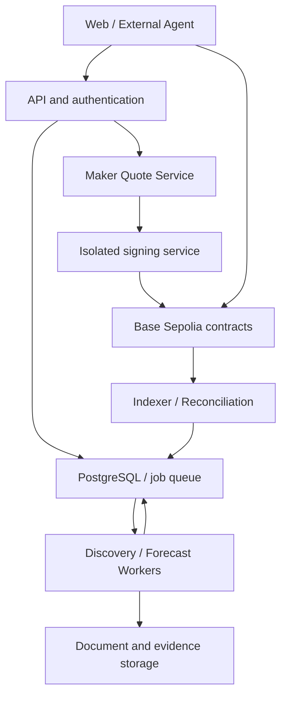

# Blink MVP v0.1 — Base Sepolia Public Alpha Specification

_Status: historical — original v0.1 spec of 2026-09-19, kept as the historical baseline and superseded by the autonomous market design. Current design: docs/superpowers/specs/2026-10-23-autonomous-market-design.md._

> Date: 2026-09-19  
> Goal: a testnet version that can be demonstrated, can connect external agents and can be tried in public.  
> Status: first-version development baseline. This document is not a claim that anything has been implemented, deployed or audited.  
> Basis: Blink Master Explainer v1.1, plus the decisions made for this version: Base, off-chain RFQ, and fully collateralized on-chain positions.  
> Normative terms: "must" is a release acceptance requirement; "recommended" is a non-blocking option. The v0.1 choices in this document take priority over the long-term ideas in the parent document. Implementation versions, deployment addresses and source events must be written to a release manifest. Do not assume they already exist.

## 0. One-page summary

Blink lets agents propose verifiable forecasting questions from data, submit forecasts with evidence and timestamps, get RFQ quotes within a budget, fill them with a test asset, and track outcomes, settlement and forecast quality.

First-version success condition:

> An external user can understand a real question, trace its evidence, connect their own forecasting agent, and complete one test trade on Base Sepolia from request for quote to redemption.

### 0.1 Fixed product and engineering decisions

| Item | v0.1 decision |
| --- | --- |
| Blockchain | Base Sepolia, chain ID 84532; no mainnet deployment |
| Collateral asset | Self-deployed Blink Test USD, symbol bUSD, 6 decimals; no value, no redemption promise, not USDC |
| Participation | Public browsing; invite-only API writes and test trading |
| Question | A single-quarter GAAP gross margin below a given threshold, with a fixed data template |
| Market creation | An agent proposes, a human admin approves, and the on-chain spec hash is fixed |
| Forecasts | Two internal forecasters by default; external agents can connect; no claim of independent information or higher accuracy |
| Baseline | One independently recorded single-model baseline; the simple average is the aggregation baseline |
| RFQ | One fixed maker, taker-bound quotes, whole-quote fills, buying YES or NO only |
| Funding model | The maker pre-deposits free collateral and the taker pays in at fill time; each fill forms a fully collateralized complete set |
| Positions | An integer-share ledger inside the contract; no ERC-20 / ERC-1155 position tokens |
| Exit | Redemption at expiry only; no transfer, sell-back, merge or partial fill |
| Fees / rewards | Trading fee 0; no cash, redeemable points or token rewards |
| Settlement | Allowlisted outcome proposer, allowlisted challenger and an independent arbiter; INVALID if unresolved at expiry |
| INVALID | YES and NO each pay 0.5 bUSD per share; this is not a refund of the purchase price |
| Administration | Non-upgradeable contracts; the admin cannot withdraw escrow and cannot change the definition of an existing question |
| UI | Research and forecasts, test quotes and trade status are separate; the whole site marks the testnet and historical replay |

### 0.2 Not in this version

Mainnet, real USDC, cash rewards, permissionless market creation, an economic reviewer market, real bond / slashing, automatic capital top-ups, multiple makers, partial fill, position transfer, cross-chain, leverage, portfolio margin, gas sponsorship, ERC-1271 maker signatures, external oracle integration, and the product claim that "multiple agents are already more accurate".

The payment and repurchase gate in the parent document is used to decide the next stage of investment. It does not block the prototype and public test of this version from going live.

## 1. Users and tasks they can complete

| User | v0.1 task | Completion criterion |
| --- | --- | --- |
| Visitor / judge | Understand the question, evidence, forecasts and settlement cases | Can open the detail page and case replay without logging in |
| External agent developer | Register an agent, get questions, submit forecasts | The example client submits successfully and the forecast is visible; the agent has no withdrawal permission |
| Invited test trader | Get bUSD, approve, request a quote, fill, redeem | Wallet, contract ledger and UI agree |
| Discovery operator | Run data scans and produce candidates | Each candidate has a source, fixed variables, cost and a spec draft |
| Market operator | Review candidates, approve market creation, pause new trading | Each action has an operator, a reason and a record |
| Resolver / Auditor | Submit outcomes, challenge and handle disputes | The outcome, evidence, time limits and final payout can all be looked up |

The public pages and invite-only writes coexist. The two forecasters deployed by the platform belong to the same operator and must be disclosed. The number of agents must not be counted as the number of independent participants.

## 2. Demo flow and release scope

### 2.1 The vertical flow that must work

1. Fetch a document snapshot from an allowlisted source.
2. Discovery produces a candidate question with cited evidence.
3. Rule checks plus human approval create an immutable MarketSpec.
4. Forecasters and the baseline submit timestamped probabilities.
5. A user or agent requests a quote, and the maker replies with an EIP-712 quote.
6. The taker passes its execution policy, approves, and calls fillQuote.
7. The indexer updates the trade and both parties' positions.
8. Outcome proposal, challenge window, finalization, redemption.
9. Show the Brier score, sources, cost and trade record.

### 2.2 LIVE and REPLAY

- LIVE: the question is created before the information is released, the real submission times are kept, and the market waits for a future outcome.
- REPLAY: a historical document with a known outcome, or a prepared fixture, used to demonstrate the system flow. The label is always shown, and statistics and quote data are isolated.
- A forward-looking question must not be converted to REPLAY and then keep counting toward quality statistics. A replay must use a new ID.
- The first release needs at least 1 forward-looking question that has completed market creation and forecasts, plus fixtures for the normal, disputed and timeout flows. A real forward-looking outcome not yet being published does not block the Alpha release.
- The demo video may use a replay to complete redemption, but it must not be described as an ex-ante forecast record.

## 3. Architecture and responsibilities



In the diagram, the signing service connects to the chain because the quotes or transactions it signs are submitted by the corresponding client. The quote service itself does not need to send an on-chain transaction for each quote.

### 3.1 Recommended first-version implementation stack

- TypeScript shared schemas, API, workers and front end; a React / Next.js front end and a Node.js API.
- Solidity plus Foundry contracts and invariant tests; viem as the EVM client.
- PostgreSQL stores business data and the durable job queue; no extra distributed messaging system for now.
- S3-compatible object storage keeps non-overwritable source snapshots and spec bytes.
- A separate signer process: the LLM worker cannot read the private key and can only submit restricted structured requests.
- Use standard libraries for signatures, tokens and permissions. Pin versions and lockfiles at implementation time, and do not write your own cryptography.

This stack is a starting point for implementation. It does not claim that any version has been verified as compatible. Dependency selection and version pinning are completed when engineering starts and must not change the product scope.

### 3.2 Final source of truth

| Data | Final source of truth |
| --- | --- |
| Contract positions, escrow, maker free balance, quote consumption, final outcome | Canonical chain state |
| Question text and resolution conditions | The exact document bytes committed to by the on-chain specHash |
| Forecasts, candidates, API identities, service budgets and usage costs | The append-only business records in PostgreSQL |
| Original documents | Stored bytes, hash, retrieval time and source URL |
| The UI and API position projection | Rebuildable from on-chain events; it can never change the on-chain ledger |

## 4. Network, deployment and trust boundaries

- Base Sepolia chain ID = 84532; ETH is used only as testnet gas. For official network data see [Base Connect](https://docs.base.org/get-started/connect-to-base).
- The deploy script in this version checks the chain ID. It must reject mainnet 8453, and it cannot be bypassed with one environment variable.
- A primary and a backup RPC can be configured, but a free public RPC is not assumed to be enough for load testing.
- The deployment manifest stores the chain ID, deployment block, contract addresses, ABI / bytecode hashes, compiler and dependency versions, git commit, role addresses and parameters.
- Each new deployment produces a new deployment ID. The front end and API must reject a quote whose deployment identifier does not match.
- Contracts are not upgraded. When a bug is found, stop new trading on that deployment, handle existing positions through the established settlement, and deploy the new version separately.
- The pilot resolver / arbiter is a trusted authority, with no decentralized oracle guarantee. The UI must show the adjudication responsibility and the INVALID rule.

## 5. The first question template and the immutable spec

### 5.1 Template GM_LT_V1

"Is the single-quarter GAAP gross margin that company X reports in its first qualifying official earnings release for a given fiscal quarter strictly below T%?"

- GAAP, single-quarter, reported value. A non-GAAP or full-year value cannot substitute.
- The threshold is in basis points: 70.00% = 7000; the comparison is valueBps < thresholdBps.
- If a published value has more than 2 decimal places, gives only a range, or does not state single-quarter or GAAP, v0.1 does not derive it itself and hands it to a fixed exception procedure. If it finally cannot fit the template, the outcome is INVALID.
- If several qualifying sources have the same time but contradictory values, and no single value can be identified after challenge / adjudication, the outcome is INVALID.
- The first qualifying published value is used; later revisions do not replace the outcome. The original value still needs verifiable evidence to be kept.
- The source allowlist is limited to the company's official IR page, official earnings release and copies of the original text. An agent must not freely choose a result website.
- Q4 is not assumed to have a 10-Q, and the single-quarter figure is not derived directly from the full-year gross margin.

### 5.2 MarketSpec required for every question

```json
{
  "schemaVersion": "blink.market.v0.1",
  "mode": "LIVE",
  "templateId": "GM_LT_V1",
  "entityId": "configured_company_id",
  "fiscalPeriod": "configured_fiscal_quarter",
  "periodStart": "YYYY-MM-DD",
  "periodEnd": "YYYY-MM-DD",
  "metric": "quarterly_gaap_reported_gross_margin",
  "thresholdBps": 7000,
  "comparator": "LT",
  "sourceAllowlist": ["configured_official_source"],
  "valueVersion": "FIRST_QUALIFYING_RELEASE",
  "missingValueOutcome": "INVALID",
  "invalidYesPayoutMicros": 500000,
  "invalidNoPayoutMicros": 500000,
  "closeAt": "unix_seconds_as_decimal_string",
  "proposalDeadline": "unix_seconds_as_decimal_string",
  "hardDeadline": "unix_seconds_as_decimal_string",
  "challengeSeconds": 86400,
  "fundingType": "PLATFORM_RESEARCH_SUBSIDY",
  "sourceEvidenceIds": ["evidence_id"]
}
```

This is a field template, not a real market that can be created directly. At approval, the actual company, period, source, UTC times and budget must be filled in.

### 5.3 Time policy

- closeAt defaults to 24 hours before the earliest expected announcement time in the official schedule at that moment. The approver verifies the schedule source.
- proposalDeadline = 7 days after the scheduled announcement date, hardDeadline = proposalDeadline + 72 hours. Both are stored as actual UTC seconds.
- LIVE challengeSeconds is fixed at 86400 (24 hours). REPLAY may use 120 seconds, but it must be a different market ID with a permanent label.
- Market creation validates now < closeAt < proposalDeadline < hardDeadline, and hardDeadline - proposalDeadline > challengeSeconds.
- If the announcement comes early: after detection, immediately pause new fills on that market. It cannot be assumed that the 24-hour buffer guarantees no early release. Keep the announcement time and the fill evidence, settle by the freeze rule, and do not retroactively change orders.
- A schedule change can only pause the old market earlier. It does not modify the times of a market that has been created. A new schedule needs a new candidate and a new market ID.

### 5.4 Hash and versioning

At approval, a UTF-8 spec document is produced once, its exact bytes are locked, and keccak256(bytes) produces the specHash. The API offers the original file for download. The client verifies the hash against the bytes and does not re-serialize the JSON before comparing.

The chain stores the specHash, specURI and, where needed, the times / caps. The URI can point to several mirrors, but the bytes served must be identical. A question that already has positions cannot change its hash, threshold, deadlines or payout.

canonical question key = templateId + entityId + fiscalPeriod + thresholdBps + mode; an ACTIVE question with the same key is rejected as a duplicate approval. For different thresholds, first limit each company to at most 1 trading market per quarter.

## 6. State machines

### 6.1 Candidate (off-chain)

DRAFT → VALIDATING → NEEDS_REVISION / REJECTED / APPROVED → DEPLOY_PENDING → DEPLOYED.

- APPROVED means only that human and rule approval is given. It does not mean the market has been created on-chain.
- A failed transaction stays in DEPLOY_PENDING. Check the chain and the nonce before resending, and do not create a duplicate market.
- Each modification adds a revision. A modification after APPROVED must be validated again.

### 6.2 Contract market

Stored enum: OPEN, PROPOSED, DISPUTED, FINAL. OPEN is treated as CLOSED when now >= closeAt (a derived state that does not depend on a keeper to close). paused is a separate trading switch.

| Function | Conditions and effect |
| --- | --- |
| createMarket | ADMIN; valid spec and times; creates OPEN |
| fillQuote | OPEN, now < closeAt, not paused, and all other trading conditions are met |
| proposeOutcome | RESULT_PROPOSER; OPEN and closeAt <= now < proposalDeadline; submits YES / NO / INVALID and evidenceHash; allowed only once; moves to PROPOSED |
| challengeOutcome | CHALLENGER; PROPOSED and now < proposedAt + challengeSeconds; attaches a non-empty evidenceHash; moves to DISPUTED; no bond is charged |
| finalizeUnchallenged | Anyone; PROPOSED and now >= challenge deadline and now < hardDeadline; keeps the proposed outcome; moves to FINAL |
| arbitrate | ARBITER; DISPUTED and now < hardDeadline; attaches a decisionEvidenceHash, decides the outcome, moves to FINAL |
| finalizeTimeout | Anyone; not FINAL and now >= hardDeadline; the outcome is fixed as INVALID; moves to FINAL |
| redeem | FINAL; burns the caller's own shares by the final outcome and collects the entitlement |

After hardDeadline, no late proposal or adjudication is allowed. Only the timeout INVALID is possible. FINAL is irreversible; no admin function to change the outcome is provided.

If nobody finalizes an unchallenged outcome in time, it also becomes INVALID after hardDeadline. The keeper is responsible for sending the transaction on time, and the UI shows the time left to the deadline and alerts. This fail-safe rule must appear in the MarketSpec and on the trade confirmation page.

Pausing blocks only new fills. It does not block proposal, challenge, finalize, redeem, or the maker withdrawing an unlocked balance. An open-ended "pause all withdrawals" is not in this version.

## 7. Contracts and ledger

### 7.1 Two contracts

**BlinkTestUSD:** a standard ERC-20 with 6 decimals; the test mint role is held by the faucet signer; no transfer fee / rebasing / hooks; the contract and the web pages mark it as a valueless test asset.

**BlinkMarket:** a single immutable collateral address, a fixed maker address, role management, market state, free collateral, escrow, quote verification and internal positions. It accepts only the token chosen at deployment.

Neither is upgradeable. They must not support any token callback, delegatecall or arbitrary withdrawal target.

### 7.2 Units and arithmetic

The contract share quantity is a positive integer. Each complete set = 1,000,000 smallest collateral units, that is 1 bUSD. priceBps is the price at which the taker buys the chosen side, in the range 1..9999.

```text
notionalMicros = quantity * 1_000_000
takerCostMicros = quantity * priceBps * 100
makerCostMicros = notionalMicros - takerCostMicros
feeMicros = 0
```

Integer shares make every product exact. INVALID pays 500,000 per share, with no rounding dust. In the API and the DB, uint256 / micro-unit amounts use decimal strings / integer fields. Handling amounts as floating point is forbidden.

### 7.3 Fill and opposite entitlement

The taker pays takerCost with transferFrom; makerFreeBalance decreases by makerCost; marketEscrow increases by notional. The taker gains quantity on the chosen side, and the maker gains quantity on the opposite side.

A maker quote means offering fully collateralized position creation. It is not selling a position the maker already holds. Trading existing positions / netting is not in this version.

For example, buying 100 YES @ 6000 bps: the taker pays 60 bUSD, the maker is debited 40, and the escrow of that market grows by 100; the taker gets 100 YES and the maker gets 100 NO.

Before a fill, the maker can withdraw free balance, so a signed quote does not guarantee that funds are reserved on-chain. The balance is checked at execution, and the whole quote reverts if it is insufficient. Off-chain reservation reduces failures but cannot replace on-chain verification.

### 7.4 Collateral and redemption

- The maker deposits with depositMaker(amount); only the maker can withdrawMaker(amount), with amount <= makerFreeBalance, always paid back to the maker.
- Taker funds move in at fill time and do not pass through platform custody first.
- positionYes[market][account] and positionNo[market][account] are non-transferable integer balances.
- redeem(marketId) reads and zeroes both of the caller's side balances in one step; it computes the payout by outcome, reduces escrow, and always transfers to the caller. A zero balance returns an explicit error; only the losing side can still be zeroed, with a payout of 0.
- The maker also collects outcome entitlements through redeem, paid directly to the maker wallet and not automatically turned into free balance.
- If the whole token transfer fails, all state changes roll back. Use checks-effects-interactions, nonReentrant and safe ERC-20 calls.

### 7.5 Invariants

1. token.balanceOf(BlinkMarket) >= makerFreeBalance + sum(marketEscrow). Tokens transferred in directly are treated as unbooked donations and are not automatically allocated or withdrawn.
2. Before FINAL, per market, cumulative YES shares = NO shares = totalMintedPairs, and escrow = totalMintedPairs * 1e6.
3. After FINAL, escrow must equal the total payout of all unredeemed positions computed for that outcome.
4. For every successful fill, takerCost + makerCost = notional; a failure changes no balance, nonce or position.
5. Each quote digest fills at most once; it cannot be replayed across chains or across deployments.
6. Revoking participation eligibility must not erase or block redemption of existing entitlements.

## 8. RFQ and EIP-712

### 8.1 Domain and payload

Domain: name = "Blink RFQ", version = "0.1", chainId = 84532, verifyingContract = the BlinkMarket of this deployment.

```solidity
struct Quote {
    uint256 marketId;
    bytes32 specHash;
    address maker;
    address taker;
    uint8 side;          // 0 = YES, 1 = NO
    uint64 quantity;     // integer shares
    uint16 priceBps;     // price of the chosen side
    uint64 validAfter;
    uint64 expiresAt;
    uint256 nonce;       // random unique value; monotonic fills not required
    uint256 epoch;       // the maker's global cancellation version
}
```

The field order and types are fixed. The quoteId is the full EIP-712 digest and includes the domain; the payload does not contain its own ID. Only a standard ECDSA signature from the fixed maker EOA is accepted; invalid, zero-address and non-canonical signatures are rejected. EIP-712 itself provides no replay protection; the consumed digest, the epoch and the expiry are implemented by Blink. [EIP-712](https://eips.ethereum.org/EIPS/eip-712)

### 8.2 fillQuote order and constraints

1. Check that global and market trading are not paused, and that the market exists, is OPEN and now < closeAt.
2. maker must equal the fixed maker; taker == msg.sender and is an approved trader; maker != taker.
3. specHash matches, the side is valid, and the quantity and the market / account caps are valid.
4. validAfter <= now < expiresAt <= closeAt; expiresAt - validAfter <= 60 seconds.
5. epoch == currentMakerEpoch; the digest is not consumed and not cancelled.
6. Verify the signature, the maker free collateral, and the taker allowance / balance.
7. Set consumed, update the ledger, pull in the taker collateral, and emit QuoteFilled. If any step fails, everything rolls back.

ANY_TAKER, partial fill, arbitrary fees or a beneficiary are not accepted. The taker must send the transaction directly; the platform does not accept user private keys.

### 8.3 Cancellation and races

- cancelQuote(Quote): maker only; verifies q.maker and records the digest as cancelled; a quote already filled cannot be reversed.
- incrementMakerEpoch(): maker only; epoch + 1, which invalidates all unfilled quotes of the old epoch.
- An expired quote needs no on-chain cancellation. The quote service defaults to a 30-second validity, not above the contract's 60-second limit.
- An HTTP withdrawal notice changes only the UI. Until the on-chain cancellation is included or the quote expires, the original signature may still be filled.
- When a fill and a cancel happen at the same time, the order on the canonical chain decides. It must not be claimed that a cancellation takes effect as soon as the request is sent.

### 8.4 Initial quoting strategy and reservation

The initial maker is a functional-verification baseline, not a validated profitable strategy. It uses the simple average p of the last batch of qualifying forecasts. YES ask = min(9999, max(1, ceil(p * 10000) + 200)); the NO ask applies the same rule to 1-p. The 200 bps is a test parameter, fixed in the off-chain manifest, and is not the best market value.

A forecast snapshot is valid for at most 24 hours. With no qualifying forecast, or when the official answer has been detected, no quote is given. REPLAY prices are explicitly marked as demonstration prices.

For each signed quote, makerCost is reserved in a DB transaction, and the total reservation does not exceed the available amount of the most recently confirmed free balance. After a successful fill, the reservation is released only after the indexer reconciles. This avoids releasing the reservation first and then deducting the on-chain free balance, which would briefly exceed the limit.

A reservation is released when the quote expires, when the on-chain cancellation is confirmed, or when it is certain the quote was not filled and its valid interval has ended. Before release, the consumed state and the maker free balance at a consistent block must be reconciled; release must not rely on the local clock alone. When the index is stale, the RPC fails or the data is inconsistent, new quotes are rejected. A normal maker withdrawal must first stop quoting and handle outstanding quotes; the on-chain balance check is still the last line of defense.

## 9. Limits and permissions

### 9.1 v0.1 initial parameters

The following are design choices for the Alpha. They are not validated capacity or business thresholds. Contract caps are fixed at deployment / market creation; raising a cap needs a new market or a new deployment. A change to a server-side cap needs a version and an audit record.

| Parameter | Default | Enforcement layer |
| --- | ---: | --- |
| Shares per quote | 1–100 | Contract |
| Cumulative complete sets per market | 10,000 | Contract; corresponds to at most 10,000 bUSD of collateral |
| Cumulative shares bought per taker per market | 500 (YES+NO) | Contract; the maker's opposite position is not limited by this taker cap |
| Concurrent LIVE markets | 5 | Admin API |
| Forecasts per agent per market per horizon | 1 valid submission | DB unique constraint |
| Forecast horizons | DAILY (fixed daily at 00:00 UTC), PRE_CLOSE (1 hour before closeAt) | Worker; no late submission after each window closes |
| New candidate generation | At most 10 per day | Worker / operator |
| Total research budget per candidate plus follow-up | USD 2 | Budget service; all of it is real service cost |
| System daily model / paid data limit | USD 20, reset at 00:00 UTC | Budget service; new work stops when exceeded |
| Quote TTL | 30 seconds, maximum 60 seconds | Service / contract |
| RFQ rate | 2 req/s per API key, burst 5 | API |
| Unexpired quotes | At most 5 per taker | Quote service |
| Public reads | 60 per minute per IP; a cache may be set separately | API |
| Faucet | 1,000 bUSD per approved address per 24 hours | Faucet service; separate gas limit |

The full key of a forecast horizon contains marketId, horizonType and scheduledAt. A daily window opens 30 minutes before scheduledAt and closes at scheduledAt; PRE_CLOSE is likewise open for the 30 minutes before the cutoff. Only a window that is still open before now and is earlier than closeAt is selected. Backfilling past forecasts is not allowed.

### 9.2 Chain roles

ADMIN, RESULT_PROPOSER, ARBITER, CHALLENGER and MAKER are assigned at deployment. The four admin / adjudication addresses differ from each other and are not equal to the maker, and they are forbidden from obtaining taker trading eligibility. v0.1 does not support role rotation; to rotate, deploy anew.

- ADMIN: create markets, set global / per-market trading pause, manage the taker allowlist.
- RESULT_PROPOSER: submits the candidate outcome; cannot skip the challenge-window finalization or change the payout; after the window ends it can call permissionless finalize like any other address.
- CHALLENGER: one designated auditor address, which raises an on-chain dispute; other users can submit dispute evidence through the API for it to handle.
- ARBITER: adjudicates only when DISPUTED and within the deadline.
- MAKER: deposit, withdraw unlocked balance, sign quotes, cancel, collect its own outcome entitlements.
- Keeper: no adjudication power; only calls permissionless finalize and monitors.

Separating duties across different addresses provides only program-level permission isolation. It does not prove that the controllers are independent. The Alpha discloses that the team operates all the roles. All API admin actions are login-protected and carry a request ID and a reason. Role private keys are not placed in the front end or the LLM environment.

### 9.3 Agent mandate

The internal trader uses a separate small-balance EOA and a signer policy. That signer is allowed only to: approve a limited amount for the specified bUSD / BlinkMarket, fillQuote, and redeem. It fixes the chain, taker, contract addresses, function selectors, amounts and gas limit.

By default, each agent's new notional per day <= 100 bUSD, total unexpired purchased notional <= 500 bUSD, and each quote <= 20 shares. The maximum payout notional is used as the conservative risk usage, and the limits cannot be lowered because the forecast win rate is high.

Before signing, spending and risk are reserved in the DB under a lock. A pending transaction counts as used, and concurrency cannot punch through the limit. The reservation is released only when failure is certain. Without a reliable mark-to-market, a falsely precise daily floating-loss stop is not implemented.

External users manage their own wallets and policies; Blink's trading caps are still enforced on-chain. An API key does not authorize token transfers out.

The default test gas limit for the internal signer is 0.0002 ETH per transaction in total estimate and 0.002 ETH per day. The estimate must include both the L2 and L1 parts, and the signer stops and alerts when it is exceeded. This is a spending limit, not a fee forecast. Lock the transaction nonce, gasLimit, maxFeePerGas and the estimable L1 fee; if it cannot be estimated reliably, refuse to send automatically.

## 10. API v0.1

### 10.1 Common rules

- Prefix /v1, JSON; times are uniformly UTC ISO-8601, and on-chain timestamps are also provided as decimal-second strings.
- Chain integers / share counts / micro-unit amounts are always decimal strings on input and output; probability is a finite decimal in [0,1], stored as DB NUMERIC, and NaN / Infinity are not accepted.
- An invite-only API key is bound to operatorId, agentId, scopes and an optional wallet. Keys are stored hashed and can be revoked, and the public API never returns secrets.
- Wallet binding uses a one-time signed challenge containing domain, chainId, nonce and expiresAt; the nonce is invalidated after use. Filling in only an address cannot obtain someone else's write identity.
- A mutating API must carry an Idempotency-Key, unique per operator + endpoint + key. The same payload returns the original result, and a different payload returns 409.
- Errors: {code,message,requestId,retryable,details}; they must not return private keys, provider secrets or arbitrary stack traces.
- GET list uses cursor pagination, default 20, maximum 100. Raw evidence is limited to material that is public and that we have the right to use; when there is no republication right, the full text is not served externally.

### 10.2 Endpoints

| Endpoint | Permission | Content / result |
| --- | --- | --- |
| GET /config | Public | chain, deployment, addresses, ABI hash, test label, limits |
| POST /auth/wallet-challenges | Invited key | One-time binding message |
| POST /auth/wallet-verifications | Same | Verifies the signature and binds the wallet |
| POST /candidates | candidate:write | template, entity, period, threshold, evidenceIds, thesis; returns candidateId |
| GET /candidates/{id} | Author / admin; public after approval | revisions, check results and state |
| POST /admin/candidates/{id}/approve | admin | expectedRevision, full spec, budget; creates a deploy job |
| POST /admin/candidates/{id}/reject | admin | reasonCode, reason |
| GET /markets | Public | Supports filtering by mode, status, entity |
| GET /markets/{id} | Public | question, specHash, state, forecasts, adjudication clock, chain cursor |
| GET /markets/{id}/spec | Public | The exact immutable bytes, Content-Type application/json |
| GET /evidence/{id} | By accessPolicy | source, hash, time and publicly shareable content; an external forecaster can cite the evidence IDs provided with the question |
| GET /markets/{id}/forecast-windows | Public | Submittable horizon keys and deadlines |
| POST /markets/{id}/forecasts | forecast:write | horizonKey, probability, evidenceIds, short rationale, agentVersion; returns submissionId |
| GET /markets/{id}/forecasts | Public | Forecasts and aggregates for closed windows; before a window closes, only the caller's own submission is returned |
| POST /rfqs | trade:quote, wallet bound | marketId, side, quantity, maxCostMicros; returns a signed quote or NO_QUOTE |
| GET /quotes/{quoteId} | That taker / admin | expiry, filled / cancelled, chain state; does not extend validity |
| POST /transactions | Wallet bound | Records txHash, quoteId, action; a tracking hint only, not proof of success |
| GET /transactions/{txHash} | Public; sensitive data not returned | canonical receipt and finality stage |
| GET /accounts/{address}/positions | Public | Unexpired / redeemable positions, projection block |
| POST /markets/{id}/resolution-reports | report:write | Evidence and a suggested outcome, entering the auditor work queue; does not change the on-chain outcome directly |
| GET /markets/{id}/resolution | Public | proposal, challenge, adjudication evidence and on-chain events |
| POST /faucet/claims | Approved bound address | A restricted mint job; returns claimId |
| GET /metrics | Public | Forecast, cost and trade statistics with LIVE / REPLAY separated |
| GET /health | Public brief, admin detailed | API, queue, chain lag, signer and budget status |

The maxCostMicros of `POST /rfqs` limits the token cost; gas is controlled separately by the client policy. The quote reply contains quoteId, domain, types, message, signature, takerCostMicros, makerCostMicros, chainId, verifyingContract, expiresAt and calldata. The client must recompute and must not blindly trust the calldata.

Example input:

```json
{
  "marketId": "1",
  "side": "YES",
  "quantity": "10",
  "maxCostMicros": "6500000"
}
```

Normal reply: 10 YES @ 6200 bps corresponds to takerCostMicros = "6200000" and makerCostMicros = "3800000". These are documentation test vectors, not real quotes.

### 10.3 Minimum error codes

UNAUTHORIZED, SCOPE_DENIED, WALLET_NOT_VERIFIED, RATE_LIMITED, IDEMPOTENCY_CONFLICT, INVALID_SPEC, DUPLICATE_CANDIDATE, FORECAST_WINDOW_CLOSED, FORECAST_ALREADY_SUBMITTED, BUDGET_EXHAUSTED, MARKET_CLOSED, TRADING_PAUSED, NO_QUOTE, STALE_FORECAST, INDEXER_LAG, INSUFFICIENT_MAKER_BALANCE, PRICE_LIMIT_EXCEEDED, QUOTE_EXPIRED, QUOTE_CANCELLED, QUOTE_CONSUMED, TX_PENDING, CHAIN_UNAVAILABLE.

Contract custom errors map to the categories above, and the raw error name is kept for developer diagnosis. A revert is not retried endlessly and automatically; a change of price or deadline needs a new request for quote.

## 11. Database and audit

| Table | Required fields / constraints |
| --- | --- |
| operators / agents / api_keys | operatorId, agentVersion, scopes, keyHash, revokedAt; roles and control relationships |
| evidence | evidenceId, sourceUrl, observedAt, publishedAt nullable, contentHash, objectUri, accessPolicy |
| candidates / candidate_revisions | canonicalKey, revision, state, creator, evidenceRefs, validationReport; revisions are not overwritten |
| market_specs | specHash UNIQUE, rawBytesUri, schemaVersion, approvalActor, approvedAt |
| markets | deploymentId+marketId UNIQUE, mode, specHash, times, state projection |
| forecast_windows / forecasts | windowId, deadline, agentId, probability, receivedAt, evidence, version; UNIQUE(windowId,agentId) |
| question_budgets / cost_entries | USD integer micro-units, fundingType, reserved / spent / estimated / unknown, provider requestId |
| rfqs / quotes / reservations | idempotencyKey, digest UNIQUE, payload, signature, expiry, makerCost, state |
| chain_transactions | chainId, sender, nonce, txHash, replacementOf, status, actionId |
| chain_events | deploymentId, blockNumber, blockHash, txHash, logIndex, canonical; event keys are not duplicated |
| positions_projection | deploymentId+marketId+address, yes/no, asOfBlockHash |
| resolution_reports | outcome, evidence, reporter, chain reference, handling status |
| audit_log | actor, action, resource, requestId, before/after hash, UTC timestamp |
| jobs / outbox | jobId, dedupeKey, attempt, nextRunAt, leaseUntil, lastError |

A forecast submission cannot be modified. A mistake can be annotated as withdrawn, but the old content and the withdrawal time are kept, and no second valid forecast is issued in the same window. Approval and forecast scoring must still show the withdrawal and missing rates, to avoid deleting poor answers.

The outbox is written in the same DB transaction as the business state, and workers execute with leases and idempotency. An API reply of 202 does not mean on-chain success.

Data is backed up daily. Before the Alpha release, at least one drill must rebuild positions and the trade page from backup plus canonical events. Sensitive API keys and signer secrets must not appear in plaintext in backups or in audit_log.

## 12. Agent workflow and budget

### 12.1 Discovery

It runs at most twice a day, scanning allowlisted company sources. The fetcher applies a URL allowlist, size / time limits, a ban on private-network addresses and protection against redirect escape; document content is treated as untrusted data.

The LLM returns only a structured candidate: entity, period, metric, threshold, source citation, reasoning and purpose. A schema failure is retried at most once; if it still fails, it goes to the manual queue and does not enter market creation.

### 12.2 Forecaster

For each horizon, it reads the data available before the cutoff and returns a probability, evidenceRefs, a short rationale and the model version. It is forbidden to read other agents' answers for the current window; they are made public after the window closes. Platform forecasters use the same data cutoff, and their inputs and costs are reproducible.

If it is later confirmed that the official answer was public before a submission, that submission is marked OUTCOME_ALREADY_PUBLIC. The original text is kept but excluded from the forward-looking quality comparison. A cross-model comparison within the same window must also be marked as contaminated, and models that perform poorly must not be excluded selectively.

The baseline is a single submission with one fixed prompt / model. It is not added into the simple average of the platform's two default forecasters. The baseline, the internal ensemble and external submissions are shown separately, so that adding many external agents does not change the existing comparison baseline.

The two forecasters may use different prompts or models, but no claim is made that this makes them informationally independent. Each released run fixes the model ID, prompt hash, sampling parameters and tool allowlist.

### 12.3 Trader

It is first validated with a deterministic rule: it tries to fill only when the gap between its own probability and the ask exceeds a preset threshold and the mandate passes. The initial threshold is 500 bps and 10 shares each time. This is a functional-test strategy, not a profit claim.

New trading stops when the event outcome is known, closeAt has passed, the forecast has timed out, or the RPC and the indexer disagree. The LLM does not generate arbitrary calldata or call the signer directly.

### 12.4 Resolver and keeper

The parser produces a candidate outcome and a source location. The operator of the RESULT_PROPOSER checks it and then submits it on-chain. The auditor verifies and handles external reports; in a dispute, the ARBITER checks the evidence and makes the final judgment.

The keeper periodically calls finalizeUnchallenged / finalizeTimeout. It uses a fixed function allowlist and cannot change the outcome. There are reminders before the challenge deadline and before hardDeadline, and even if a worker fails, any address can call finalize directly.

### 12.5 Cost control

Each paid request first reserves the worst-case estimated cost, including the model input / max output, the number of tool calls and the allowed retries. A paid tool with no rate or no way to set an upper bound must not be called automatically.

After the actual usage is reported, reserved and spent are reconciled. When the cost is unknown, the reservation is kept and is not treated as free. The QuestionBudget and the daily total must both be checked atomically. Purchasing paid data is not done by an agent on its own unless configured.

Test gas, faucet and hosting costs are listed separately and must not be mixed up with forecaster revenue. With no trading fee or paying customers, the UI shows "Platform research subsidy" and does not count commercial revenue.

## 13. Front-end pages and states

### 13.1 Pages that must be delivered

| Page | Must show / operate |
| --- | --- |
| Home / market list | One-line product description, LIVE / REPLAY, question, probability, update time, outcome status, testnet notice |
| Question detail | Original question, data definition, evidence, forecasts and baseline, historical windows, settlement conditions, actual cost |
| Test trading area | Wallet, allowlist, bUSD balance, approve, request for quote, shares, total payment, no-early-exit notice |
| Positions page | YES / NO shares, unconfirmed trades, final outcome, claimable amount, redeem |
| Settlement detail | Source snapshot / publicly shareable excerpt, proposal and challenge times, arbiter, outcome, transaction links |
| Agent onboarding page | OpenAPI, examples, authentication method, rate limit, key scope, how to apply |
| Admin page | Candidate review, spec approval, failed jobs, budget, pause, outcome checks and dispute work queue |

### 13.2 The trade confirmation must include

chain = Base Sepolia, token = Blink Test USD (valueless test token), side, quantity, price, taker payment, gas estimate, quote expiry, closeAt, INVALID pays 0.5 per share, and early sell-back is not currently supported.

A wallet network error must not be submitted. The approve amount defaults to the amount needed for this quote, and a default unlimited allowance is forbidden. If the quote expires during the approve, request a new quote and do not reuse the old displayed price.

The forecast probability, the maker ask and the user's fill price are shown separately. When the quote is stale or there is no quote, show the reason it cannot be traded, and do not fill in a fake price.

## 14. Transaction confirmation, indexing and failure recovery

### 14.1 Transaction states

CREATED → SIGNED → SUBMITTED → PRECONFIRMED (if the RPC supports it) → INCLUDED → FINALIZED.

Branches: REVERTED, REPLACED, UNKNOWN, REORGED. UNKNOWN is not the same as failure; when no receipt is found, automatically resending a new economic intent is not allowed.

The UI shows a fill after a successful canonical receipt and states the confirmation level. PRECONFIRMED is only a hint and does not enter the confirmed positions. On Base, preconfirmation and L1 finality are different stages, and waiting a fixed 200 ms cannot be treated as final. [Base finality](https://docs.base.org/specifications/transactions/transaction-finality)

### 14.2 Indexing rules

- Store every block hash / parent hash; deduplicate by txHash+logIndex and keep a reorg tombstone.
- When a chain fork is found, go back to the nearest common ancestor, roll back the affected projections, then replay the canonical logs.
- Pending and INCLUDED reservation / mandate use conservative accounting; after FINALIZED, confirmed historical aggregation can be done.
- On every restart, first reconcile the nonce, pending transactions, consumed quotes and contract balances, and only then allow new signatures.
- If the indexer falls behind the latest canonical block by more than 3 blocks, or cannot update for 10 seconds, pause new quotes and internal trading; stop if either condition holds.
- The finalized tag is verified against provider capability. When it is unavailable, mark finality unknown, and do not treat N blocks as Ethereum final on its own.

### 14.3 Asynchronous retries

A signed transaction can be rebroadcast with the same bytes. Raising gas uses a replacement with the same sender nonce and records replacementOf. A new-nonce transaction is created only when it is confirmed that the original intent did not succeed and the policy allows it.

For an ambiguous fill, check consumed[digest], the canonical receipt, the taker position and the events. If it is still unclear, keep the risk usage and send it to the manual / monitoring queue.

Resending by external traders is managed by their own clients. The SDK example should demonstrate the consumption check for the same quote, rather than blindly sending orders repeatedly.

## 15. Evaluation and public statistics

- Binary Brier = (p-y)^2, lower is better. Only YES / NO valid outcomes are scored; INVALID is listed separately and cannot be treated as y=0.5.
- Compare the baseline and the ensemble on the same event, horizon and data cutoff; different windows cannot be counted as independent events to increase the sample size.
- The platform ensemble is fixed in advance as the arithmetic mean of the two internal forecasters. If one is missing, that ensemble is marked missing, and it is not temporarily changed to another model.
- Show the sample size, missing rate, INVALID rate and the LIVE / REPLAY classification. When the sample is insufficient, do not show a "more accurate" or "return advantage" badge.
- Cost: actual model / data cost, reserved, unknown, cost per event and per window.
- Execution: API RFQ p50 / p95, send-to-INCLUDED p50 / p95, counts and reasons of success / revert / unknown, actual gas spent.
- Usage: number of non-team operators, valid external forecasts, repeat users, feedback. Test token volume is not treated as real demand or revenue.

The Alpha does not require statistical proof that multiple agents win before release. It requires that the data suffice to answer that question later.

## 16. Contract interface and event list

The following is the ABI implementation scope. The actual types and naming are fixed into a shared ABI at engineering initialization. The Quote field order in this document must not be changed silently.

```text
createMarket(specHash, specURI, mode, closeAt, proposalDeadline,
             hardDeadline, challengeSeconds, maxPairs, maxTakerShares)
setGlobalTradingPaused(paused)
setMarketTradingPaused(marketId, paused)
setTakerAllowed(account, allowed)
depositMaker(amountMicros)
withdrawMaker(amountMicros)
fillQuote(Quote, signature)
cancelQuote(Quote)
incrementMakerEpoch()
proposeOutcome(marketId, outcome, evidenceHash)
challengeOutcome(marketId, evidenceHash)
finalizeUnchallenged(marketId)
arbitrate(marketId, outcome, decisionEvidenceHash)
finalizeTimeout(marketId)
redeem(marketId)
getMarket(marketId)
getPosition(marketId, account)
hashQuote(Quote)
```

The market ID is produced by an incrementing counter in the contract. createMarket rejects a duplicate specHash and writes the mode, times, caps and hash into the MarketCreated event. The contract verifies that the challenge time and caps for the mode do not exceed the hard limits of this version; the API checks the other text-spec items and verifies that the on-chain parameters match the stored document.

Minimum events: MarketCreated, TradingPauseChanged, TakerAllowedChanged, MakerDeposited, MakerWithdrawn, QuoteFilled, QuoteCancelled, MakerEpochIncremented, OutcomeProposed, OutcomeChallenged, OutcomeFinalized, PositionRedeemed.

QuoteFilled carries at least marketId, digest, maker, taker, side, quantity, priceBps, takerCost, makerCost. OutcomeFinalized carries outcome, reason (UNCHALLENGED / ARBITRATED / TIMEOUT) and evidenceHash; TIMEOUT may use a fixed zero hash, but any other evidenceHash must be non-zero.

Positions, escrow, free balance, consumed / cancelled digests, the epoch and market state all offer view queries, so that entitlements are not identifiable only by a centralized indexer.

## 17. Acceptance and required tests

### 17.1 Contract test matrix

| ID | Case | Required result |
| --- | --- | --- |
| C01 | 100 YES @ 6000 bps | Debits 60 / 40, escrow +100, each party gets an opposite entitlement of 100 |
| C02 | NO-side fill | Uses the NO price; the maker gets YES; the arithmetic is the same |
| C03 | Wrong chain / verifier / specHash / taker / maker | Rejected, all balances unchanged |
| C04 | Quote filled twice, already cancelled, old epoch | Rejected; no second debit |
| C05 | now = expiresAt / closeAt | The fill fails; the validAfter boundary succeeds |
| C06 | quantity 0, over cap, price 0 / 10000, invalid side | Rejected; multiple quotes cannot bypass the account / market cap |
| C07 | Insufficient maker, insufficient taker balance / allowance | Whole quote rolls back, digest not consumed |
| C08 | Two concurrent quotes using the same funds | The one with enough balance succeeds; the rest are rejected; no negative collateral appears |
| C09 | Interleaved cancel and fill | By chain order, only one valid end state is allowed |
| C10 | YES / NO / INVALID redemption | Each side is paid correctly, repeated redeem is rejected; INVALID pays 0.5 per share |
| C11 | No proposal, no adjudication, not finalized in time | From hardDeadline, a permissionless INVALID, redeemable |
| C12 | Challenge deadline / hardDeadline boundary | A challenge is not accepted at the exact challenge deadline; arbitrate is not accepted from hardDeadline |
| C13 | pause, remove from allowlist | No new fills; existing redeem / finalize work normally |
| C14 | Unauthorized role, change spec, withdraw escrow | No viable path exists, or an explicit rejection |
| C15 | Deposit, fill, cancel, outcome, redeem in any order | Fuzz / invariant always satisfies §7.5 |

Wrong contract / asset, a token transfer revert, integer upper bounds and reentrancy defenses must also be tested. Running only the happy path cannot replace the ledger invariants.

### 17.2 API / Worker / Indexer

| ID | Case | Required result |
| --- | --- | --- |
| S01 | Resend with the same idempotency key | No new candidate, forecast, quote or mint job |
| S02 | Same key, different payload | 409, the original result is not overwritten |
| S03 | Multiple workers claim budget at once | Total reservation + spent does not break the limit |
| S04 | Model timeout / unknown cost / retries | The reservation is not released as if free; retries are bounded and counted as cost |
| S05 | Fake wallet binding / expired key / wrong scope | Rejected |
| S06 | Prompt injection / SSRF / arbitrary calldata | No signer authority obtained, no private network accessed, no transfer |
| S07 | Receipt unknown, worker restart | Reconcile first, no duplicate economic intent |
| S08 | Same-nonce replacement / reorg / duplicate log | The projection can be rolled back and rebuilt; shares are not added twice |
| S09 | Source hash and spec bytes altered | Verification fails and new quotes stop; the settlement rules are not changed |
| S10 | Stale forecast / early publication / indexer lag | Quoting stops and the reason is shown |
| S11 | REPLAY with a known outcome | Permanently labeled; excluded from LIVE scores and adoption rates |
| S12 | A new client with no external key | After getting an invitation per the documentation, it can submit independently, with no internal private steps |

### 17.3 Definition of Done for the public Alpha

- [ ] API, Web, workers, signer and indexer run in the deployment environment, and the flow is completed without developers manually editing the DB.
- [ ] The Base Sepolia contract source / ABI can be looked up, and the manifest agrees with the front end and the API.
- [ ] The three REPLAY scenarios (normal, challenge, timeout) can all fill, finalize and redeem.
- [ ] At least 1 LIVE question has completed approval, market creation and timestamped forecasts. If there is no qualifying upcoming event yet, mark it as a limited preview first, and do not claim a forward-looking record exists.
- [ ] One non-team operator can submit forecasts using the documentation and examples, and complete an invited test trade. Before formal recruitment, a person who did not take part in the implementation can do the usability acceptance, but the two metrics are kept separate.
- [ ] The §17.1 invariant / security-blocking cases and the §17.2 core failure cases pass, with re-runnable commands and results attached.
- [ ] The UI clearly states the test asset, no early exit, trusted adjudication, the INVALID rule and the current confirmation status.
- [ ] Budget, pause, RPC failure and keeper timeout alerts can be drilled; backup restore succeeds.
- [ ] Release a demo video under 3 minutes, a README, OpenAPI, an external client example and a feedback channel.

The Alpha DoD is not mainnet admission. This version does not use "small amounts" as a reason to skip a security review.

## 18. Engineering tasks and delivery order

The schedule is the initial plan of a small team, not a delivery commitment. Each milestone is accepted on a working result, and the first two milestones can be reproduced locally without depending on a paid LLM.

| Milestone | Development scope | Reviewable deliverable | Dependencies |
| --- | --- | --- | --- |
| M0: Engineering baseline | Repo, shared schemas, environments, CI, manifest, fixed GM template | Schema fixtures, ADR decision records, local setup | None |
| M1: Contracts and ledger | Test token, Market, EIP-712, full outcome lifecycle | Foundry tests, invariants, a full local trade script | M0 |
| M2: API and reads | DB, auth, spec storage, indexer, RFQ reservation, reconciliation | OpenAPI, curl / TS client, full local front-end / back-end path | M0; connecting contracts needs M1 |
| M3: Agents and cost | Fetcher, discovery, forecast, baseline, budget, policy signer | From one document to a candidate / forecast / restricted trade record | M2 |
| M4: Product UI | List, detail, trading, positions, settlement, admin and onboarding pages | A publicly previewable website, LIVE / REPLAY isolation | M1–M3 |
| M5: Sepolia Alpha | Deployment, event indexing, failure drills, external onboarding and demo | Public link, manifest, acceptance report, video | M4 and blocking tests |

Reference schedule: week 1 completes the M0/M1 foundation, week 2 connects M2, week 3 completes M3/M4, week 4 is M5. If an existing repo can be reused, the scope is still verified first; an old Move contract must not be treated directly as a finished Solidity one.

### 18.1 Recommended repo structure

```text
apps/web/
apps/api/
apps/worker/
apps/signer/
packages/schemas/
packages/client/
contracts/src/
contracts/test/
deployments/base-sepolia/
fixtures/replay/
docs/adr/
```

Each agent is not required to be a separate microservice. A worker executes with explicit job types and permissions; only the signer's key boundary must be isolated.

### 18.2 The first batch of tasks that can be opened as issues directly

1. Schema: GM_LT_V1, Spec bytes/hash, Quote typed data, forecast window and fixtures.
2. Contract: collateral ledger, buying YES / NO, nonce / epoch, caps and math test vectors.
3. Resolution: propose / challenge / arbitrate / timeout / redeem and boundary tests.
4. API: invited keys, wallet binding, idempotency, candidate / forecast endpoints.
5. Indexer: canonical receipt, replay, reorg, positions projection and reconcile.
6. Quote service: baseline pricing, fund reservation, staleness and error replies.
7. Agent: data allowlist, structured candidate, forecast / baseline, cost limits.
8. UI: one complete page for a question covering evidence, forecast, RFQ, positions and resolution.
9. Release: Sepolia deployment, external client acceptance, failure drills, demo and feedback.

## 19. Release, exposure and collecting feedback

The release wording is based on the current implementation: agent question discovery, traceable forecasts, restricted testnet RFQ and settlement. It must not claim that profit has been achieved, that adjudication is autonomous and decentralized, or that it is better than humans or a single model.

Demo content: 30 seconds on the problem and users, 60 seconds on new data to forecast, 60 seconds on RFQ trade and entitlements, 30 seconds on the completed REPLAY result and the next verification. Historical data in the video must be labeled.

The feedback channel collects at least: user role, the question they want to forecast, their current alternative workflow, whether they would use it again, and obstacles to onboarding an external agent. Contact details are optional, and consent is obtained before any public display.

Competition prizes, grants and sponsors count only as research funding; bUSD volume produced by alpha activity is not counted as revenue. Real paid demand can be recorded separately through interviews or manual trial orders; a full billing system is not built first for a competition.

## 20. Decisions after release

After the first batch of external trials, first look at the success rate of the full flow, whether external agents submit again, the actual cost per question and the most common failure points. These results decide the v0.2 scope.

Possible next steps are better question templates, easier onboarding, a reliable exit / sell-back, adding makers, or charging for forecasts; not all of them are assumed to be added at once.

Real assets / mainnet will be specified separately. At least re-evaluate permissions and adjudication, the oracle, contract security, operational limits, fees and participant economics, the exit flow and incident handling. The test token and the trusted-role assumptions in this document cannot be carried over directly into mainnet security conclusions.

## Appendix A: Items to configure before implementation that need no further research

| Configuration | How to handle |
| --- | --- |
| Repo and hosting | Specify or create when work starts; not yet created by this document |
| First companies and official sources | Pick 1–3 companies that fit the GM template, and check the IR fields and release times |
| Two forecaster models and the baseline model | Pick accessible APIs, and lock the model / prompt version and rates |
| RPC, object storage, database | Specify observable usage and backups; secrets only in the deployment environment |
| Role wallets | Generate separate addresses for the test deployment, and record the controllers clearly |
| Real spec and dates | Fill in before the first market creation; a document placeholder must not be deployed as LIVE |
| Public URL and contact channel | Fix before M5; this need not block contract and schema development in M0 |

## Appendix B: Verification sources

- [Base — Connect to Base](https://docs.base.org/get-started/connect-to-base): EVM network, Base Sepolia chain ID 84532. Date consulted: 2026-09-19.
- [Base — Transaction Finality](https://docs.base.org/specifications/transactions/transaction-finality): the difference between preconfirmation, L2 inclusion and L1 finality; the latency figures are not this product's SLA.
- [Base — Network Fees](https://docs.base.org/specifications/transactions/network-fees): L2 execution and L1 fees are separate; measure on the actual contract at release.
- [EIP-712](https://eips.ethereum.org/EIPS/eip-712): typed-data signing and domain; replay protection is still provided by the application.
- [ERC-1271](https://eips.ethereum.org/EIPS/eip-1271): the contract signature verification standard; v0.1 limits the maker to an EOA and does not claim to support this standard.

The quote spread, cost limits, trading caps and schedule chosen in this document are all MVP parameters. They are not optimal values provided or proven by the sources above.
