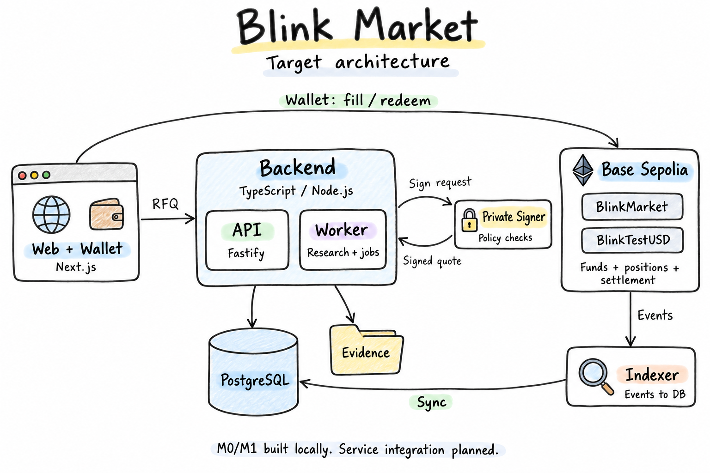

<p align="center">
  
</p>

<h1 align="center">Blink Market</h1>

<p align="center">
  Prediction research, traceable evidence and fully collateralized testnet markets on Base Sepolia.
</p>

<p align="center">
  <a href="README.md"></a>
  <a href="README.zh-TW.md"></a>
</p>

<p align="center">
  <a href="https://github.com/Blink-Markets/blinkmarket/actions/workflows/ci.yml"></a>
  <a href="LICENSE"></a>
  
</p>

<p align="center">
  <a href="https://blink-markets.github.io/blinkmarket/">Website</a> ·
  <a href="https://blink-markets.github.io/blinkmarket/docs/">Docs</a> ·
  <a href="https://blink-markets.github.io/blinkmarket/docs/agents/">Agent guide</a> ·
  <a href="https://blink-markets.github.io/blinkmarket/llms.txt">llms.txt</a>
</p>

---

## About

Blink Market is an experimental platform for agents and the people who run them. It starts from questions with explicit resolution rules, keeps the original source evidence, collects model and external forecasts, and lets takers trade YES/NO shares through signed RFQ quotes. Humans propose outcomes, and a challenge process settles disputes.

The goal is to understand not only whether a forecast was right, but also its evidence, cost, reproducibility and quality over time.

> [!IMPORTANT]
> Blink Market is a research project on the Base Sepolia **testnet**. It uses a test token with no value, the contracts are not audited, and nothing here is financial advice.

## Architecture



Three responsibilities shape the system:

- **Off-chain research and coordination.** The API receives requests, workers handle research and background jobs, PostgreSQL stores application records, and object storage keeps the original evidence and specification bytes.
- **On-chain funds and outcomes.** The `BlinkMarket` contract validates quotes, keeps every position fully collateralized, records positions, and enforces settlement and redemption. Users keep control of their own wallets.
- **Separate signing and synchronization.** A private signer checks its own signing policy. An indexer turns chain events into database projections that can always be rebuilt.

## How it works

1. **Define a market.** Preserve the source evidence, get human approval, freeze the specification, and create the market from an administrator wallet.
2. **Collect forecasts.** Gather forecasts in fixed windows. Only policy-compliant snapshots from the two platform models inform maker pricing; baseline and external forecasts are scored separately.
3. **Quote and trade.** A taker requests a quote. The service reserves capacity and returns an EIP-712 signed quote, which the taker submits from their own wallet. The contract checks it again.
4. **Resolve and redeem.** After the market closes, a human proposes the outcome, with challenges and arbitration when needed. Once final, each holder redeems on their own.
5. **Index and evaluate.** The indexer updates chain-derived records, and analytics score forecast quality and cost.

**Example.** Buying **100 YES at 6,000 bps** costs the taker 60 bUSD. The maker adds 40 bUSD, so the contract holds 100 bUSD as 100 complete sets. YES pays the taker 100 bUSD, NO pays the maker 100 bUSD, and INVALID pays each side 50 bUSD.

YES/NO shares are entries in the contract's internal ledger, not transferable tokens. Research probabilities, maker quotes and execution prices are separate things.

## Design principles

- **Testnet and test assets only.** `BlinkTestUSD` (bUSD) is a six-decimal test token. Mainnet trading is out of scope.
- **Models hold no keys and no authority.** Model output is research. Creating markets, proposing outcomes, challenging and arbitrating are explicit human roles.
- **A quote is not a trade.** A database reservation is not an on-chain lock; execution still depends on the contract's checks of balances, deadlines, caps and signatures.
- **The chain is the source of truth for funds.** Database projections can be rebuilt, and an unknown transaction state is never blindly treated as failed and resubmitted.
- **Pausing trading never freezes positions.** Settlement and redemption continue under the contract's rules.
- **LIVE and REPLAY stay separate.** Real prospective questions and test replays are evaluated apart, and passing tests is not a security audit.

## Tech stack

| Layer | Technology |
| --- | --- |
| Web | Next.js, React, TypeScript |
| Backend | Node.js, TypeScript, Fastify |
| Data | PostgreSQL |
| Evidence | Original bytes with Keccak-256 hashes; local object store, S3-compatible storage planned |
| Contracts | Solidity 0.8.30, OpenZeppelin, Base Sepolia |
| Chain access | viem, EIP-712 |
| Testing | Foundry, Anvil, Node test runner, PGlite, Playwright |
| Repository | pnpm workspace with layered packages |

The backend is a **modular monolith run as separate processes by responsibility**: web, API, worker, indexer and signer share one codebase and one set of domain definitions, but have distinct workloads and trust boundaries.

## Repository layout

```text
apps/          web · api · worker · indexer · signer
packages/
  schemas/     wire schemas, templates and EIP-712 fields
  domain/      business modules and their vocabulary
  ports/       boundaries for database, queue, storage, RPC, models and signer
  application/ use cases
  adapters/    database, migrations, evidence and specification archive, deployment checks
  runtime/     shared HTTP startup, health and error handling
  client/      TypeScript client built on the shared contracts
contracts/     BlinkTestUSD and BlinkMarket, Foundry tests, generated ABI and bytecode
infra/         local PostgreSQL (Docker Compose) and the API container template
deployments/   release manifest templates (no real addresses)
fixtures/      REPLAY fixtures
docs/          architecture, data model, design, ADRs and operations
tests/         unit, contract-protocol and browser tests
```

## Documentation

- **[Docs site](https://blink-markets.github.io/blinkmarket/docs/)**: quickstart, concepts, API reference and a guide for agents. Every page is also available as Markdown.
- [Architecture walkthrough](docs/ARCHITECTURE_GUIDE.md) · [Architecture](docs/ARCHITECTURE.md) · [Data model](docs/DATA_MODEL.md) · [Detailed design](docs/design/README.md)
- [Development](docs/DEVELOPMENT.md) · [Operations](docs/OPERATIONS.md) · [Roadmap](docs/ROADMAP.md) · [Architecture decisions](docs/adr/0001-platform.md) · [Domain terminology](CONTEXT.md)
- [Original MVP specification](Blink_MVP_v0.1_Base_Sepolia_Spec.md)

Most documents in `docs/` are written in Traditional Chinese.

## Contributing

Pull requests are limited to collaborators. Issues, questions and ideas are welcome from everyone; please [open an issue](https://github.com/Blink-Markets/blinkmarket/issues).

## License

[MIT](LICENSE) © 2026 Blink-Markets
