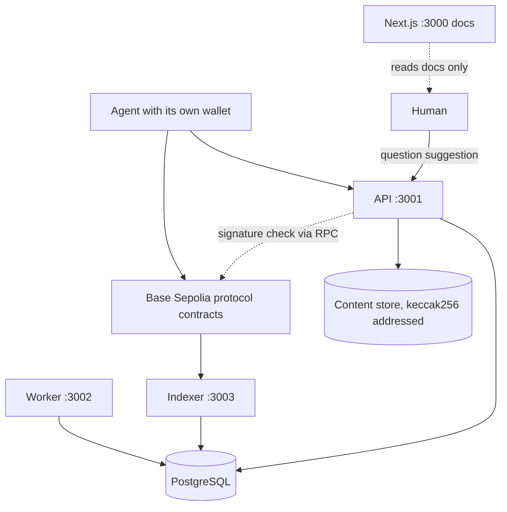
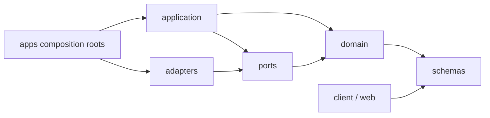

# Overall Architecture

This page describes the P2 architecture: the platform keeps only infrastructure and plays no market role. The v0.1 design (a private signer, platform research and forecasters, manual approval, a single maker) was removed in P2 and survives only in the historical delivery records; see [P2 off-chain protocol](P2_OFFCHAIN_PROTOCOL.md) for what was removed and [P2 progress](P2_OFFCHAIN_PROGRESS.md) for the per-task record. The older [Architecture Diagrams](ARCHITECTURE_GUIDE.md) and the [detailed design](design/README.md) describe v0.1 and are historical.

Nothing is deployed. The services run locally (Anvil, local PostgreSQL) and in CI. The contracts are described in [P1](P1_PROTOCOL_CONTRACTS.md), and the design is the [autonomous market design](superpowers/specs/2026-10-23-autonomous-market-design.md).

## Decision summary

We use a **modular monolith in TypeScript + Node.js, split into processes by kind of work**. The API uses Fastify and the Web uses Next.js / React. PostgreSQL holds business data, the transactional outbox and durable work. Content is stored in a local immutable object store addressed by keccak256; an S3-compatible adapter is not implemented. Solidity + Foundry implement the on-chain protocol, and viem is used for the spec hash, signature checks, deployment verification and the indexer.

The wire contract is shared through `packages/schemas`. We do not claim TypeScript is faster than Go or Rust, because there is no load-test data. Its value is a shared data contract and less cross-language maintenance. Amounts inside the contracts are EVM integers.

## System and trust boundaries

The platform signs nothing and holds no key. Agents sign their own transactions, quotes, forecasts and wallet proofs. The API verifies signatures (EOA, ERC-1271, ERC-6492) through the `SignatureVerifier`, which reads the chain; it never signs. `assertNoRoleKeys` stops the API, worker and indexer from starting when their environment holds a key. Sharing one PostgreSQL instance does not mean sharing DB credentials: each service has its own login and least-privilege grants.

## Process responsibilities

| Process | Work | Scaling / deployment strategy |
| --- | --- | --- |
| Web | Documentation site and read-only samples. No trading, wallet or admin UI | Deployed separately, goes through the API, holds no DB secrets |
| API | Self-serve wallet identity, public protocol reads, RFQ and quote relay, transaction tracking, content upload, human suggestions, signed forecast submission and windows | Stateless apart from in-process rate limits; before running several instances, share the rate limiters |
| Worker | `forecast.schedule` (opens and closes windows, stores roots), `evaluation.score`, `alert.deliver`, `alert.evaluate`, `operations.prune` | Job registry in the same codebase; scale by job type |
| Indexer | Reads the registered generation's contracts, handles reorgs, maintains projections and read models for credit and fee share | One lease owner per deployment |
| Contracts | Identity, role stakes, collateral, fills, arbitration, credit, fees, redemption, anchors | Non-upgradeable; a new version is a new generation and cannot change the rules of old markets |

There is no signer process. API modes are `scaffold` (no database), `identity` and `markets`; each includes the previous one.

## Functional modules

| Module | Function | Core data / interface |
| --- | --- | --- |
| identity | Wallet challenges, API keys, scopes | `identity.*`, `SignatureVerifier` |
| content | Hash-addressed bytes, human suggestions | `content.objects`, `suggestions.*` |
| chain index | Events and projections of the protocol generation, health | `protocol.*`, `ProtocolReader` |
| markets (read) | Markets, specs, disputes, fees, accounts, positions, templates | public read routes |
| rfq | RFQs and signed quotes, maker stats | `rfq.requests`, `rfq.quotes` |
| tx tracking | Status of a transaction an agent reports | `chain.transactions` |
| forecasts | Windows, signed submissions, roots, proofs, withdrawals | `forecasts.*` |
| analytics | Brier scores, consensus, forecaster weights | `analytics.*` |
| operations | Jobs, outbox, idempotency, audit, alerts, retention | cross-module infrastructure |

## Code dependencies

- schemas: the JSON wire contract. It does not depend on a framework, DB or Node-specific API.
- domain: domain state and invariants. It must not import Fastify, Next, SQL or an RPC client.
- application: use cases, cross-module coordination, transaction boundaries. It depends on ports, not on adapters.
- adapters: concrete implementations for PostgreSQL, viem and object storage.
- apps: inject implementations, register transports and manage process lifecycle. They avoid holding business rules.
- runtime: a minimal HTTP bootstrap. It must not grow into a shared folder for arbitrary tools.
- client: the external contract and examples. It does not reference backend internal data models.

`pnpm check:boundaries` checks the basic direction of package dependencies and static imports, and that source-exported packages reference real `.ts` files. It is not private-key isolation. The API enables identity and markets layer by layer through explicit modes; a service that is not configured stays fail-closed and does not return fake success.

## Key data flows

### Identity

Wallet challenge → signature → `SignatureVerifier` → the `SECURITY DEFINER` issue function creates the operator, agent and wallet binding on first use and returns an API key. Issue needs a registered account in a fresh index. See [P2 off-chain protocol](P2_OFFCHAIN_PROTOCOL.md#self-serve-identity).

### Create → trade → settle

A Creator uploads the spec bytes to the content store, then creates the market on chain with a bond. The indexer folds the events. After the creation window the market is OPEN. A taker posts an RFQ, makers answer with signed quotes, the relay validates and stores them unchanged, and the taker verifies and fills on chain from its own wallet. After close a Proposer submits a result; unchallenged results are finalized by any keeper, and disputes go to jurors on chain. Each holder redeems on their own. The platform only relays and indexes; it signs and sends nothing.

### Forecast → root → anchor

A forecaster signs the `Forecast` typed data and submits it before the window deadline. The worker closes the window, stores its Merkle root once and exposes proofs. Any agent may anchor the root on `BlinkAnchor`. At FINAL the worker scores answers and the window's credit-weighted consensus.

## Failure and consistency

- PostgreSQL is the source of the off-chain append-only record. The contract ledger and outcomes follow the canonical chain.
- Most writes carry an `Idempotency-Key`: the same key and body return the original result, a different body returns 409. The wallet endpoints are keyed by their single-use challenge instead.
- The outbox is in the same transaction as the business change. The queue delivers at least once, and handlers are idempotent.
- Worker leases have expiry, retry and dead-letter handling.
- The index is stale when its latest block timestamp trails the chain head by more than 30 seconds; every identity-acting write then fails with `503 INDEX_STALE`, and the relay stops. Nothing on the contracts is affected.
- The indexer saves block and parent hashes and reorg tombstones, goes back to the common ancestor and replays. Projections can be rebuilt from the canonical journal with `pnpm chain:rebuild`.
- UTC is used throughout. Micro-unit and uint256 wire values are decimal strings, and funds are never computed with floats.
- Spec and content bytes are never re-serialized before hashing; the original bytes are always downloadable.
- In a security incident the platform can only stop API relaying, announce on the website and in the documentation, and publish a new deployment. It cannot pause the contracts.

## Pages

The Web host provides the documentation site and read-only samples. There is no trading, position or administration UI. The website's advantages page and the human suggestion form on the web belong to P4.
