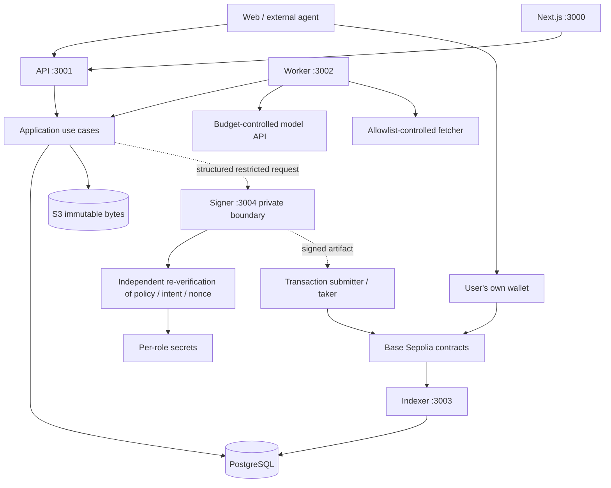
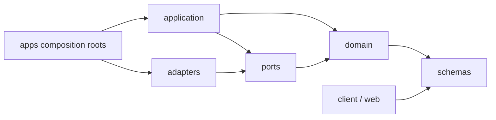

# Overall Architecture

For a diagram-based tour, see [Architecture Diagrams and How the System Runs](ARCHITECTURE_GUIDE.md). It covers the implemented scope first, then the full system and the runtime flows.

For detailed interfaces and transaction order, see [Detailed design](design/README.md). Decisions follow [ADR 0002](adr/0002-protocol-boundaries.md). The backend for M0/M1 and Tasks 1–16 is implemented but not deployed. The API, worker, indexer and signer have business wiring. See [RFQ](M2_RFQ.md), [Signer](M2_SIGNER.md), [Indexer](M2_CHAIN_INDEXER.md), [public reads](M2_PUBLIC_READS.md) and [this round's documentation delivery](ROADMAP.md). Local verification covers REPLAY only, there is no paid model, and LIVE approval is still rejected. The [internal trader](M3_INTERNAL_TRADER.md), [SDK / example agent](M5_CLIENT_SDK.md), [local Alpha harness](M5_LOCAL_ALPHA.md) and [health/metrics readiness](M5_HEALTH_METRICS.md) are implemented. This page does not claim that all of M2/M3/M5 is complete.

## Decision summary

We use a **modular monolith in TypeScript + Node.js, split into processes by risk and kind of work**. The API uses Fastify. The Web uses Next.js / React. PostgreSQL holds business data, the transactional outbox and durable work. S3-compatible storage is the official target for snapshot storage. Solidity + Foundry implement the on-chain ledger. M0/M1 pin viem 2.56.8 and use it for the spec hash, deployment verification and local REPLAY.

This choice fits the current load: at most 5 LIVE markets, a single maker, a small team and an I/O-bound workload. We do not claim TypeScript is faster than Go/Rust, because there is no load-test data. Its value is a shared data contract, less cross-language maintenance and enough early throughput. Amounts inside the contracts are handled by EVM integers.

## System and trust boundaries

This diagram covers the implemented backend and the undeployed infrastructure targets. The only model today is a deterministic fixture gateway. Object storage uses a local immutable archive, and the S3 adapter is not implemented. The Signer has caller bearer verification, role policy, persisted requests and key-file isolation. Network ACL, mTLS, a secret manager and at-rest encryption are still deployment work. Sharing one PostgreSQL instance does not mean sharing DB credentials. The Web currently shows only static samples and is not connected to backend data.

## Process responsibilities

| Process | Work | Scaling / deployment strategy |
| --- | --- | --- |
| Web | Read-only explainer site, docs and fictional REPLAY samples; trading / position / admin UI not implemented | Deployed separately, goes through the API, holds no DB / signer secrets |
| API | Authentication, validation, reads, synchronous RFQ and command intake | Stateless; before running multiple instances, share rate limiting and DB reservations |
| Worker | discovery, forecast, cost reconciliation, keeper and mandate trader scheduling | Job registry in the same codebase; scale by job type / concurrency limit |
| Indexer | Event fetching, reorg, projection, restart reconciliation | One lease owner per deployment; scale out by sharding per deployment |
| Signer | Restricted signing for maker quotes, faucet and keeper; the trader worker is wired for exact approve / fill / redeem | Private process; role keys, caller token and nonce lock are implemented; deployment isolation is pending |
| Contracts | Collateral, fill, positions, final outcome and redemption | Non-upgradeable; a new version is a new deployment and cannot change the rules of old markets |

Early on, Web/API/Worker/Indexer can share one small application host. The Signer is at least a separate process with its own OS/container identity. Caller identity and a per-role function allowlist are implemented. The official Alpha must also put in place a network ACL and separate secrets management. Separate folders alone do not form security isolation. The manually managed admin and arbitration wallets are not placed in the automated signer.

## Functional modules and ownership

| Module | Function | Core data / interface |
| --- | --- | --- |
| identity | operator, agent, invite key, scope, wallet binding | api_keys, wallet_challenges |
| evidence | Source allowlist, fetch, snapshot, hash, public permission | SourceFetcher, ImmutableObjectStore |
| discovery | Daily scan, structured candidates, revision, checks | candidates, candidate_revisions |
| markets | Manual approval, frozen spec, deployment intent, question reads | MarketSpec, markets |
| forecasts | DAILY/PRE_CLOSE, two internal models, baseline, external forecasts | windows, forecasts, model_runs |
| budgets | Per-question / daily cost, reservation, actual / unknown usage | cost_entries, UnitOfWork |
| trading | RFQ, simple average price, reservation, mandate, quote lifecycle | quotes, collateral/risk reservations |
| chain | Transaction status, nonce/replacement, events, reorg, position projection | ChainReader, transactions, cursors |
| resolution | Outcome suggestion, auditor tickets, manual check, keeper | reports, on-chain outcome |
| faucet | Mint to invited addresses, 24h limit, separate gas budget | claims, restricted mint intent |
| analytics | Brier, missing/INVALID, cost, latency, external adoption | Rebuildable score/read models |
| operations | jobs/outbox, idempotency, audit, alerts and recovery | Cross-module infrastructure |

The admin pages are not a thirteenth set of domain logic. They call the admin use cases of the same modules. The quote service is a trading application module at first, not a separate microservice. Each forecaster is a job type / model setting, not a separate service.

## Code dependencies

- schemas: the JSON wire contract. It does not depend on a framework, DB or Node-specific API.
- domain: domain state and invariants. It must not import Fastify, Next, SQL or an RPC client.
- application: use cases, cross-module coordination, transaction boundaries. It depends on ports, not on adapters.
- adapters: concrete implementations for PostgreSQL, viem, model providers and object storage.
- apps: inject implementations, register transports and manage process lifecycle. They avoid holding business rules.
- runtime: a minimal HTTP bootstrap. It must not grow into a shared folder for arbitrary tools.
- client: the external contract and examples. It does not reference backend internal data models.

`pnpm check:boundaries` checks the basic direction of package dependencies and static imports. It is not private-key isolation and not a full static analysis. The API enables identity, preparation, approval, markets and trading layer by layer through explicit modes. Services that are not configured stay fail-closed and do not return fake success. markets/trading are wired to public reads, forecast, resolution and evaluation. trading is also wired to RFQ, faucet, public health and admin execution metrics. The API's `/health/ready` uses the same readiness decision. Readiness is not a fill guarantee for any single market or taker. See [Health and metrics](M5_HEALTH_METRICS.md). For details see [identity delivery](M2_IDENTITY_DELIVERY.md), [public reads](M2_PUBLIC_READS.md) and [RFQ](M2_RFQ.md).

## Key data flows

### Candidate → market

Allowlisted fetch → save bytes/hash → candidate revision → validation → manual approval. The approval use case writes the approval, spec record, deployment intent, audit and outbox in one DB transaction. Object storage does put-if-absent first, then the DB reference is committed. A failure leaves an orphaned object that can be cleaned up. A spec whose bytes were not saved is never served.

Market creation is signed by the ADMIN manual wallet. The worker tracks that intent and tx. APPROVED → DEPLOY_PENDING → the market is DEPLOYED only after the canonical MarketCreated is indexed. A retry checks specHash, nonce and receipt first and does not create a new market.

### Forecast → RFQ → fill

Window opens → atomic research budget reservation → model / external submission → publication after the deadline → qualified fixed two-model average. The baseline is kept separate. If one model is missing, the ensemble is missing. The maker rejects a quote when there is no qualified snapshot.

RFQ validates identity / wallet / deployment / market and freshness → maker collateral reservation under a DB lock → signer re-verification → return an EIP-712 quote. On-chain funds are not locked yet. The quote service does not replace contract verification. An external taker approves and fills in person. The internal trader has a mandate and a notional reservation taken under lock. It executes the exact approve / fill through the public RFQ and the restricted signer, and redeems after FINAL. Only one trader per deployment is supported. The edge must be strictly above the threshold (default 500 bps), and exactly equal means no trade. The mandate is set by the DB owner, and the signer does not re-verify the mandate limit. Gas is controlled separately by the signer's role/day accounting. See [limits](M3_INTERNAL_TRADER.md).

Index the canonical QuoteFilled → reconcile consumed, balance, reservation and position projection on the same cursor. If signing succeeds but the reply is lost, the reservation is kept. An expiry does not release it on local time alone.

### Settlement → quality

Parser suggestion → RESULT_PROPOSER manually checks and proposes → CHALLENGER may challenge → ARBITER manually resolves / permissionless finalize → on-chain FINAL → holder redeems in person. After hardDeadline the only outcome is INVALID. Pausing and revoking trading eligibility do not block redemption. The keeper has no power to decide.

analytics computes Brier only from LIVE YES/NO on the same event/horizon. INVALID, REPLAY, missing and contaminated are listed separately. A larger number of windows does not add independent event samples.

## Failure and consistency

- PostgreSQL is the source of the off-chain append-only record. The contract ledger and outcomes follow the canonical chain.
- Every write use case has operator + endpoint + idempotency key. A different payload hash returns 409.
- The outbox is in the same transaction as the business change. The queue delivers at least once, and handlers must be idempotent. We do not claim exactly-once.
- Worker leases have expiry / retry / dead-letter and manual replay. Paid model calls and economic operations must not retry without limit.
- An API 202 only means the intent was accepted. UNKNOWN does not release risk, and we do not resend blindly with a new nonce.
- If the Indexer lags by more than 3 blocks or has no update for more than 10 seconds, either condition stops RFQ and the internal trader.
- Save the block / parent hash and reorg tombstones. Go back to the common ancestor, withdraw the projection and replay. If the finalized tag is not supported, mark it unknown.
- Pausing only blocks new trades. proposal / challenge / finalize / redeem and free collateral withdrawal keep the contract rules.
- UTC is used throughout with explicit time zones. Micro-unit / uint256 wire values use decimal strings, SQL NUMERIC, and bigint for computation. A probability may be a finite decimal in [0,1]. Floats are never used to compute funds.
- Do not re-serialize the spec to verify the hash. The original bytes must be downloadable.

## Page categories (the public explainer site is implemented; the operation UI is undecided)

Public: market list, question detail (evidence / forecast / baseline / cost), settlement detail, agent onboarding.
Wallet: test trading, positions / redemption. Admin: candidate approval, failed work, budget, pause, outcome and dispute tickets.

The research probability, the maker ask and the actual fill price are kept separate. The LIVE/REPLAY and test-asset labels are always shown. The Web host provides a read-only Next.js explainer site, docs and clearly labeled fictional REPLAY market samples. These are not API market data, and there are no trading / wallet / admin operations. The API and contracts are not deployed, so the website has no trading.
