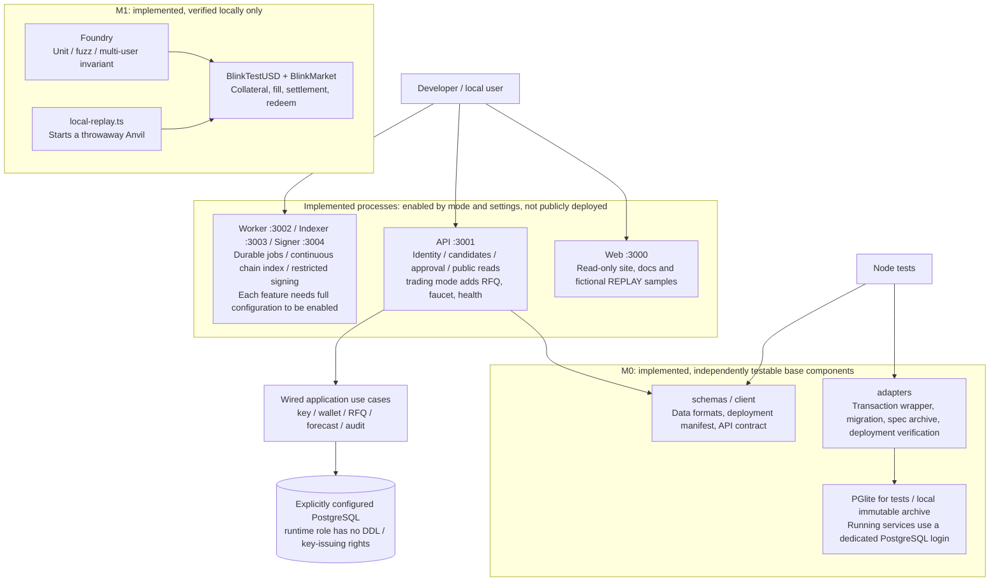
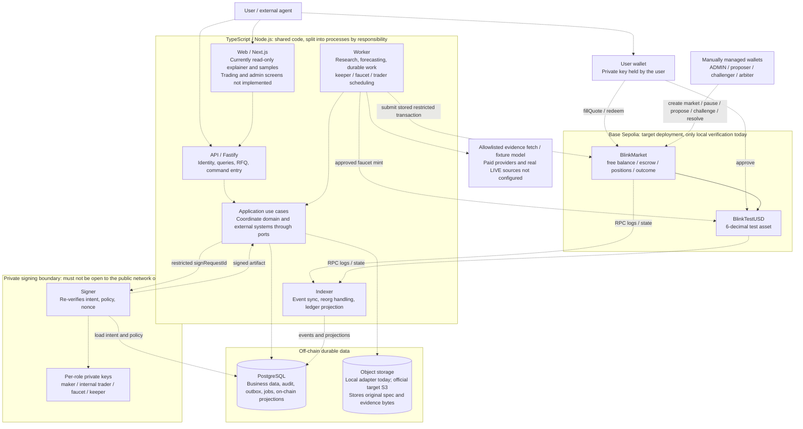
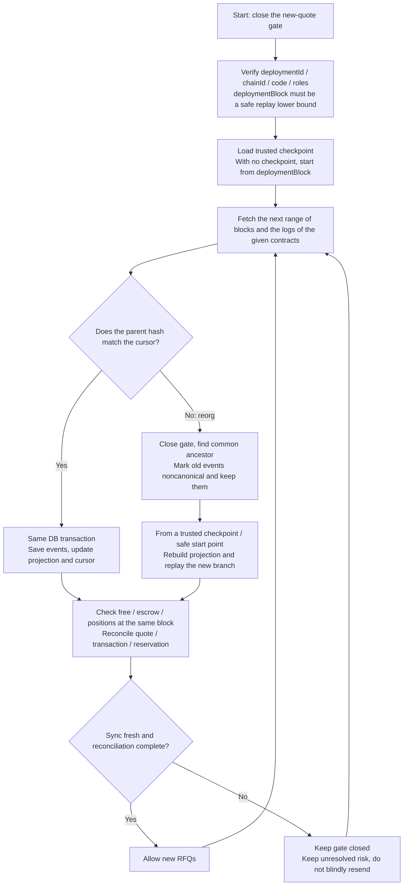

# Architecture Diagrams and How the System Runs

Remember one sentence: **the off-chain system handles research, quotes and work coordination; the on-chain contracts handle funds, positions and the final outcome.** The website is not a ledger, and the database cannot change on-chain positions.

The diagrams below use Mermaid. A Markdown previewer that supports Mermaid shows them directly. For technical details see [Architecture](ARCHITECTURE.md) and [Detailed design](design/README.md).

## 1. What has been built so far?

The backend implements evidence, candidates and manual approval, research and forecasting, RFQ and restricted signing, durable work, continuous chain indexing and transaction tracking, and settlement and evaluation. See [RFQ](M2_RFQ.md), [research worker](M3_RESEARCH_WORKERS.md), [Indexer](M2_CHAIN_INDEXER.md), [keeper/faucet](M3_KEEPER_FAUCET.md) and [internal trader](M3_INTERNAL_TRADER.md). The [local Alpha](M5_LOCAL_ALPHA.md) ties together three REPLAY settlements and projection recovery. It uses real service components with a local PostgreSQL and Anvil (chain ID 84532). It is not a public deployment and not a full operational acceptance. There is no public API host and no Base Sepolia deployment. The website is still a read-only explainer with fictional samples, and the wallet, trading and admin UIs are not implemented. There is no paid model, and LIVE approval is still rejected.

This simplified diagram shows only the **capabilities implemented today**. It leaves out the full data flow between processes. A solid line means a call or verification path that exists. It does not mean the path is enabled or deployed publicly. The API is enabled by mode, and the other processes are enabled by their own settings.



The Web app does not call the API to trade, and it does not show live API market data. A fully configured trading API is wired to the signer. The Worker composes research, execution and trader with queue and outbox scheduling. The Indexer has continuous sync and reorg handling. In trading mode, the API's `/v1/health` and `/health/ready` use the same deployment readiness decision. Earlier modes still return 503. Readiness is not a fill guarantee for any single market or taker. See [Health and metrics](M5_HEALTH_METRICS.md). There is no official deployment address. Local verification does not mean a hosted service, external acceptance or a security audit is complete.

For the identity flow and how to enable it, see [M2.1 delivery](M2_IDENTITY_DELIVERY.md). The default is still the scaffold. A shared DATABASE_URL being present does not make it connect to the business database by itself.

## 2. How will the full system divide the work?

The diagram below shows **responsibilities and the deployment target**. A dashed line means an interaction across processes or with an external system. It does not mean the business logic is unimplemented: the API, Worker, Indexer and Signer are wired, and the local Alpha has verified the main flows. The Web-to-API operation screens, the official S3 and the paid model are still undelivered targets. The Signer has bearer caller verification and key-file isolation. Official private-network ACL/mTLS, a secret manager and at-rest encryption are still deployment requirements.



### The functional modules are not twelve microservices

| Category                | Domain modules               | Responsibility                                              |
| ----------------------- | ---------------------------- | ----------------------------------------------------------- |
| Access and management   | identity, operations         | Identity, permissions, audit, idempotency, work and failure recovery |
| Research and market creation | evidence, discovery, markets | Sources, snapshots, candidates, manual approval, frozen spec |
| Forecasting and cost    | forecasts, budgets           | Forecast windows, model/external forecasts, budget and actual cost |
| Trading and assets      | trading, chain, faucet       | RFQ, risk reservation, transaction tracking, test-token claims |
| Settlement and evaluation | resolution, analytics      | Outcome suggestions, dispute tickets, performance and quality statistics |

They share one set of domain/application code and live in the API or the Worker depending on the kind of work. There is no need to maintain a separate deployment for each module. The Indexer only syncs the chain, and the Signer only controls signing risk.

Dependency direction: `apps → application → ports/domain → schemas`, and `adapters` implement `ports`. Business logic does not depend directly on Fastify, SQL or RPC. See the [full dependency graph](ARCHITECTURE.md#code-dependencies).

## 3. From question to fill: when does money actually move?

The diagram below is the **conceptual order of the implemented flow**. It is not a list of every transport or DB transaction. The platform's discovery and forecaster call the public API with invite keys. Chain indexing and RFQ reservation reconciliation are done separately by the Indexer and the Worker, and are not in one transaction. For the concrete wiring and limits see [research worker](M3_RESEARCH_WORKERS.md), [RFQ](M2_RFQ.md), [Indexer](M2_CHAIN_INDEXER.md) and [local Alpha](M5_LOCAL_ALPHA.md). There is no public trading service.

```mermaid
sequenceDiagram
    actor Admin as Manual admin
    participant W as Worker / research
    participant A as API / use cases
    participant D as DB / object storage
    participant S as Private Signer
    actor T as Taker wallet
    participant C as On-chain contracts
    participant I as Indexer
    W->>D: Save source evidence, candidate questions
    Admin->>A: Approve candidate and fixed rules
    A->>D: Save original spec bytes first, then commit hash / intent / audit / outbox
    Admin->>C: Sign createMarket themselves
    C-->>I: MarketCreated event
    I->>D: Canonical market projection
    W->>D: Budget reservation, model forecasts, qualified snapshot after the window closes
    Note over A,C: Maker must approve and depositMaker beforehand; a quote does not lock free balance on-chain
    T->>A: RFQ: market, side, size, identity and idempotency key
    A->>C: Read same-block market / epoch / maker free
    A->>D: Lock the funds pool and cursor, save reservation / quote draft
    A->>S: signRequestId
    S->>D: Reload intent / policy / reservation
    S->>C: Re-verify deployment, expiry and on-chain state
    S->>D: Save signed artifact
    S-->>A: artifactId
    A-->>T: EIP-712 signed quote
    T->>C: approve the token, then call Market.fillQuote
    Note over T,C: Contract verifies signature, expiry, cap, balance; charges taker cost and deducts maker free, creates full collateral
    C-->>I: QuoteFilled event
    I->>D: Update on-chain projection / cursor in one transaction; Worker reconciles the reservation separately
```

Example: buying **100 YES at 6000 bps**, the taker pays 60 bUSD, the maker's free balance drops by 40 bUSD, and the market escrow rises by 100 bUSD. The taker gets 100 YES and the maker gets 100 NO. These shares are an internal `BlinkMarket` ledger. They are not transferable YES/NO ERC-20 tokens.

A DB reservation stops the service from promising the same limit twice, but it cannot guarantee that a quote will fill. On-chain execution can still reject because of expiry, cap, withdrawal, cancellation or an epoch change. The contract's execution result is what counts.

## 4. After close, who decides the outcome?

This diagram matches the **implemented contract state machine**. A research model can only suggest. It has no power to decide.

```mermaid
stateDiagram-v2
    [*] --> OPEN: ADMIN creates the market
    OPEN --> PROPOSED: After closeAt and before proposalDeadline, manual proposal
    PROPOSED --> DISPUTED: Within the challenge window, CHALLENGER challenges
    PROPOSED --> FINAL: Challenge window ended and hardDeadline not reached, anyone finalizes
    DISPUTED --> FINAL: Before hardDeadline, ARBITER resolves
    OPEN --> FINAL: At hardDeadline, anyone times out to INVALID
    PROPOSED --> FINAL: At hardDeadline, anyone times out to INVALID
    DISPUTED --> FINAL: At hardDeadline, anyone times out to INVALID
    FINAL --> FINAL: Each position holder redeems separately; a cleared position cannot be redeemed again
```



| Final outcome | Per YES share | Per NO share |
| ------------- | ------------: | -----------: |
| YES           |        1 bUSD |            0 |
| NO            |             0 |       1 bUSD |
| INVALID       |      0.5 bUSD |    0.5 bUSD |

The LIVE challenge window is 86400 seconds, and REPLAY is 120 seconds. After `closeAt`, no more fills are possible. Even if trading is paused or a taker's trading eligibility is revoked, existing positions can still settle and redeem under the rules. A maker's redemption proceeds go back to the wallet. They do not automatically become new free balance.

## 5. Why do we need the Indexer? How does it recover after a failure?

The diagram below is a **conceptual view of the implemented sync and recovery duties**. It does not mean every step is done by the Indexer or in one transaction. The Indexer stores canonical events, projections and the cursor, and handles reorgs. The Worker separately reconciles quote reservations, and RFQ checks freshness and gates. For details see [Indexer](M2_CHAIN_INDEXER.md) and [RFQ](M2_RFQ.md). For the local drill of projection rebuild and drop-and-reindex, see [Alpha](M5_LOCAL_ALPHA.md). The chain is the source of truth for funds and outcomes. This does not replace an official DB backup/restore acceptance.



New quotes stop if the latest head is more than 3 blocks behind, **or** there has been no successful update for more than 10 seconds. A signing or transaction-submit timeout does not mean failure. An expiry also must not release a reservation based on the local clock alone. A contradiction that crosses an already finalized checkpoint must stop and be investigated manually.

The early M0/M1 delivery already protects these base points (historical background, not all current capabilities):

- If a DB `COMMIT` actually answers `ROLLBACK`, the use case must fail and must not report success.
- A local object is written to a complete temporary file first, then published atomically at the hash path. Concurrent operations never read a half-published file.
- Deployment verification checks that both contracts still have no code at `deploymentBlock - 1`. This prevents a later start point from missing events.

## Suggested reading order

Start with diagrams 1 and 2 on this page for the current state and the target. Then read diagrams 3 and 4 to understand trading and settlement. To check acceptance and the remaining deployment work, read the [acceptance matrix](ACCEPTANCE_MATRIX.md) and the [local Alpha](M5_LOCAL_ALPHA.md) first, then the [work packages](design/06-work-packages.md) and the [recovery details](design/04-execution-recovery.md).
