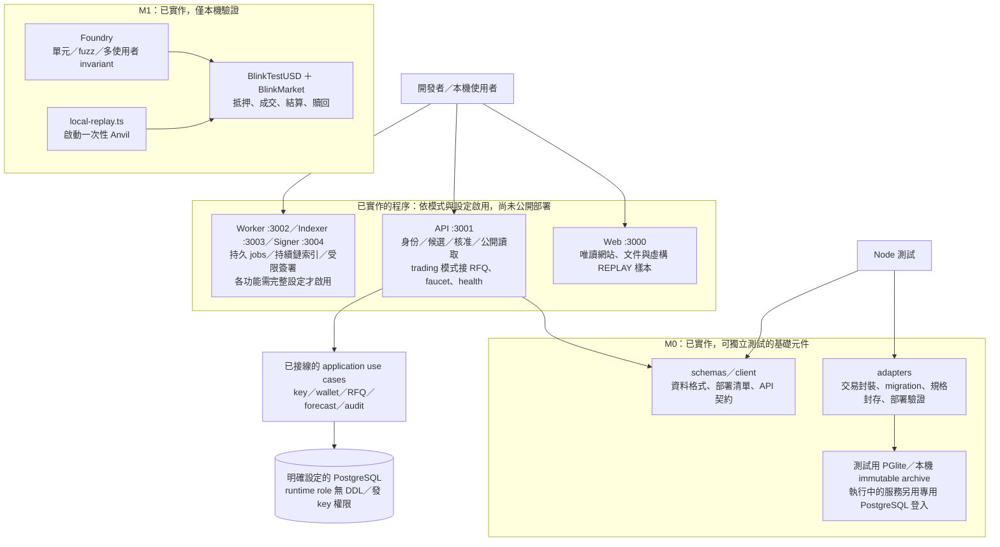
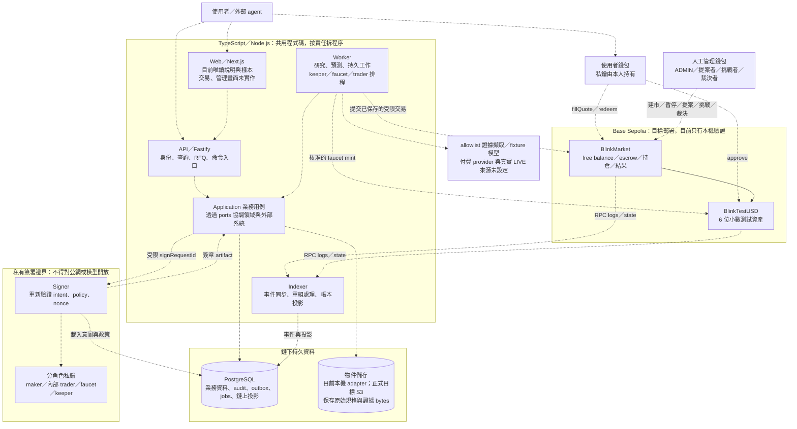
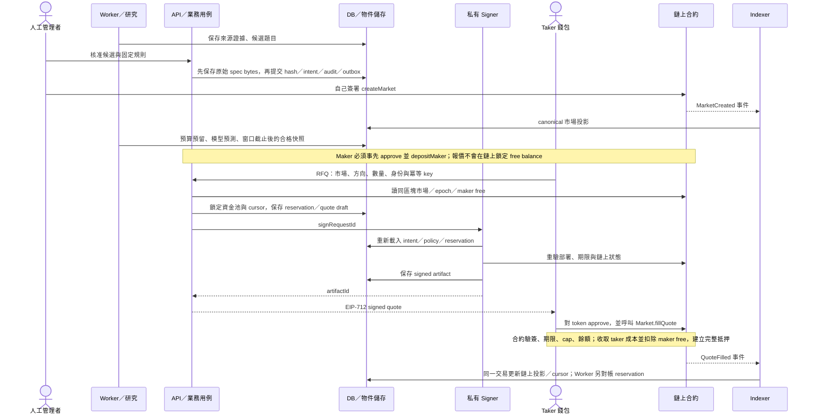
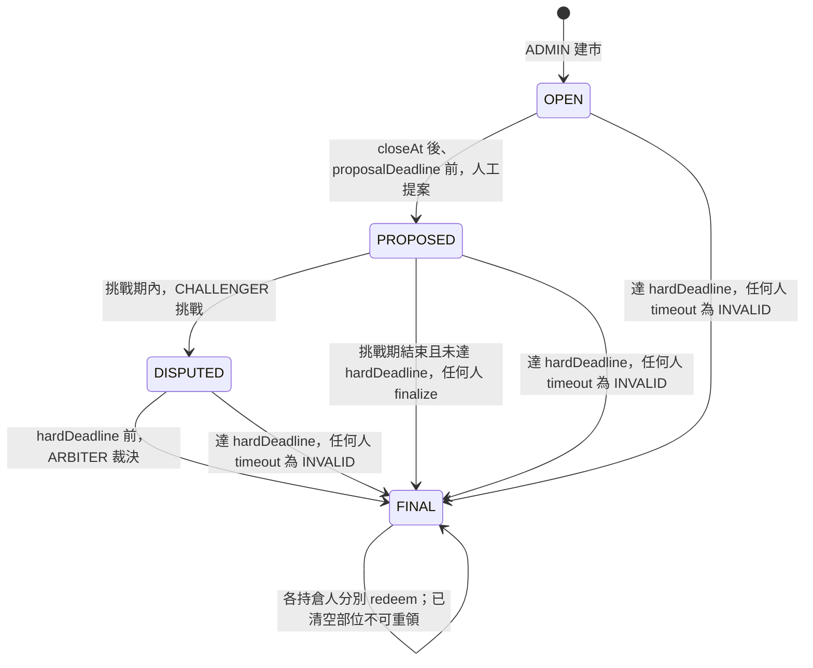
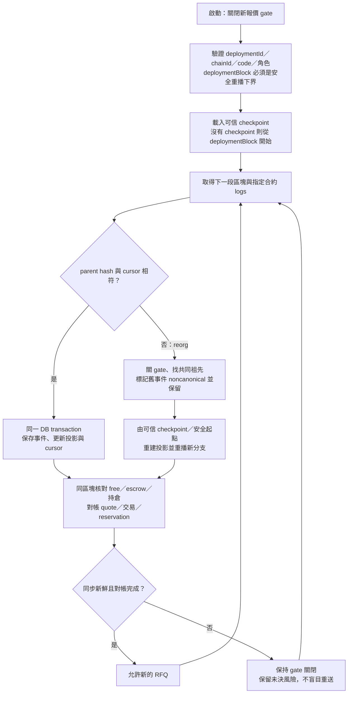

# 架構圖解與運行方式

先記住一句話：**鏈下系統負責研究、報價與工作協調；鏈上合約負責資金、持倉及最終結果。** 網頁不是帳本，資料庫也不能修改鏈上的持倉。

以下使用 Mermaid 圖，支援 Mermaid 的 Markdown 預覽器可直接顯示。技術細節見 [架構設計](ARCHITECTURE.md)、[細部設計](design/README.md)。

## 1. 現在已經做到哪裡？

Backend 已實作證據／候選／人工核准、研究與預測、RFQ／受限簽署、持久工作、持續鏈索引與交易追蹤、結算與評估；見 [RFQ](M2_RFQ.md)、[研究 worker](M3_RESEARCH_WORKERS.md)、[Indexer](M2_CHAIN_INDEXER.md)、[keeper／faucet](M3_KEEPER_FAUCET.md) 與 [內部 trader](M3_INTERNAL_TRADER.md)。[本機 Alpha](M5_LOCAL_ALPHA.md) 串起三種 REPLAY 結算與投影恢復，使用真實服務元件與本機 PostgreSQL／Anvil（chain ID 84532）；不是公開部署或完整營運驗收。沒有公開 API 主機或 Base Sepolia 部署；網站仍是唯讀說明與虛構樣本，錢包／交易／管理 UI 尚未實作。沒有付費模型，LIVE 核准仍拒絕。

這張簡圖只畫**目前已實作的能力**，省略各程序間的完整資料流。實線代表已存在的呼叫或驗證路徑，不代表已啟用或對外部署；API 依模式、其他程序依個別設定啟用。

Web 不呼叫 API 完成交易，也不顯示即時 API 市場資料。設定完整的 trading API 已接 signer，Worker 已組合 research／execution／trader 與 queue／outbox 排程，Indexer 已有持續同步與 reorg 處理。API 的 `/v1/health` 與 `/health/ready` 在 trading 模式使用同一部署 readiness 決策；較早模式仍為 503，且 readiness 不是單一市場／taker 的成交保證，見 [健康與指標](M5_HEALTH_METRICS.md)。沒有正式部署地址；本機驗證不代表託管服務、外部驗收或安全審計已完成。

身份流程與啟用方式見 [M2.1 交付](M2_IDENTITY_DELIVERY.md)。預設仍是 scaffold，不會因存在共用 DATABASE_URL 就自行連接業務資料庫。

## 2. 完整系統將如何分工？

以下是**責任分工與部署目標圖**。虛線表示跨程序／外部系統的互動，不表示業務尚未實作：API、Worker、Indexer 與 Signer 已接線，本機 Alpha 已驗證主要流程。Web → API 的操作畫面、正式 S3 與付費模型仍是未交付目標。Signer 已有 bearer caller 驗證與 key-file 隔離；正式私有網路 ACL／mTLS、secret manager 與 at-rest encryption 仍是部署要求。

### 功能模組不是十二個微服務

| 功能分類   | 領域模組                     | 負責什麼                                 |
| ---------- | ---------------------------- | ---------------------------------------- |
| 接入與管理 | identity、operations         | 身份、權限、audit、冪等、工作與故障恢復  |
| 研究與建市 | evidence、discovery、markets | 來源、快照、候選、人工核准、凍結規格     |
| 預測與成本 | forecasts、budgets           | 預測窗口、模型／外部預測、預算及實際成本 |
| 交易與資產 | trading、chain、faucet       | RFQ、風險預留、交易追蹤、測試幣領取      |
| 結算與評估 | resolution、analytics        | 結果建議、爭議工單、績效與品質統計       |

它們共用同一套 domain/application 程式碼，依工作型態放在 API 或 Worker；不需要替每個模組維護一套部署。Indexer 專門同步鏈，Signer 專門控制簽署風險。

程式依賴方向：`apps → application → ports/domain → schemas`，`adapters` 實作 `ports`。業務邏輯不直接依赖 Fastify、SQL 或 RPC；見 [完整依賴圖](ARCHITECTURE.md#程式依賴)。

## 3. 從題目到成交：錢何時真正移動？

以下是**已實作流程的概念順序**，不是逐項 transport 或 DB transaction 清單。平台 discovery／forecaster 透過邀請 key 呼叫公開 API；鏈索引與 RFQ reservation 對帳分由 Indexer 與 Worker 完成，並非同一個 transaction。具體接線與限制見 [研究 worker](M3_RESEARCH_WORKERS.md)、[RFQ](M2_RFQ.md)、[Indexer](M2_CHAIN_INDEXER.md) 及 [本機 Alpha](M5_LOCAL_ALPHA.md)；沒有公開交易服務。

例：買入 **100 YES、價格 6000 bps**，taker 付 60 bUSD，maker 的 free balance 扣 40 bUSD，市場 escrow 增加 100 bUSD；taker 取得 100 YES，maker 取得 100 NO。這些份數是 `BlinkMarket` 內部帳本，不是可轉讓的 YES/NO ERC-20。

DB reservation 防止服務重複承諾額度，但不能保證 quote 一定成交。鏈上執行時仍可能因過期、cap、提款、取消或 epoch 改變而拒絕；以合約執行結果為準。

## 4. 到期後，誰決定結果？

這張圖對應**已實作的合約狀態機**。研究模型只能提出建議，沒有裁決權。

| 最終結果 | 每份 YES |  每份 NO |
| -------- | -------: | -------: |
| YES      |   1 bUSD |        0 |
| NO       |        0 |   1 bUSD |
| INVALID  | 0.5 bUSD | 0.5 bUSD |

LIVE 挑戰期為 86400 秒，REPLAY 為 120 秒。`closeAt` 到後不能再成交；即使交易暫停或 taker 被取消交易資格，既有持倉仍可依規則結算、贖回。Maker 贖回所得回到錢包，不自動成為新的 free balance。

## 5. 為什麼需要 Indexer？故障後如何恢復？

以下是**已實作同步與恢復責任的概念圖**，不表示所有步驟都在 Indexer 或同一次交易完成：Indexer 保存 canonical events／projections／cursor 並處理 reorg；Worker 另對帳 quote reservations，RFQ 檢查 freshness 與 gates。細節見 [Indexer](M2_CHAIN_INDEXER.md) 與 [RFQ](M2_RFQ.md)，投影 rebuild／drop-and-reindex 的本機演練見 [Alpha](M5_LOCAL_ALPHA.md)。鏈是資金與結果的真相來源；這不取代正式 DB backup／restore 驗收。

最新 head 落後超過 3 blocks，**或**超過 10 秒未成功更新，任一成立就停止新報價。簽署或送交易逾時不等於失敗；到期也不能只看本機時鐘就釋放 reservation。跨越已 finalized checkpoint 的矛盾要停下來人工調查。

早期 M0/M1 交付已保護以下基礎環節（歷史背景，並非目前全部能力）：

- DB 的 `COMMIT` 若實際回覆 `ROLLBACK`，用例必須失敗，不能回報成功。
- 本機物件先寫完整暫存檔，再原子發布 hash 路徑；並行操作不會讀到發布中的半份內容。
- 部署驗證會檢查 `deploymentBlock - 1` 時兩份合約均尚無 code，避免未來從過晚的起點漏同步事件。

## 建議閱讀順序

先看本頁第 1、2 圖掌握現況與目標，再看第 3、4 圖理解交易與結算；需要核對驗收與剩餘部署工作時，先讀 [驗收矩陣](ACCEPTANCE_MATRIX.md) 與 [本機 Alpha](M5_LOCAL_ALPHA.md)，再讀 [工作包](design/06-work-packages.md) 與 [恢復細節](design/04-execution-recovery.md)。
