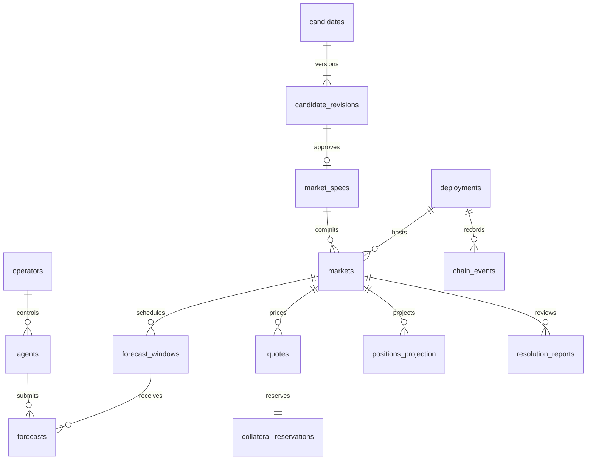

# Data Model Design

Latest increment: `0005_creation_tracking` implements `chain.creation_projections` and `chain.creation_observations`. `0006_creation_tracking_schedule` adds a durable retry/lease schedule for market-creation tracking that is verified and pins the txHash. The remaining blocks/events/global cursor and position tables are still to be implemented. See [M2.3a](M2_CREATION_TRACKING.md) and [M2.3b](M2_CREATION_POLLER.md).

This is the full logical model for M2. 0001 is the operations base. 0002 is identity. 0003 is evidence/discovery. 0004 has added markets.deployments/deployment_checks/specs/approvals/creation_intents/active_slots. For the latest transaction boundary see [approval delivery](M2_APPROVAL_DELIVERY.md). On-chain events, slot release and the remaining business tables are still to be implemented. The other names in the table below are a logical blueprint and do not mean the SQL tables already exist.

## Modules and tables

| Owner | Tables | Main columns and constraints |
| --- | --- | --- |
| identity | operators, agents, api_keys | agent.operator_id FK; key_hash unique, scopes, revoked_at, expires_at; no plaintext key |
| identity | wallet_challenges, wallet_bindings | nonce hash unique, domain/chain/expires_at/consumed_at; binding verified by signature |
| evidence | source_allowlists, evidence | URL, published/observed_at, content_hash, object_uri, access_policy; the original snapshot cannot be overwritten |
| discovery | candidates, candidate_revisions | candidate + revision unique, creator, state, canonical_key; append-only revision |
| markets | market_specs | spec_hash unique, raw_bytes_uri, schema_version, approval actor/time, canonical_key |
| markets | markets | UNIQUE(deployment_id, chain_market_id), mode, spec FK, times, state projection |
| forecasts | forecast_windows | UNIQUE(market_id, horizon_type, scheduled_at), open_at, deadline |
| forecasts | forecasts | UNIQUE(window_id, agent_id), not deleted even when withdrawn; NUMERIC probability CHECK 0..1, received_at |
| forecasts | model_runs | model/prompt hash, sampling/tool version, input hash, cutoff, baseline/platform/external |
| budgets | question_budgets, daily_budgets | USD micros caps, reserved/spent/unknown; daily date fixed to UTC |
| budgets | cost_entries | reserve/reconcile events, provider request ID, estimated / actual / unknown cost; append-only |
| trading | rfqs, quotes | rfq taker/market/max_cost, digest unique, payload, signature, expiry, epoch |
| trading | collateral_reservations | quote/draft intent FK, maker_cost, state, reconciled block hash |
| trading | mandates, risk_reservations | agent, daily/open notional, gas cap, economic intent, pending holds |
| chain | deployments | deployment_id, 84532, addresses, deployment block, ABI/bytecode hashes, roles, version |
| chain | chain_transactions | action_id, sender, nonce, hash, replacement_of, status; one nonce may have several hashes, so do not set it unique by mistake |
| chain | chain_blocks, chain_cursors | block hash, parent hash, number, canonical, finalized capability, deployment cursor |
| chain | chain_events | UNIQUE(deployment_id, block_hash, tx_hash, log_index), canonical flag/tombstone |
| chain | positions_projection | UNIQUE(deployment_id, market_id, address), yes/no, as_of_block_hash |
| resolution | resolution_reports, resolution_actions | author, evidence, suggested outcome, operator, intent, canonical chain ref |
| faucet | faucet_claims | verified address, claimed_at, amount, economic intent, pending status |
| analytics | evaluation_runs, score_entries | mode, event/horizon, input versions, missing/invalid/contaminated flags |
| operations | idempotency_records | UNIQUE(operator_id, endpoint, key), payload_hash, response/intent ref |
| operations | audit_log | actor, action, resource, reason, request_id, before/after hash, UTC |
| operations | jobs, outbox | dedupe_key, type, attempt, next_run_at, lease_until, lease_owner, last_error |

## Relationships

## Constraints that must be written into migrations

- An on-chain market ID cannot be a global key on its own. All chain data carries deploymentId. Per [ADR 0002](adr/0002-protocol-boundaries.md), the API's /markets/:id uses the on-chain decimal marketId and also requires a deploymentId query. The DB UUID is called marketRecordId and is used only as an internal FK. This replaces the earlier opaque path ID design, and schema/API implementation is still pending.
- UInt columns use the blink.uint256 domain: NUMERIC plus CHECK 0 <= value < 2^256 and value=trunc(value). This avoids NUMERIC(78,0) rounding a fraction first. uint64/caps are smaller per the contract limits.
- All business times are TIMESTAMPTZ and stored in UTC. A chain timestamp uses NUMERIC decimal seconds separately.
- Question de-duplication needs a transaction lock: the same canonical key may not be ACTIVE twice, and LIVE allows at most one trading market per company quarter. REPLAY uses different IDs and isolates the mode. The check for the 5-LIVE-market limit and the approval are inside the same lock boundary.
- The forecast unique constraint does not lapse on withdrawal. withdrawn_at is kept and the original text is not changed. After the window expires, a late submission is rejected.
- Chain event identity includes the block hash. This lets an orphaned tx be re-included later in another block. The canonical projection uses canonical events and must not treat a tombstone as permanently consumed.
- Do not set sender+nonce unique. replacementOf chains the history, and the active intent/nonce allocation is controlled by a lock.
- The 24-hour faucet limit per address is a rolling window, not a UTC calendar day. A same-address transaction lock plus a pending reservation prevent concurrent claims.
- Audit, revision, forecast and cost ledger are append-only. The service DB role is not granted UPDATE/DELETE. Withdrawal/annotation goes into an additional event. The chain canonical flag / projection is data that can be modified and rebuilt.
- Whether evidence has full-text republication rights is separate from access to the original object. The public API filters through access_policy, and the object bucket is not public.
- Evidence references can use a join table. Do not use JSONB heavily on queryable relationships. Only the original model payload and the quote payload keep JSONB with a schema version.

## Atomic transactions

1. Approval: lock candidate revision / active key / LIVE capacity → write approval + spec ref + intent + audit + outbox.
2. Model: fixed lock order, daily budget first, then question budget → worst-case estimated cost reservation → commit → external request. An unknown cost keeps the hold.
3. Quote: lock the maker deployment reservation pool → check free balance / staleness at the same cursor → reservation + quote draft → commit → restricted signing. A signing timeout leaves UNKNOWN and must not release directly.
4. Indexing: deployment lease → canonical block/events + projection + cursor in the same transaction. A reservation is released by verifying consumed / balance queries at the same block.
5. Idempotency: insert scope key + payload hash → on a unique conflict return the original response, and 409 if the payload differs; an in-flight request returns a retryable state and must not redo side effects.

Amount-limit / budget decisions must not use SKIP LOCKED to skip a locked funds row. SKIP LOCKED is used only for claiming jobs. A handler does not hold a long DB transaction while doing external IO.

## Recovery

Daily backup + object manifest. Before Alpha, restore the business records into an empty DB, replay the canonical events from the deployment block, and rebuild the positions. Check escrow/free balance/consumed market by market. RFQ is not resumed until REORGED, UNKNOWN and unresolved reservations are reconciled.
