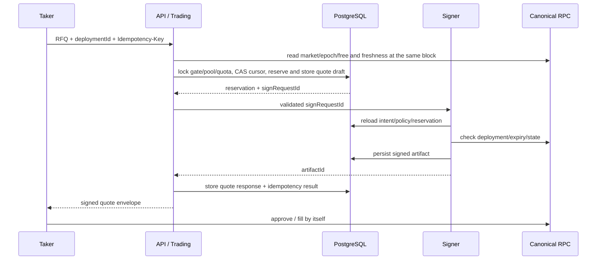

# 04 — RFQ, Signer, Indexer and Failure Recovery

_Status: historical — v0.1 team-operated design baseline (2026-09-22), largely retired by the autonomous-market redesign of 2026-10-23 (§6). Current design: docs/superpowers/specs/2026-10-23-autonomous-market-design.md._

Tasks 5/8/9/13 implemented the reorg-aware indexer, the restricted signer, RFQ reservations and the keeper/faucet dispatcher wiring. See [Indexer](../M2_CHAIN_INDEXER.md), [Signer](../M2_SIGNER.md), [RFQ](../M2_RFQ.md) and [keeper/faucet](../M3_KEEPER_FAUCET.md). The [internal trader](../M3_INTERNAL_TRADER.md) is wired to the public RFQ, reservation under the mandate lock, exact approve / fill and FINAL redeem. Each deployment supports only one trader, and the edge must strictly exceed the threshold (default 500 bps). The text below is the design baseline. Implementation differences and risks are defined by the delivery records. The private key is read only by the signer, from a mode 0600 file. The raw transaction artifact has no app-level encryption yet. Network ACL/mTLS and deployment are still to be done. Locally, only REPLAY runs, with no paid models.

## Three different states

| Entity | States | What cannot be inferred |
| --- | --- | --- |
| Quote artifact | DRAFT / SIGN_REQUESTED / SIGNED / SIGN_UNKNOWN / EXPIRED / CANCELLED / CONSUMED | SIGNED does not mean on-chain; a local EXPIRED does not mean the reservation can be released |
| Reservation | HELD / RECONCILE_REQUIRED / ACCOUNTED / RELEASED | an RPC timeout or lease loss cannot go straight to RELEASED |
| Tx attempt | CREATED / SIGNED / SUBMITTED / PRECONFIRMED / INCLUDED / FINALIZED; REVERTED / REPLACED / UNKNOWN / REORGED | UNKNOWN is not a failure; INCLUDED does not equal L1 finality |

A quote's CONSUMED/CANCELLED is the result observed in a canonical block, with a cursor attached. After a reorg it may become valid again. ACCOUNTED means the quote's spend is already reflected in the free balance at the same cursor, so the reservation is not deducted again. It does not mean "never at risk". RELEASED only means that there is currently no executable risk on the reconciled block. History is kept for reorg rebuilds.

## Quote sequence

A new cursor may appear after the RPC snapshot is taken and while waiting for the DB lock. The transaction must compare pool.version/cursor. If it changed, it drops the old snapshot and reads again. It must not combine the new free with the old consumed. The signer checks expiry and the gate again before signing, but still cannot guarantee that the maker will not withdraw later. The on-chain check is the last line of defense.

Available amount = makerFreeBalance at the same cursor − all HELD/RECONCILE_REQUIRED amounts of the same pool. ACCOUNTED/RELEASED are not deducted again. When LIVE and REPLAY share the same contract maker free, they must share one fund pool, even though the pricing snapshots and statistics are separate. Each must not treat all of free as available.

The price uses only the most recent closed same-window snapshot in which both fixed platform forecasters are eligible and the age is <=24h. Baseline/external forecasts are not added to the platform average. Probability uses integer millionths: p=(p1+p2)/(2*1000000). The ceil of the YES ask is computed with integer rational arithmetic. NO uses the complement over the same denominator, then adds 200 and clamps to 1..9999.

validAfter is generated from the verified canonical block timestamp, and expiry=min(validAfter+30,closeAt). If at response time the quote has already expired or the remaining time is not enough to use it, return NO_QUOTE and keep the existing artifact/reservation until reconciliation. The same digest must not be extended quietly. Clock drift raises an alert, and the policy does not take the client clock as truth.

## Signer internal protocol

Only a private-network mTLS service identity can call it. Routes are split by role. The research worker identity has no sign scope at all. An allowed request carries only the signRequestId/intentId and the expected payload hash. It does not accept arbitrary calldata or a key selector from the caller.

Caller → role allowlist:
- quote API: maker quote. Maker withdraw/epoch/cancel automation is not allowed.
- execution worker: approveExact/fillQuote/redeem of the specific internal trader.
- keeper worker: finalizeUnchallenged/finalizeTimeout.
- faucet worker: TestUSD mint for an approved claim.
- ADMIN/proposer/challenger/arbiter: not in the service scope, manual wallet.

The signer reloads the deployment manifest, the fixed to/chain/from, the intent, the reservation and the policy version. It encodes with the ABI itself and checks gas / expiry / amount. It rejects arbitrary ETH value, an unknown selector, an unlimited approval, a wrong token/market, an expired lease or a cancelled intent. Each role has its own key and nonce guard. A maker quote signature does not consume a transaction nonce.

The sign request unique key prevents two artifacts. A retry returns the same artifact. The signature and the DB cannot be committed atomically. The implementation must first persist the request and the canonical payload, then sign, and reply externally only after the artifact is saved. If a crash happens after signing but before saving, the same digest / same unsigned transaction can be rebuilt. Changing the payload or allocating a new nonce is forbidden.

Persisting the signed artifact and the "can be sent by the dispatcher" state happen in the same transaction. Transactions are sent only from a saved artifact. Signing and broadcasting at the same time is not allowed. If a single intent needs a replacement, create a new versioned attempt that keeps the same nonce and the same economic calldata, adjusts only gas, and reserves the gas upper bound again.

## Reservation release

| Observation | Handling |
| --- | --- |
| signing RPC timeout / response lost | SIGN_UNKNOWN + HELD, look up the signRequest artifact, do not sign a new quote |
| expiresAt is past the local time | show as expired, keep the funds until the canonical block is reconciled |
| consumed=true at the same block | update free/positions with that block, then set the reservation to ACCOUNTED |
| cancelled=true at the same block, or the epoch is invalidated, and consumed=false | reconcile free, then RELEASED |
| canonical block timestamp>=expiresAt and consumed=false | reconcile free at the same block, then RELEASED |
| maker free drops / pool inconsistent | close the gate, keep the unresolved risk, alert, reconcile withdrawals/fills |
| provider disconnected / finality unknown | keep the risk; unknown finality must not be faked as FINALIZED |

The latest canonical INCLUDED can serve as the temporarily usable state for v0.1. Every reserve/release/accounting carries a block hash. If a reorg withdraws that block, first close the gate, rebuild its pool/reservations, then open it again. RELEASED must not be treated as an irreversible terminal state. An old quote may become valid again after a reorg and must be counted again. If it then exceeds the amount, stop signing new ones. The contract cannot atomically block an external wallet fill, but the contract still guarantees the actual collateral.

## Indexer

Each deployment holds a lease with a fencing token and stores the applied block hash/number. The sync flow:
1. Fetch the header and confirm parent = the current cursor. If not, find the common ancestor first.
2. Pull the logs of the specified contract addresses for that range, verify the ABI/hash, and sort by blockNumber/transactionIndex/logIndex.
3. In the same DB transaction, store the blocks/events, update the market/position/quote/outcome/escrow projections and the cursor according to the events. The event unique key includes blockHash.
4. Additionally cross-check makerFree/escrow/positions with contract reads at the same block. Reads are located by block hash. If the provider does not support that, use the block number and check the header before and after, and discard on any change.
5. Finality comes from the finalized tag of a verified provider. If it has no such capability, mark UNKNOWN.
6. The RFQ gate checks latest head lag>3 OR last successful update>10s, and stops when either holds. Polling starts at 1 second. It is an engineering parameter and not a finality promise.

Reorg: close the gate first → mark events after the ancestor as noncanonical and keep them → rebuild the affected projections from the nearest trusted checkpoint or the deployment block → sync the new branch → reconcile all unfinalized quote/tx/reservation at the same cursor → update the cursor/gate atomically.

Event actions use idempotent reducers. QuoteFilled adds the correct opposite side to each of the two parties. PositionRedeemed clears the remaining balance. Share counts must not be derived from the transaction status alone. MakerRedeem does not add free. Only deposit/withdraw/fill affect free.

If a contradiction crosses a checkpoint already marked finalized, stop automatic recovery and alert for a manual check of the provider. Historical finalized data is never quietly changed into a different result.

## Transaction submission and recovery

For each sender, lock the nonce guard first, read the pending/latest nonce and reconcile it with the DB allocations, and hold the occupation. A replay can use the same raw bytes. A replacement uses the same nonce and records replacementOf. When a nonce is occupied by an unknown transaction, mark UNKNOWN and check the chain. Do not move it to a new nonce automatically to redo the original intent.

The external wallet transaction API only tracks. It does not allocate a nonce or sign for an external taker. When an internal fill is uncertain, check whether the digest is consumed, the canonical receipt, the events and the position. The position alone cannot identify a single fill, and must be linked to the digest event.

On every service restart, close the new-trade gate first. Until the reconcile is complete it is not ready. The rescue keeper / read-only queries can continue under a separate health state. A closed quote gate must not block permissionless finalize.
