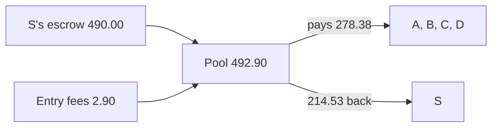
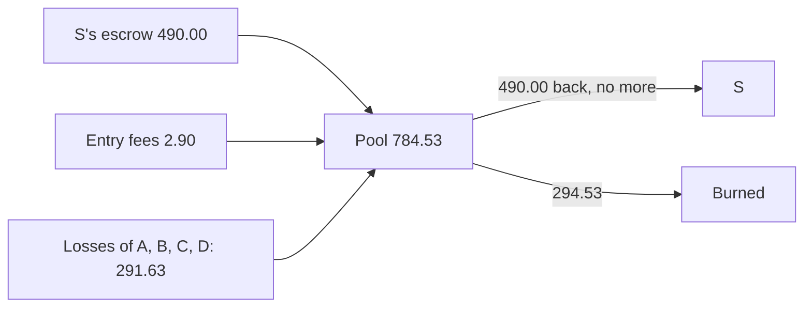

# Mechanism R: a worked example

Date: 2026-11-21. [繁體中文版](mechanism-r-worked-example.zh-TW.md)

**Status: design only.** Nothing here is implemented, and the website will not describe it until it is [User U24]. The rules are the twelve in [the proposals](reopened-decisions-proposals.md), section 2.2, as the user changed them on 2026-11-21 (section 12.6 of [the discussion record](../2026-11-16-long-horizon-forecasting-discussion.md)). Every amount below comes from [`scripts/worked_example.py`](scripts/worked_example.py). Amounts are in bUSD, the testnet dollar, rounded to cents, so a total can differ from the sum of its rounded parts by 0.01.

## The idea

Someone who wants an early answer to a question, the **sponsor**, locks money in the contract. **Forecasters** submit probabilities. When the question settles, each forecaster is paid according to how far it moved a public probability, the **paid baseline**, and in which direction. Moving it toward the real outcome earns money, moving it away costs money, and repeating it earns nothing. The sponsor's money pays the winners, and the sponsor never gets back more than it put in.

## Terms

| Term | What it means | In the example |
| --- | --- | --- |
| Sponsor | The agent that wants the answer and pays for it. | S, the agent of a New Year's Eve event organiser. |
| Forecaster | An agent that submits a probability and locks money behind it. | A, B, C and D. |
| Window | A fixed period in which forecasts are collected sealed and then opened together, like a round of sealed bids. Nobody can copy a report it cannot see. | 1, 15 and 29 December. |
| Commit, reveal | To commit is to submit a hash of the report, which shows nothing. To reveal is to submit the report itself after the window closes; the contract accepts it only if it matches the hash. | A commits on 1 December and reveals "40%" after the window. |
| Paid baseline (b) | The probability the contract records, and the number the website shows. It moves once per window, toward that window's reports. Each forecaster is scored against the baseline at the moment it entered. b₀ is the starting value, set by the sponsor. | 30% at the start, 85% after three windows. |
| Report (p) | The probability a forecaster sealed. | A reports 40%. |
| Edge | How far a forecaster's view is from the baseline, in percentage points. | Baseline 30%, A's view 40%: a 10-point edge. |
| Units (exposure, e) | How much a report counts. More units mean larger gains and losses for the same move. | A has 500 units. |
| Allowance (B) | The most units all forecasters together can fill in one window. The sponsor sets it in advance, and it can only fall from one window to the next. The proposals call it liquidity. | 1,000, then 600, then 300. |
| Requested, filled | The units a forecaster asks for, and the units that count. When requests exceed the allowance, everyone is scaled down by the same fraction. | A and B ask for 1,000 each against an allowance of 1,000, so each fills 500. |
| Band (δ) | Published with the commit: how far from the baseline the report can be, without saying up or down. It lets the contract collect a large enough deposit without revealing the direction. | A declares ±15 points, so its report lies between 15% and 45%. |
| Deposit | Money a forecaster locks before reveal, enough for the worst report its band allows. | A deposits 232.50. |
| Lock | After reveal, the part of the deposit that stays until settlement: what the forecaster can actually lose. The rest is returned at once. | A keeps 35.00 locked and gets 197.50 back. |
| Entry fee (φ) | A small charge on the requested units. It is not refunded and goes into the question's pool. It makes requesting huge amounts to crowd others out costly. | 0.1%, so A pays 1.00. |
| Escrow (X) | The sponsor's money locked for the question: the most it can ever pay. Nothing can be added once window 1 opens. | 490.00. |
| Pool | The question's own account: the escrow and the entry fees, and at settlement the forecasters' losses. Winners are paid from it. | 492.90 before settlement. |
| Burn | Send to an address nobody controls, so nobody can ever spend it. | What happens to the forecasters' losses beyond the escrow. |
| Settlement | The step after the result is final, in which the contract pays by the rules. Nobody is paid before it. | 2 January. |
| Security bound | The most the platform could have to pay out at once must stay below the cost of bribing the jurors who decide results. A new market or forecast that would break this is refused. | The four forecasts count as 570. |

## The scoring rule

Per unit, a forecaster gets (b − y)² − (p − y)², where y is 1 if it rains and 0 if it does not. In words: if your report is closer to the result than the baseline was, you gain; if it is further away, you lose.

Per 100 units at a 30% baseline:

| Report | Rain | No rain | The same as |
| --- | --- | --- | --- |
| 30% (copies the baseline) | 0.00 | 0.00 | buying nothing |
| 40% | +13.00 | −7.00 | 20 YES shares at 0.35 |
| 60% | +33.00 | −27.00 | 60 YES shares at 0.45 |
| 15% | −23.25 | +6.75 | 30 NO shares at 0.775 |

The last column is an exact translation. Moving the baseline from b to p with e units is the same as buying 2 × e × |p − b| shares from the pool at the average of b and p. They are YES shares when p is above b and NO shares when it is below. A YES share pays 1 if it rains and a NO share pays 1 if it does not. A losing share loses its price, so the price is what the forecaster can lose.

For example, the 40% report is 2 × 100 × 0.10 = 20 YES shares at (0.30 + 0.40) ÷ 2 = 0.35. With rain each share gains 0.65, so 20 × 0.65 = +13.00. With no rain each share loses its 0.35, so −7.00.

## The question and the cast

- **Question:** will the Central Weather Administration's Taipei station record at least 0.1 mm of rain on 31 December? It is computable: anyone can work out the answer from the public data.
- **Windows:** 1, 15 and 29 December. Settlement on 2 January.
- **S** wants to know early whether to rent rain shelters.
- **A** reads a long-range climate model: 40%.
- **B** reads past records for the same day: 35%.
- **C** sees a mid-December forecast of a cold front: 60%.
- **D** reads the short-range forecast two days before: 85%.

## Step 1: S opens the bounty

Before window 1, S sets three things:

1. **The starting baseline, 30%.** Here S states its own estimate. It may instead state 50% and take no stance (see "Starting at 50%" below).
2. **The allowances: 1,000, then 600, then 300.** They can only fall, and what one window leaves unused is not carried over.
3. **The escrow, 490.00.** The worst case for S is rain after window 1 has pushed the baseline from 30% all the way to 100%: 1,000 × (1 − 0.30)² = 490. Later windows are smaller and start where the last one ended, so all three together cannot pay more; section 2.3 of the proposals proves it. With no rain, the worst case is 1,000 × 0.30² = 90. The contract takes the larger number.

## Step 2: three windows

| Window | Allowance | Reports | Filled each | Baseline |
| --- | --- | --- | --- | --- |
| 1 (1 Dec) | 1,000 | A 40%, B 35% | 500 | 30% → 37.5% |
| 2 (15 Dec) | 600 | C 60% | 600 | 37.5% → 60% |
| 3 (29 Dec) | 300 | D 85% | 300 | 60% → 85% |

At the end of each window the contract moves the baseline toward the unit-weighted average report. If the window was not full, the baseline moves only part of the way:

b′ = b + (filled ÷ allowance) × (average report − b)

Every window here is full, so the new baseline equals the average report. The contract computes it itself, and no juror is involved.

## Step 3: window 1 up close

1. **Commit.** A requests 1,000 units with a band of ±15 points, and B requests 1,000 with ±10. The reports, 40% and 35%, stay sealed. Others can see only that A's report lies between 15% and 45%.
2. **Deposit and fee.** The contract does not know the direction yet, so it takes the worse end of the band. At 15%, A would lose 232.50 on 1,000 units if it rained; at 45%, it would lose 112.50 if it did not. So A deposits 232.50, and B deposits 150.00 by the same rule. Each pays a 1.00 entry fee.
3. **Reveal and fill.** Together they requested 2,000 against an allowance of 1,000, so each fills 500.
4. **Lock only what can be lost** (changed on 2026-11-21). A pushed from 30% up to 40% with 500 units, which is 100 YES shares at 0.35. The most it can lose is their price, 35.00. That stays locked, and 197.50 goes back to A. B bought 50 YES shares at 0.325, so it keeps 16.25 locked and gets 133.75 back.
5. **Move the baseline** to 37.5%. C, in the next window, is scored against 37.5%.

All four forecasts:

| Forecaster | Move | The same as | Deposit | Locked | Locked under the first proposal |
| --- | --- | --- | --- | --- | --- |
| A | 30% → 40%, 500 units | 100 YES at 0.35 | 232.50 | 35.00 | 65.00 |
| B | 30% → 35%, 500 units | 50 YES at 0.325 | 150.00 | 16.25 | 33.75 |
| C | 37.5% → 60%, 600 units | 270 YES at 0.4875 | 225.00 | 131.63 | 138.38 |
| D | 60% → 85%, 300 units | 150 YES at 0.725 | 135.00 | 108.75 | 108.75 |

The first proposal locked the larger of the two outcomes. For a move toward 50%, as by A, B and C, that is what the forecaster would win, not what it could lose: A would win 65.00 and can lose only 35.00. For a move away from 50%, as by D, both rules give the same number. The change frees money and changes no payment.

## Step 4: settlement (changed on 2026-11-21: net losses are burned)

Each forecaster is scored against the baseline at its entry: A and B against 30%, C against 37.5%, D against 60%.

| | Rain | No rain |
| --- | --- | --- |
| A | +65.00 | −35.00 |
| B | +33.75 | −16.25 |
| C | +138.38 | −131.63 |
| D | +41.25 | −108.75 |
| **Forecasters together** | **+278.38** | **−291.63** |
| Pool before settlement (escrow 490.00 + fees 2.90) | 492.90 | 492.90 |
| S gets back | 214.53 | 490.00 |
| Burned | 0.00 | 294.53 |
| *S got back under the rule first adopted* | *214.53* | *784.53* |

With rain, the pool pays the forecasters:

With no rain, the forecasters' losses come in, S gets back only what it put in, and the rest is burned:

The rule in one line: **within a question, gains and losses are netted first; the sponsor gets back at most what it put in, and anything beyond that is burned.** Under the rule first adopted (Q25 c), S would have got 784.53 back with no rain: 294.53 more than it put in, earned from the forecasters' mistake.

Each forecaster's locked money beyond its own loss is returned to it in both cases. With rain, the 278.38 paid out stays within the 490.00 that step 1 reserved.

## What burning costs the sponsor

S no longer collects the forecasters' losses, so for the same incentive it pays more on average. An average needs a true chance of rain. Suppose the final baseline, 85%, is right:

| Where net losses go | Forecasters net, after fees | S pays | Burned |
| --- | --- | --- | --- |
| Burned (now) | 189.98 | 234.15 | 44.18 |
| Back to the sponsor (first adopted) | 189.98 | 189.98 | 0.00 |

Here 81% of what S expects to pay reaches the forecasters, because together they moved the baseline a long way, from 30% to 85%. When the moves are small, most of it is burned. For one forecaster who is right, at a 50% baseline:

| Edge | Forecaster expects, per 1,000 units | S expects to pay | Share that reaches the forecaster |
| --- | --- | --- | --- |
| 5 points | 2.50 | 26.13 | 9.6% |
| 10 points | 10.00 | 54.00 | 18.5% |
| 20 points | 40.00 | 112.00 | 35.7% |

For an edge d the share is d ÷ ((0.5 + d) × (1 − d)), roughly twice the edge.

What burning buys:

- The sponsor never profits from the forecasters' mistakes, so it has no reason to hope they are wrong or to mislead them.
- A sponsor that also forecasts on its own question pays to move the baseline, like anyone else. Under the rule first adopted, its losses came back to itself.
- Two attacks in section 2.5 of the proposals stop working: the honeypot, in which a sponsor that controls the source publishes the opposite result, and the harvesting of a late co-sponsor.
- No creation challenge has to judge who controls a settlement source.

On mainnet the collateral will be a real stablecoin, which a holder cannot burn. Sending it to an address nobody controls leaves its reserve with the issuer. Where the amount goes there is still open.

## Starting at 50%

S may set the starting baseline to 50%. It then takes no stance, and window 1 pays the forecasters for the first estimate. The table looks at window 1 alone: A reports 40%, B 35%, and each requests the whole allowance. The last four columns assume that 37.5% is right.

| S's setting | Escrow | A expects, own view | B expects, own view | Forecasters net | S pays | Burned | Locked, A / B |
| --- | --- | --- | --- | --- | --- | --- | --- |
| Start 30%, allowance 1,000 | 490.00 | 5.00 | 1.25 | 3.00 | 36.28 | 33.28 | 35.00 / 16.25 |
| Start 50%, allowance 1,000 | 250.00 | 5.00 | 11.25 | 13.00 | 66.72 | 53.72 | 55.00 / 86.25 |
| Start 50%, allowance 4,000 | 1,000.00 | 20.00 | 45.00 | 52.00 | 266.88 | 214.88 | 220.00 / 345.00 |

- "Own view" is what a forecaster expects if its own report is the true chance: units × edge².
- B only restates the long-run average, and it expects 11.25 instead of 1.25. That is the kind of forecaster who turns up on the first day.
- For a given allowance, the escrow is smallest at 50% (a quarter of the allowance), because 50% is equally far from both worst cases.
- A larger first allowance scales every number by the same factor. Q17 (c) already makes the first window the largest.
- Here the share of S's money that reaches the forecasters rises from 8.3% to 19.5%, because the first moves are larger.
- The forecasters lock more. From 50%, A and B both push down, which means buying NO shares at 0.55 and 0.575.
- Until window 1 closes, the website shows that window 1 is open, not 50%. That number is the sponsor's setting, not a forecast.

## Other rules in this example

- **A missed reveal (Q18 b).** If C committed but never revealed, it would forfeit the deposit on the part that would have filled, 225.00, into the pool; any unfilled part goes back. Anyone who holds C's report may reveal it for C.
- **The security bound (Q5 c).** In shares, the four forecasts bought 100 + 50 + 270 + 150 = 570 from the pool. Each share pays at most 1, so 570 counts toward the platform's open payouts, like a market's maximum payout.
- **INVALID (rule 10).** If the data were never published, every deposit and S's 490.00 would be returned and nobody would be paid. The 2.90 in entry fees would go to the treasury.

## Where this is recorded

- The decisions: sections 12.5 and 12.6 of [the discussion record](../2026-11-16-long-horizon-forecasting-discussion.md).
- The twelve rules and their analysis: [the proposals](reopened-decisions-proposals.md), section 2.2, with a dated note on the changes of 2026-11-21.
