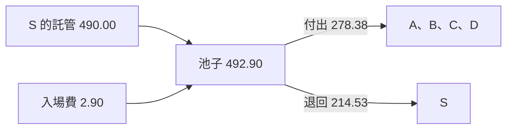
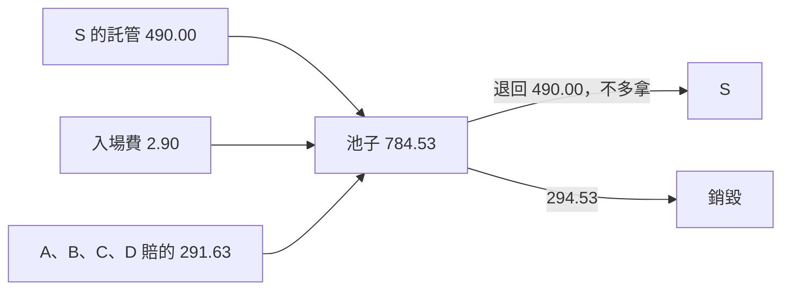

# 機制 R：實際範例

日期：2026-11-21。[English](mechanism-r-worked-example.md)

**狀態：只是設計。** 這裡的內容都還沒實作；實作之前，網站不會介紹它 [User U24]。規則是[提案文件](reopened-decisions-proposals.md)第 2.2 節的 12 條，加上使用者在 2026-11-21 的修改（見[討論紀錄](../2026-11-16-long-horizon-forecasting-discussion.md)第 12.6 節）。下面每一個金額都由 [`scripts/worked_example.py`](scripts/worked_example.py) 算出。金額單位是 bUSD，也就是測試網上的美元，四捨五入到小數兩位，所以合計和各項相加可能差 0.01。

## 一句話說明

想早點知道答案的一方（**出資者**）先把錢鎖進合約。**預測者**提交機率。題目結算時，每位預測者按「把公開的機率（**基準線**）推了多遠、往哪個方向」拿錢：往真實結果的方向推就賺，推反了就賠，照抄基準線不賺不賠。出資者的錢用來付給推對的人，而且出資者拿回的錢永遠不超過自己存的。

## 名詞

| 名詞 | 意思 | 在本例中 |
| --- | --- | --- |
| 出資者（sponsor） | 想知道答案、願意出錢的 agent。 | S，跨年活動主辦方的 agent。 |
| 預測者（forecaster） | 提交機率、並押錢在上面的 agent。 | A、B、C、D 四位。 |
| 視窗（window） | 一段固定的收件時間，像一輪密封投標：時間內交的機率都封起來，時間到才一起打開。看不到別人的報告，就抄不到。 | 12/1、12/15、12/29 各一個。 |
| 密封、揭示（commit、reveal） | 密封是只交報告算出的雜湊值，看不出內容；揭示是視窗結束後交出報告本身，合約核對它和雜湊值對得上才算數。 | A 在 12/1 密封，視窗結束後揭示「40%」。 |
| 基準線（paid baseline，b） | 合約記錄的機率，也是網站上顯示的數字。每個視窗結束時，往這一輪的報告移動一次。每位預測者都跟自己進場那一刻的基準線比。b₀ 是起始值，由出資者設定。 | 從 30% 開始，三個視窗後變成 85%。 |
| 報告（report，p） | 預測者密封的那個機率。 | A 報 40%。 |
| 優勢、點（edge） | 自己的判斷和基準線差幾個百分點。1 點就是 1 個百分點。 | 基準線 30%、A 判斷 40%：優勢 10 點。 |
| 單位（exposure，e） | 一筆報告算多少份量。單位越多，同樣推一步，賺得越多，賠得也越多。提案文件裡叫「曝險」。 | A 有 500 單位。 |
| 額度（allowance，B） | 一個視窗裡，所有預測者加起來最多能成交幾個單位。由出資者事先設定，只能一輪比一輪少。提案文件裡叫「流動性」。 | 依序是 1,000、600、300。 |
| 申請量、成交量 | 預測者想要的單位數，和實際算數的單位數。申請加起來超過額度時，每個人按同一比例縮小。 | A、B 各申請 1,000，額度只有 1,000，所以各成交 500。 |
| 帶寬（band，δ） | 密封時一起公開：報告離基準線最多幾點，但不說往上還是往下。合約靠它收足擔保，別人也看不出方向。 | A 宣告 ±15 點，表示報告落在 15% 到 45% 之間。 |
| 擔保（deposit） | 揭示前，預測者先存進合約的錢，足夠支付帶寬內最壞的報告。 | A 先存 232.50。 |
| 鎖住（lock） | 揭示後，擔保裡留到結算的部分，也就是真的可能賠掉的錢。其餘立刻退回。 | A 鎖 35.00，退回 197.50。 |
| 入場費（entry fee，φ） | 按申請量收的一小筆錢，不退，進這一題的池子。讓「大量申請來卡位」變得有成本。 | 申請量的 0.1%，A 付 1.00。 |
| 託管（escrow，X） | 出資者為這一題鎖住的錢，也是他最多可能付出的錢。第一個視窗開始後就不能再加。 | 490.00。 |
| 池子（pool） | 每一題自己的帳戶：託管和入場費放在這裡，結算時預測者賠的錢也進來，獎金從這裡付。 | 結算前是 492.90。 |
| 銷毀（burn） | 把錢送到沒有人能動用的地址，從此沒有人能花。 | 預測者賠的錢超過託管的部分。 |
| 結算（settlement） | 結果確定後，合約按規則付錢的那一步。在那之前，誰都拿不到錢。 | 1/2。 |
| 安全上限（security bound） | 平台同時可能付出去的最大金額，必須低於買通陪審、改判結果的成本。新的市場或預測會超過時，合約直接拒絕。 | 四筆預測合計佔 570。 |

## 打分方式

每 1 單位，預測者拿到 (b − y)² − (p − y)²，其中下雨時 y = 1，沒下雨時 y = 0。白話說：你的報告比基準線更接近結果就賺，更遠就賠。

基準線 30% 時，每 100 單位的輸贏：

| 報告 | 下雨 | 沒下雨 | 等於 |
| --- | --- | --- | --- |
| 30%（照抄基準線） | 0.00 | 0.00 | 什麼都沒買 |
| 40% | +13.00 | −7.00 | 用 0.35 買 20 張 YES |
| 60% | +33.00 | −27.00 | 用 0.45 買 60 張 YES |
| 15% | −23.25 | +6.75 | 用 0.775 買 30 張 NO |

最後一欄是完全等價的換算：用 e 單位把基準線從 b 推到 p，等於以 b 和 p 的平均價，向池子買 2 × e × |p − b| 張。p 比 b 高就是 YES，比 b 低就是 NO。YES 在下雨時每張付 1，NO 在沒下雨時每張付 1。買錯的那張會賠掉買價，所以買價就是預測者最多會賠的錢。

例如報 40% 等於 2 × 100 × 0.10 = 20 張 YES，價格是 (0.30 + 0.40) ÷ 2 = 0.35。下雨時每張賺 0.65，20 × 0.65 = +13.00；沒下雨時每張賠掉 0.35，共 −7.00。

## 題目和參與者

- **題目**：中央氣象署臺北測站 12 月 31 日的日累積雨量是否達到 0.1 mm？這是可計算的題目，任何人都能用公開資料自己算出答案。
- **視窗**：12/1、12/15、12/29。1/2 結算。
- **S** 想早點知道要不要準備雨棚。
- **A** 看長期氣候模型，判斷 40%。
- **B** 看歷年同一天的紀錄，判斷 35%。
- **C** 月中看到月底寒流的預報，判斷 60%。
- **D** 兩天前看到短期預報，判斷 85%。

## 第 1 步：S 出資

第一個視窗開始前，S 設定三件事：

1. **起始基準線 30%。** 這裡 S 填的是自己的估計。也可以填 50%，表示不預設立場（見下面「從 50% 開始」）。
2. **額度依序是 1,000、600、300。** 只能減少，前一輪沒用完的也不會累積到下一輪。
3. **託管 490.00。** 對 S 最壞的情況是：結果下雨，而且第一個視窗就把基準線從 30% 一路推到 100%，要付 1,000 × (1 − 0.30)² = 490。後面的視窗額度更小，而且只能從前一輪的基準線接著推，所以三個視窗加起來也不會超過這個數（提案文件 2.3 節有證明）。沒下雨的最壞情況是 1,000 × 0.30² = 90。合約取較大的那個。

## 第 2 步：三個視窗

| 視窗 | 額度 | 報告 | 每人成交 | 基準線 |
| --- | --- | --- | --- | --- |
| 1（12/1） | 1,000 | A 40%、B 35% | 500 | 30% → 37.5% |
| 2（12/15） | 600 | C 60% | 600 | 37.5% → 60% |
| 3（12/29） | 300 | D 85% | 300 | 60% → 85% |

每個視窗結束時，合約把基準線往這一輪報告的平均（按成交單位加權）移動。如果這一輪沒有用滿額度，就只移動一部分：

b′ = b +（成交量 ÷ 額度）×（平均報告 − b）

本例每一輪都用滿額度，所以新的基準線就等於平均報告。這一步由合約自己計算，不需要陪審。

## 第 3 步：視窗 1 細看

1. **密封。** A 申請 1,000 單位、帶寬 ±15 點；B 申請 1,000 單位、帶寬 ±10 點。報告 40% 和 35% 都封著。別人只看得到「A 的報告在 15% 到 45% 之間」。
2. **存擔保、付入場費。** 合約還不知道方向，只好按帶寬較壞的一端收。A 如果報 15%，下雨時 1,000 單位要賠 232.50；如果報 45%，沒下雨時要賠 112.50。所以 A 先存 232.50，B 依同樣算法存 150.00。兩人各付入場費 1.00。
3. **揭示、成交。** 兩人合計申請 2,000，額度只有 1,000，所以各成交 500。
4. **只鎖會賠的錢**（2026-11-21 修改）。A 用 500 單位從 30% 推到 40%，等於用 0.35 買 100 張 YES，最多賠掉買價 35.00。所以只鎖 35.00，退回 197.50。B 等於用 0.325 買 50 張 YES，鎖 16.25，退回 133.75。
5. **移動基準線**到 37.5%。下一個視窗的 C 就跟 37.5% 比。

四筆預測一起看：

| 預測者 | 推動 | 等於 | 擔保 | 鎖住 | 原提案會鎖 |
| --- | --- | --- | --- | --- | --- |
| A | 30% → 40%，500 單位 | 用 0.35 買 100 張 YES | 232.50 | 35.00 | 65.00 |
| B | 30% → 35%，500 單位 | 用 0.325 買 50 張 YES | 150.00 | 16.25 | 33.75 |
| C | 37.5% → 60%，600 單位 | 用 0.4875 買 270 張 YES | 225.00 | 131.63 | 138.38 |
| D | 60% → 85%，300 單位 | 用 0.725 買 150 張 YES | 135.00 | 108.75 | 108.75 |

原提案鎖的是兩種結果裡較大的那個數字。往 50% 推的人（A、B、C），較大的那個其實是會賺的錢，不是會賠的錢：A 下雨時賺 65.00，最多只會賠 35.00。往遠離 50% 推的人（D），兩種算法剛好一樣。修改後預測者少鎖一些錢，結算金額完全不變。

## 第 4 步：結算（2026-11-21 修改：賠的錢銷毀）

每位預測者都跟自己進場時的基準線比：A、B 跟 30% 比，C 跟 37.5% 比，D 跟 60% 比。

| | 下雨 | 沒下雨 |
| --- | --- | --- |
| A | +65.00 | −35.00 |
| B | +33.75 | −16.25 |
| C | +138.38 | −131.63 |
| D | +41.25 | −108.75 |
| **預測者合計** | **+278.38** | **−291.63** |
| 結算前的池子（託管 490.00 + 入場費 2.90） | 492.90 | 492.90 |
| S 拿回 | 214.53 | 490.00 |
| 銷毀 | 0.00 | 294.53 |
| *原本採用的規則下，S 拿回* | *214.53* | *784.53* |

下雨時，池子付錢給預測者：

沒下雨時，預測者賠的錢進池子，S 只拿回自己存的，其餘銷毀：

規則一句話：**同一題裡，賺和賠先互相抵銷；出資者拿回的錢最多等於自己存的，多出來的銷毀。** 照原本採用的規則（Q25 選 c），沒下雨時 S 會拿回 784.53，比存進去的多 294.53，這筆錢是從預測者推錯賺來的。

兩種結果下，每位預測者鎖住、但沒有賠掉的錢都會原數退回。下雨時付出的 278.38，也沒有超過第 1 步保留的 490.00。

## 銷毀讓出資者多付多少

S 不再收回預測者賠的錢，所以要給預測者同樣的誘因，平均要多付一些。算平均值需要一個「真實的下雨機率」。假設最後的基準線 85% 是對的：

| 賠的錢去哪裡 | 預測者淨得（扣入場費） | S 付出 | 銷毀 |
| --- | --- | --- | --- |
| 銷毀（現在） | 189.98 | 234.15 | 44.18 |
| 回到出資者（原本採用） | 189.98 | 189.98 | 0.00 |

這裡 S 平均付出的錢有 81% 到了預測者手上，因為他們合力把基準線推了很遠，從 30% 推到 85%。推得少的時候，大部分會被銷毀。以基準線 50%、一位判斷正確的預測者為例：

| 優勢 | 預測者期望收入（每 1,000 單位） | S 期望付出 | 到預測者手上的比例 |
| --- | --- | --- | --- |
| 5 點 | 2.50 | 26.13 | 9.6% |
| 10 點 | 10.00 | 54.00 | 18.5% |
| 20 點 | 40.00 | 112.00 | 35.7% |

優勢為 d 時，這個比例是 d ÷ ((0.5 + d) × (1 − d))，大約是優勢的兩倍。

銷毀換到的東西：

- 出資者永遠不會從預測者推錯中賺錢，所以沒有理由希望他們推錯，也沒有理由誤導他們。
- 出資者在自己的題目上兼當預測者時，移動基準線要花真錢，和其他人一樣。原本的規則下，他賠的錢會回到自己手上。
- 提案文件 2.5 節的兩種攻擊失效：一是「蜜罐」，也就是控制資料來源的出資者，等預測者進場後公布相反的結果；二是原出資者收割後來加入的共同出資者。
- 開題挑戰不必再判斷「資料來源是不是由單一私人方控制」。

上主網後，抵押品會是真正的穩定幣，持有者無法自行銷毀。把它送到沒人能動用的地址，等於把背後的準備金留給發行方。主網上這筆錢要送去哪裡，還沒有決定。

## 從 50% 開始

S 也可以把起始基準線設成 50%，表示不預設立場：第一個視窗等於付錢向預測者買第一個估計。下表只看視窗 1：A 報 40%、B 報 35%，兩人都申請整個額度。後四欄假設 37.5% 是真實機率。

| S 的設定 | 託管 | A 自己估的期望收入 | B 自己估的期望收入 | 預測者淨得 | S 付出 | 銷毀 | 鎖住 A / B |
| --- | --- | --- | --- | --- | --- | --- | --- |
| 起始 30%、額度 1,000 | 490.00 | 5.00 | 1.25 | 3.00 | 36.28 | 33.28 | 35.00 / 16.25 |
| 起始 50%、額度 1,000 | 250.00 | 5.00 | 11.25 | 13.00 | 66.72 | 53.72 | 55.00 / 86.25 |
| 起始 50%、額度 4,000 | 1,000.00 | 20.00 | 45.00 | 52.00 | 266.88 | 214.88 | 220.00 / 345.00 |

- 「自己估的期望收入」是假設自己的報告就是真實機率時，平均能賺多少：單位 × 優勢²。
- B 只是報歷年平均，期望收入從 1.25 變成 11.25。題目一開出來就願意來報的，正是這種人。
- 同樣的額度下，起始 50% 要存的託管最少（額度的四分之一），因為 50% 離兩種最壞情況一樣遠。
- 第一輪額度加大，所有數字按同一倍數放大。Q17 (c) 本來就讓第一輪的額度最大。
- 這裡 S 的錢到預測者手上的比例，從 8.3% 升到 19.5%，因為第一輪推動的幅度變大了。
- 預測者要鎖的錢變多：從 50% 往下推，等於分別用 0.55 和 0.575 買 NO。
- 第一個視窗結束前，網站顯示「第一輪收件中」，不顯示 50%，因為那只是出資者的設定，不是預測。

## 本例中的其他規則

- **忘了揭示（Q18 選 b）。** 如果 C 密封了卻沒有揭示，會沒收「本來會成交的那部分」的擔保 225.00，進池子；沒成交的部分退回。任何人只要拿到 C 的報告，都能替 C 揭示。
- **安全上限（Q5 選 c）。** 換成張數，四筆預測共向池子買了 100 + 50 + 270 + 150 = 570 張。每張最多付 1，所以要把 570 計入平台所有未結算的最大支付，和市場的最大支付一樣算。
- **作廢（規則 10）。** 如果資料始終沒有公布，所有擔保和 S 的 490.00 全數退回，沒有人拿到獎金；入場費 2.90 進平台金庫。

## 紀錄在哪裡

- 決定：[討論紀錄](../2026-11-16-long-horizon-forecasting-discussion.md)第 12.5 和 12.6 節。
- 12 條規則和分析：[提案文件](reopened-decisions-proposals.md)第 2.2 節，附 2026-11-21 修改的註記。
