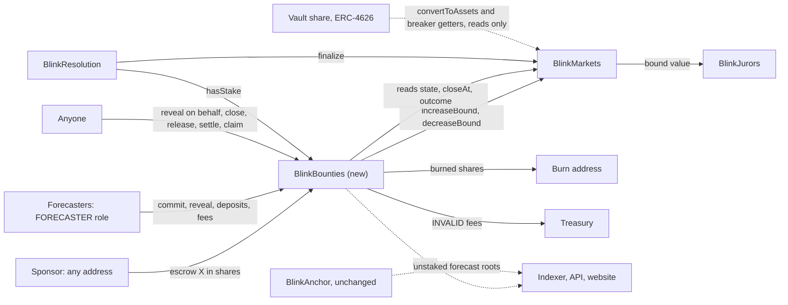
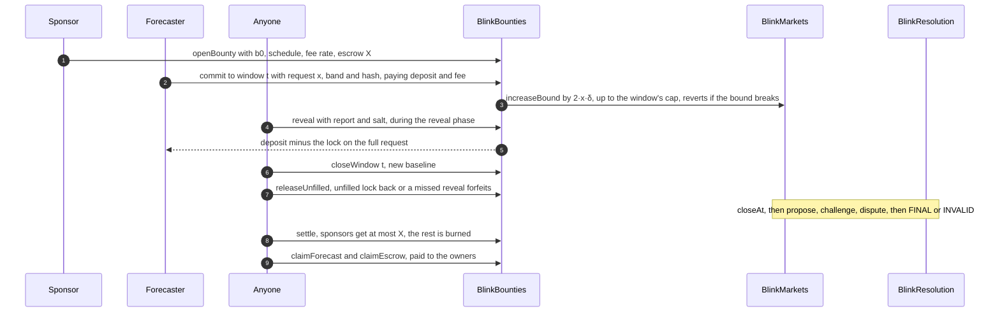
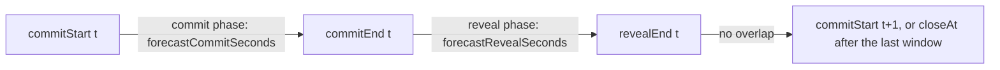

# Next contract generation: design spec

Date: 2026-11-23. Status: reviewed design (2026-11-27); the user decided the open questions of §10 on 2026-11-26. Nothing here is implemented, and the website will not describe it until it is built [User U24].

This spec turns the confirmed long-horizon decisions into a design for Blink's next contract generation, together with the off-chain changes that go with it. Blink's contracts have no admin and cannot be upgraded, so a change ships as a new deployment generation (record §10).

## 1. Purpose, scope and precedence

### 1.1 Purpose

The spec has two uses:

1. An executable reference model and the Q13 attack simulation are written from it (§9.4, §9.7).
2. An implementation plan follows from it, with tests written first (§9.1).

It is a design, not code. Where the sources left a choice open, the spec did not make it: it stated an open question in §10, with options, costs and a recommendation. The user decided every one of them on 2026-11-26, and the spec writes each decided option as design, citing it as OQ-n (x) where the choice matters.

### 1.2 Scope

- **Contracts.**
  - A new contract, `BlinkBounties`, for Mechanism R.
  - Changes to `BlinkMarkets`, `BlinkJurors`, `BlinkResolution`, `BlinkRegistry` and `BlinkTypes`.
  - A mock vault for the testnet, and mocks for tests.
- **Off-chain.** The indexer and the API, the consensus display, the reference agents, and the website once the contracts are built.

What is out of scope is listed in §11.

### 1.3 Sources and precedence

Sources, in order of precedence:

1. The [discussion record](2026-11-16-long-horizon-forecasting-discussion.md): §§12.5–12.13 first, then §§4–10.
2. The [long-horizon review](2026-11-17-long-horizon-review/README.md):
   - the [proposals](2026-11-17-long-horizon-review/reopened-decisions-proposals.md), whose section 2.2 states Mechanism R;
   - the [Mechanism R worked example](2026-11-17-long-horizon-review/mechanism-r-worked-example.md);
   - the [reconfirmed decisions with worked examples](2026-11-17-long-horizon-review/reconfirmed-decisions-worked-examples.md), rounds 1 to 5;
   - the [vault permissions survey](2026-11-17-long-horizon-review/vault-permissions-survey.md);
   - the scripts in `scripts/`, for example [`worked_example.py`](2026-11-17-long-horizon-review/scripts/worked_example.py).
3. The [governing design](2026-10-23-autonomous-market-design.md).
4. The current code, cited by file and line.

For awareness only: the [roadmap](../../ROADMAP.md), whose mainnet prerequisites are out of scope, and the [P5 design](2026-11-01-p5-red-team-design.md).

Two rules decide between sources:

- A later dated decision overrides an earlier text.
- An italic *Changed*, *Refined* or *Confirmed* note overrides the table text it follows.

§2.2 lists every override. §2.3 lists the conflicts and gaps that the dates do not settle.

**Citations.**

- "Record 12.6 item 3" is section 12.6, item 3 of the discussion record.
- "Rule 9" is rule 9 of Mechanism R in proposals 2.2 (lines 101–112), as changed on 2026-11-21 (lines 116–121, record 12.6).
- "Worked example" is the Mechanism R worked example; "round 3" is the round 3 section of the reconfirmed decisions; "survey 4.1" is section 4.1 of the vault survey.
- Code is cited as `path:line` from the repository root.

### 1.4 Notation and units

| Symbol | Meaning | Unit |
| --- | --- | --- |
| W | 10^18, the fixed-point scale of probabilities and rates (WAD) | — |
| base unit | one base unit of the vault share token; every amount is a whole number of base units | — |
| UNIT | one whole share, 10^d base units, where d is the share token's decimals | base units |
| y | the outcome, YES or NO | — |
| b, b_t, b₀ | the paid baseline; its value at the start of window t; the starting value the sponsor sets | WAD |
| p | a forecaster's report after clamping to its band | WAD |
| δ | the band: the report lies within b ± δ | WAD |
| x | the exposure a forecaster requests | base units |
| e | the exposure that fills: e = x · min(1, B_t ÷ R_t) | base units |
| B_t | the allowance: the most exposure window t can fill | base units |
| T | the number of windows | count |
| R_t | the requests revealed in window t, Σ x | base units |
| E_t | the filled exposure, min(R_t, B_t) | base units |
| P_t | Σ x·p over window t's revealed commits | base units × WAD |
| m_t | the mean revealed report, P_t ÷ R_t | WAD |
| H_t | the window's total deviation, Σ x·\|p − b_t\| over its revealed commits | base units × WAD |
| X | the escrow, the sum of the sponsors' deposits | base units |
| φ | the entry-fee rate | WAD |
| F, M | the entry fees and the missed-reveal forfeits a bounty has collected | base units |
| G_y, L_y | the settlement totals for outcome y, summed over windows: what the forecasters on the right side gain, and what those on the wrong side lose (§4.2.6) | base units |
| S1, S2 | the bound ledger: Σ boundShares over open markets, and Σ boundShares × hardDeadline (§4.3) | base units; base units × seconds |
| hwm | the highest share price recorded for the bound (§4.3; OQ-11) | asset base units per UNIT |
| ρ | the interest-reserve rate per year (OQ-11) | WAD per year |
| YEAR | 365 days | seconds |

**Names.**

- "Shares" alone means vault shares, the collateral. A market's YES and NO shares are "outcome shares".
- In the rain example, A, B, C and D are forecasters and S is the sponsor, as in the worked example. The spec writes "forecaster B" or "sponsor S" wherever the letter could be read as a symbol; B on its own is an allowance.
- The mover and the maker of the Q19 example are written out.
- w(p, b) is the proposals' worst-loss function (§2.3, C-2). W is always 10^18.

**The scoring rule.** Per unit of exposure, a forecaster receives L(b, y) − L(p, y), with L(p, y) = (p − y)². This is the payout of record 6.2 with the sign corrected in its review note (record line 79).

**Equivalent outcome shares.** Moving the baseline from b to p with e units is the same as buying 2e|p − b| outcome shares at the price (b + p) ÷ 2: YES when p > b, NO when p < b (proposals 2.0, line 81; worked example, "The scoring rule"). Per unit, the gain if those outcome shares win and the loss if they lose are:

| Case | Gain per unit, paid if the move was right | Loss per unit, kept if it was wrong |
| --- | --- | --- |
| p > b | (p − b)(2 − p − b), paid on YES | (p − b)(p + b), kept on NO |
| p < b | (b − p)(p + b), paid on NO | (b − p)(2 − p − b), kept on YES |

The gain and the loss add up to 2|p − b|, the number of equivalent outcome shares per unit. In WAD arithmetic the spec writes them as numerators over W²: gainNum and lossNum.

Worked: forecaster A moves the baseline from 30% to 40% with 500 units (worked example, step 3). That is 100 YES outcome shares at 0.35: a gain of 500 × 0.10 × 1.30 = 65.00 on rain, and a loss of 500 × 0.10 × 0.70 = 35.00 with no rain.

### 1.5 Assumptions

The spec makes these choices where the sources are silent and the choice has little effect on the mechanism. A choice with a material effect is an open question instead (§10). Each assumption is settled by this spec, except A-2 and A-3, which the user decided (OQ-25, OQ-21).

- **A-1. One share for everything.** Trading collateral, role stakes, registration fees, bonds, trading fees and juror rewards are in the same vault share as the bounty. Record 12.12 says that "a whole generation accounts in one interest-bearing vault share" (record line 347), and lists forecaster collateral, escrow, payouts and the bound. The spec reads "a whole generation" as including the rest. This moves the record's sybil costs, the registration fee and the role stake (record 12.8 item 1), into a share whose value grows.
- **A-2. One bounty per market** (user decision, OQ-25). The spec's layout has one bounty per market, which co-sponsors join (OQ-4 (c)). Because any address can open that bounty first, a cheap bounty can squat a market (T-44); OQ-25 (c) sets limits on it.
- **A-3. Only an OPEN market can be funded** (user decision, OQ-21).
- **A-4. Every window ends by the market's `closeAt`.** No window is still open when a result is proposed, because a proposal needs `block.timestamp ≥ closeAt` (`contracts/src/protocol/BlinkResolution.sol:128`).
- **A-5. One commit per forecaster identity per window.**
- **A-6. Committing requires the FORECASTER role** in the registry (`contracts/src/protocol/BlinkTypes.sol:4`); revealing does not. The sybil costs the record uses (12.8: about 10 bUSD of registration fee plus a refundable 100 bUSD each) are the costs of that role (`packages/schemas/src/protocol-params.ts:85–86`).
- **A-7. Rounding.** Every amount follows the rounding rules of §4.0. The contract also has a solvency guard that the proof in §4.2.13 says never fires.
- **A-8. Juror conflicts.** Rule 12's "a forecast position or sponsor escrow on that question" is read as "ever committed a forecast on the market or ever deposited escrow for it". This excludes slightly more addresses than "holds one now". It also lets a juror conflict itself out of a dispute with a dust commit, or a small `addEscrow` before window 1, which needs no role, while its stake still counts toward the quorum (T-45, OQ-29).
- **A-9. Two-step refund.** The deposit is returned in two steps (conflict C-3).
- **A-10. The Q19 query** takes the size of the drag as an argument and rounds both costs down.
- **A-11. Lazy closing.** Anyone may close a window once it is due. `commit`, `releaseUnfilled` and `settle` first close any due windows.
- **A-12. Exact intake.** A transfer in is checked by the change in the contract's balance, and a mismatch reverts.
- **A-13. Commitment fields.** A commitment binds the chain, the contract, the market, the window and the forecaster (§4.2.5).
- **A-14. Even-count median.** The median of an even number of forecasts is the mean of the two middle ones, rounded half up to a basis point.
- **A-15. A second reveal of the same commit reverts.**
- **A-16. Testnet burn address.** On the testnet, burned shares go to a fixed address that nobody controls. The mainnet destination is OQ-1.
- **A-17. Price rounding.** The share price used for the bound is rounded up: `convertToAssets` of one whole share, plus one base unit of the asset. The high-water mark paired with it is OQ-11 (ii).

## 2. Decision trace

### 2.1 Decisions and where they are implemented

| Decision | Settled in | What the generation does | Spec |
| --- | --- | --- | --- |
| Q2 The problem restated | Record 12.7 (Q2) | On a funded question the early number is the paid baseline: every move of it is staked and is scored only once the parent settles. | §5.3 |
| Q5 (c) Conditions for direction 3 | Record 12.5; proposals Q5 (lines 241–247) | Each forecast position counts toward the security bound as 2 × exposure × deviation (2xδ before reveal). The contract computes the baseline, outside arbitration. Juror conflicts cover forecast positions and escrow. Everything is refunded on INVALID. | §4.2.4–4.2.8, §4.3, §4.6, OQ-29 |
| Q6 Merge | Deferred (record 12.5, 12.12) | Forecast positions stay non-transferable, so merge stays irrelevant. | §11 |
| Q7 (b) Interest-bearing collateral | Record 12.5; confirmed 12.12; kept 12.13 | The generation accounts in one vault share, and pays payouts and refunds in shares without ever redeeming. The testnet uses a mock vault. | §4.1, §4.11 |
| Q8 (a) No scoring before the parent settles | Record §5 (line 46); kept in 12.5 | Nothing is paid before FINAL, and positions cannot be transferred. | §4.2.9, I-16 |
| Q9 (c) and (d) Credit by relative score | Record 12.5; confirmed 12.8 | Credit is a pass-or-fail threshold against the paid baseline. Only staked forecasts on funded questions earn it, and at most one entry per question counts. | §4.9, §5.3 |
| Q10 (c), refined; (d) kept | Record 12.5; refined 12.6 item 2; confirmed 12.9 | A funded question shows the paid baseline, and shows window 1 as open from its start until it closes (the start is commitStarts[0], OQ-25). An unfunded question shows the median of qualified forecasters, labelled "unstaked", or only the list. | §5.3, OQ-25 |
| Q13 Staging | Record §8 (line 153, note of 2026-11-23) | Mechanism R enters the generation only after the attack simulation, which uses scripted strategies and LLM participants. The user approves the cost of the LLM runs first. | §9.7 |
| Q14 (c), refined | Record 12.5; 12.6 item 3 | The allowance and the escrow are separate numbers. The deposit covers the worst report the band allows (its form at a clamped band end is the loss form, OQ-28); after reveal only the losing side stays locked. | §4.2.4–4.2.7, OQ-28 |
| Q15 (c) Entry fee | Record 12.5 | A fee of φ·x on the requested exposure, not refunded, paid into the question's pool. φ is set by the sponsor within the protocol's bounds. | §4.2.4, OQ-2 |
| Q16 (b) No creator default bounty | Record 12.5; confirmed 12.8 | There is no default path from the creator's fees. A creator funds like any sponsor, and nobody tops up after window 1 opens. | §4.2.3, OQ-4, OQ-25 |
| Q17 (c) Allowance schedule | Record 12.5 | The allowance never rises and has no rollover; the schedule is strictly decreasing. | §4.2.3, I-2, OQ-3 |
| Q18 (b) Missed reveal | Record 12.5; record 6.3 (line 96) | Staked forecasts are committed and revealed on-chain. A missed reveal forfeits the deposit on the part that would have filled. Anyone may reveal with the preimage. Unstaked forecasts stay on the off-chain windows. | §4.2.5, §4.2.7, §4.8, OQ-6, OQ-26 |
| Q19 (c) Published cost of manipulation | Record 12.5; confirmed 12.10 | A read-only query returns the raw numbers, the certain cost and the cost with a counterparty. | §4.10 |
| Q20 (b) Sub-markets | Record 12.5; confirmed 12.9 | There is no fallback from the long credit bucket to the short one. | §4.9 |
| Q21 (c), Q12 The first experiment | Record 12.11 | Not part of the generation. | §11 |
| Q22 The sponsor | Record 12.7 | Any address may sponsor. Before window 1 it sets b₀, the schedule and φ; it judges nothing and never gets back more than it put in. | §4.2.3, OQ-8, OQ-25 |
| Q23 (c), partly withdrawn | Record 12.5; 12.6 item 1 | No new ground for a creation challenge. The pollster guidance stays as documentation. | §4.6 |
| Q24 Funding existing markets | Record 12.7 | A sponsor funds an existing market, deposits the whole escrow and states its settings before window 1, and adds nothing afterwards. Identity is shown by a mechanically checkable proof. | §4.2.3, OQ-8, OQ-21, OQ-25 |
| Q25 Net losses | Record 7.2 (line 134), then 12.5, then 12.6 item 1, then 12.12 (line 349) | Gains and losses are netted within a question. Net losses are burned on every question, and a sponsor never gets back more than it deposited, counted in shares. The market's resolution source and the sponsors' addresses are published in machine-readable form, as record 7.2 requires. | §4.2.8, §4.10, I-1, OQ-1 |
| Q26 Where sponsor money goes | Record 12.7 | Sponsor money goes only to the forecast bounty, and nothing is paid by volume. | I-22 |
| U12 Suggesters | [Design](2026-10-23-autonomous-market-design.md) table (line 74); record 12.7 (Q22) | A suggester is paid nothing. A suggester who adds money is a sponsor. | §4.2.3 |
| U13 Forecasters, as revised | Design table (line 75); record 7.1 (line 119) and §10 (line 169) | Forecasters now have a bounty source, paid only by relative score after settlement. | §4.2 |
| U24 The website | Design (line 86); record 12.5 (line 268) | The website keeps describing what is built until the generation ships. | §5.5 |
| The decisions of 2026-11-23 | Record 12.13 (vault); record §8 (simulation); [P5 design](2026-11-01-p5-red-team-design.md) §14 (P5) | Payouts in shares and the strict vault level. The simulation uses scripted and LLM participants. P5 is a defensive review. The circuit breaker, open then, is decided by OQ-22. | §4.1, §4.12, §9.7, §9.8, OQ-22 |

### 2.2 Where a later decision overrides an earlier text

- **O-1. The payout sign.** Record 6.2 writes "own Brier score − the baseline's score". Its review note (record line 79) and proposals 2.0 (line 79) correct this to L(b, y) − L(p, y).
- **O-2. Q14.** Record 6.2 (lines 77–82): a per-window budget escrowed in advance, and exposure = stake × min(1, B ÷ total stake).
  - Replaced by Mechanism R (record 12.5, Q14 (c)): the allowance and the escrow are separate, and a forecast locks only its worst-case loss.
  - Refined by record 12.6 item 3: after reveal only the losing side stays locked. The deposit, the payments and the bound do not change.
- **O-3. Q17.** The three-part schedule of record 6.3 (line 95), including rollover (c), is replaced by record 12.5 Q17 (c): the allowance never rises, has no rollover and is strictly decreasing. Rule 1 still writes B₁ ≥ B₂ ≥ …; see C-1.
- **O-4. Q15.** Record 6.3 (line 94): a fee per unit of stake, added to later windows. Replaced by record 12.5 Q15 (c): a fee on the requested exposure, paid into that question's pool, at a rate the sponsor sets within the protocol's bounds.
- **O-5. Q18.** Record 6.3 (line 96): a missed reveal counts as the largest loss and is slashed. Replaced by record 12.5 Q18 (b): only the escrowed worst-case loss on the part that would have filled is forfeited, and anyone may reveal. The rest of line 96 stays: staked forecasts are committed on-chain, and the off-chain windows keep only unstaked forecasts.
- **O-6. Q25.** Record 7.2 (line 134): slashed stake rolls into later windows, and the remainder goes to the treasury.
  - Replaced by record 12.5 Q25 (c): netting, with the net loss returned to the sponsor on some questions.
  - Then by record 12.6 item 1: net losses are burned on every question, and the sponsor never gets back more than it put in.
  - Record 12.12 (line 349): that rule counts shares. Record 12.13 restates it.
  - The last sentence of record line 134 stands, since nothing replaced it: "The market's resolution source and the sponsor's address are published in machine-readable form, as in Q19." The Q19 query carries both (§4.10).
- **O-7. Q23.** Record 12.5 Q23 (c) added a ground for a creation challenge; record 12.6 item 1 withdrew it. The part about pollsters stays.
- **O-8. Q16 and Q11.** Record 7.1 (lines 117–121): the creator escrows a bounty at creation and recovers it from its fee share, and anyone may add. Replaced by record 12.5 Q16 (b), confirmed in 12.8: the default path is removed, a creator funds like any sponsor, and nobody tops up after the first window opens.
- **O-9. Q9.** Record §5 (line 47): credit is the score relative to the previous window's consensus, used as a weight. Replaced by record 12.5 Q9 (c), confirmed with (d) in 12.8: scored against the paid baseline, earned only by staked forecasts on funded questions, used only as a threshold, with one entry per question.
- **O-10. Q10.** Record §5 (line 48): fall back to the shorter bucket (b), then to stake weighting (c).
  - Replaced by record 12.5 Q10 (c): the paid baseline with a bounty, and no number when nobody qualifies.
  - Refined by record 12.6 item 2: window 1 is shown as open until it closes.
  - Confirmed for unfunded questions in record 12.9: the median of qualified forecasters, labelled "unstaked".
- **O-11. Q20.** Record §5 (line 49), together with the Q10 (b) fallback. Replaced by record 12.5 Q20 (b), confirmed in 12.9: no fallback from the long bucket to the short one.
- **O-12. Q5.** Record 6.1 (line 71): anyone recomputes the baseline and disputes it through arbitration. Replaced by record 12.5 Q5 (c):
  - the contract computes the baseline, outside arbitration;
  - forecast positions count in the bound;
  - juror conflicts cover positions;
  - INVALID refunds everything.
- **O-13. Q19.** Record 6.3 (lines 97–99) published "the cost of moving the consensus", and said that the corrector collects what the manipulator lost.
  - The review note (record line 103) corrects the last point.
  - Record 12.5 and 12.10 replace the single number with raw numbers and two costs.
  - Record 12.10 (line 322) replaces the proposals' 1.0, 38.2 and about 580 with 0.94, 37.78 and about 575.
- **O-14. Q2, Q22, Q24 and Q26.** The texts in record §4 (line 34) and 7.2 (lines 131–135) were rewritten for Mechanism R in record 12.7.
- **O-15. Q7.** Record §4 (line 38) asked for a collateral interface that can bear yield.
  - Record 12.5 chose (b).
  - Record 12.12 confirmed it, with a fallback to (c).
  - Record 12.13 kept (b) and dropped the fallback. It also assumed the strictest permission level and decided four things: payouts in shares, no redeeming, a mock vault on the testnet, and a vault chosen right before mainnet after a fresh survey.
- **O-16. Interest drift.** Proposals Q7 (line 338): about a tenth over two years, and the check is not redone. Replaced by record 12.12 (line 381): 8.2% at 4% a year, and the bound is checked again at `requestUnstake`. Record 12.12 (line 372) also states the bound exactly.
- **O-17. Rules 4 and 7 of Mechanism R.** Changed on 2026-11-21 (proposals lines 116–121; record 12.6 items 1 and 3).
- **O-18. Q13.** Record §8 (line 153): the simulation method decided on 2026-11-23.
- **O-19. P5's method.** P5 design R4, and its §§6, 8.1, 9 and 11, as changed by its §14 on 2026-11-23.
- **O-20. U13.** The design table (line 75) is revised by record 7.1 (line 119) and §10 (line 169).
- **O-21. Q12 and Q21.** Record §8 (lines 148–152), changed by record 12.11. Out of scope here.
- **O-22. The website.** Record 12.5 (line 268): the website keeps the plain-mean fallback and "the protocol pays a forecaster nothing" until the change is built [User U24].

### 2.3 Conflicts and gaps that the dates do not settle

Each item ends with a ruling. *Settled by the spec* means that the dated sources already decide the point, or that the choice is naming, sequencing or work that changes no economics. *User decision* names the open question that put the point to the user, who decided it on 2026-11-26 (§10); each ruling below is written as design.

- **C-1. Strict or non-strict decrease.** Rule 1 (proposals line 101) writes B₁ ≥ B₂ ≥ …, while record 12.5 Q17 and proposals Q17 (c) (line 202) say "strictly decreasing". *Settled by the spec:* strictly decreasing, because the user's choice in 12.5 is later and says so. The size of the step stays OQ-3.
- **C-2. The deposit formula.**
  - Rule 3 (line 103) takes the deposit as x · max(w(b + δ, b), w(b − δ, b)), where w(p, b) = |p − b| · max(p + b, 2 − p − b) (line 74).
  - The script (`docs/superpowers/specs/2026-11-17-long-horizon-review/scripts/worked_example.py:34–35`, commented "rule 3 … (unchanged)") and the worked example ("enough for the worst report its band allows") take the larger of the losses at the two band ends, after clamping them to [0, 1].
  - The two agree whenever the band lies inside [0, 1], as in every example. They differ only when an end is clamped. With b = 90% and δ = 20 points, the loss form gives 0.19 per unit, the loss at 100% if NO; the clamped w-form gives 0.32, the gain at 70% if NO; and the w-form without clamping gives 0.40.
  - Record 12.6 item 3 says that "the deposit before reveal (rule 3), the payments and the security bound (rule 11) do not change" (record line 282), and no example clamps a band, so the user has not seen the difference.
  - *User decision: OQ-28.* The user chose the loss form on 2026-11-26. It matches the deposit's stated purpose and the reason record 12.6 item 3 gave for not locking gains, and the spec writes the deposit that way.
- **C-3. When the deposit comes back.** Rule 4 (line 104) returns "the rest" at once after reveal. But the fill fraction is known only once the reveal phase ends, so the lock on the part that fills is not yet known at reveal. *Settled by the spec, by sequencing (A-9):*
  - at reveal, the deposit minus the lock on the full request comes back;
  - after the window closes, the lock on the unfilled part comes back.

  The total is unchanged. Forecaster A gets back 162.50, then 35.00, which is the 197.50 of worked example step 3.4.
- **C-4. Where the bound is checked.** Record 12.12 (line 372) says the contract checks the bound when a market is created and when a juror requests to unstake. Rule 11 (line 113) also checks each commit. *Settled by the spec:* all three. 12.12 describes the checks that exist today and does not withdraw rule 11.
- **C-5. Co-sponsors.** Record 12.5 Q16 (b) lets anyone add before the first window, while 12.7 Q24 describes a single sponsor that states b₀ and the schedule. Nothing says how an addition changes the schedule. *User decision: OQ-4,* together with OQ-25.
- **C-6. The unit of the bound.** Proposals Q7 (line 342) want the juror token's price quoted in shares. Record 12.12 (line 366) asks for one unit without naming it. *User decision: OQ-12.*
- **C-7. Forfeits on INVALID.** Rule 9 puts a forfeit into the pool. Rule 10 refunds deposits and escrow in full and sends the fees to the treasury. Nothing says what happens to a forfeit. *User decision: OQ-7.*
- **C-8. Several missed reveals in one window.** Rule 9's "the part that would have filled" is ambiguous when more than one commit in the window misses its reveal. *User decision: OQ-6,* with OQ-26 for dust commits.
- **C-9. The bucket label.** Record 12.5 Q10 (c) does not mention it, while record §5 Q10 (d) and the proposals' recommendation (line 299) keep it. *Settled by the spec:* kept, since nothing withdrew Q10 (d).
- **C-10. Two meanings of "bounty".** In the current code, the "bounty" is the reward for overturning a result, unrelated to the forecast bounty: `bountyShareBps` (`contracts/src/protocol/BlinkTypes.sol:20`, `contracts/src/protocol/BlinkMarkets.sol:404`) and `bountyWinner` (`contracts/src/protocol/BlinkResolution.sol:104`, `contracts/src/protocol/BlinkMarkets.sol:412`, `:419–421`). *Settled by the spec:* this is naming only; the user chose OQ-17 (a), and §4.7 lists the renames.
- **C-11. The sponsor costs.** The sponsor costs in proposals 2.6 (line 179: 608 and 3,648) assume losses go back to the sponsor. Record 12.6 item 1 says that with burning they are higher and were not recomputed. *Settled by the spec:* recomputing is work, not a choice. The Q13 simulation recomputes them and reports the result to the user; OQ-18 records what that costs.
- **C-12. Fees on INVALID.** Record 12.6 item 1 burns net losses instead of sending them to the treasury (proposals line 118), while rule 10 sends entry fees to the treasury on INVALID. *Settled by the spec:* there is no conflict. 12.6 changes where net losses go at FINAL, not rule 10, and the worked example (line 194) still sends 2.90 to the treasury.

### 2.4 Check against record §§12.5–12.13

| Record section | Items | Where in this spec |
| --- | --- | --- |
| 12.5 | Mechanism R's six cards (Q14, Q17, Q25, Q15, Q18, Q5); Q16, Q19, Q8, Q9, Q10, Q20, Q23, Q21, Q7; Q22, Q26, Q24 and Q2 reopened; Q6 deferred; the website rule. U26 and U27 are positioning and change nothing in the generation. | §2.1 rows; §4.2, §4.3; §5.5 |
| 12.6 | Burn everywhere, and the mainnet destination left open there (OQ-1 (a) decides it); the sponsor costs not recomputed; b₀ and the first allowance are the sponsor's, with "50% means no stance" documented; window 1 shown as open (from its start, OQ-25); no fixed payment for taking part; lock only the losing side | §4.2.8, OQ-1, OQ-18, §4.2.3, §5.3, OQ-25, §5.5, §4.2.5 |
| 12.7 | Q2, Q22, Q24, Q26 | §2.1, §4.2.3, I-22 |
| 12.8 | Q9 (c) and (d); Q16 (b) | §4.9, §4.2.3 |
| 12.9 | Q10 for unfunded questions; Q20 (b) | §5.3, §4.9 |
| 12.10 | Q19 (c) and its example | §4.10, §5.4 |
| 12.11 | Q21 (c); Q12 horizons | §11 |
| 12.12 | Q7 (b) confirmed; the bound stated exactly; the drift and the recheck at unstake; corrections | §4.1, §4.3 |
| 12.13 | The vault survey; payouts in shares; the strict level; mock vault; vault chosen before mainnet; circuit breaker still open there (OQ-22 decides it) | §4.1, §4.11, §4.12, OQ-22 |

## 3. Overview

### 3.1 Components

| Component | New or changed | What it does in this generation |
| --- | --- | --- |
| `BlinkBounties` | New | Mechanism R: escrow, windows, on-chain commit and reveal, the paid baseline, netting, burning, refunds, claims, and the Q19 query. |
| `BlinkMarkets` | Changed | Collateral in vault shares. Keeps the security-bound ledger: market payouts, plus forecast positions, plus an interest reserve. Holds the high-water mark and the vault circuit breaker (§4.3, §4.12), and serves the bound shares that bonds use (§4.6). |
| `BlinkJurors` | Changed | `requestUnstake` checks the new bound value; rewards are paid in shares. |
| `BlinkResolution` | Changed | Juror conflict checks cover forecast positions and escrow. Proposer and challenge bonds are sized on the market's bound shares. |
| `BlinkRegistry`, `BlinkTypes` | Changed | New parameters and the `bounties` address. |
| `BlinkAnchor` | Unchanged | Anchors the off-chain windows of unstaked forecasts. |
| Vault share (ERC-4626) | External | The generation's collateral. A mock vault on the testnet. |
| Indexer, API, website | Changed | New events, the consensus display and the credit read model. |
| Reference agents | Changed and new | A new sponsor. A forecaster that commits and reveals on-chain. A maker that sizes depth by the Q19 query. |



### 3.2 The lifecycle of a funded question

1. A creator opens a market, as today. After the creation window, `open()` moves it to OPEN (`contracts/src/protocol/BlinkMarkets.sol:314–322`).
2. A sponsor opens a bounty on the OPEN market before window 1, and not more than `maxFundingLead` ahead of it (OQ-25). It sets b₀, the window starts, the allowances, φ and the escrow X, all in shares (§4.2.3).
3. Each window t runs in four steps:
   - **Commit phase.** Forecasters commit a hash with their request x and band δ, and pay a deposit and a fee.
   - **Reveal phase.** Anyone reveals with the preimage. The contract clamps the report, keeps the lock on the full request and refunds the rest of the deposit.
   - **Close.** Anyone closes the window. The baseline moves, the fill fraction is fixed, and the window's bound contribution becomes final.
   - **Release.** Anyone releases each commit. A revealed commit gets back the lock on its unfilled part; a missed one forfeits the deposit on the part that would have filled.
4. After the last window the baseline is frozen. The market closes at `closeAt`, and a result is proposed and possibly disputed, as today.
5. At FINAL YES or NO, `settle` nets the gains and losses, refunds at most X to the sponsors and burns the rest. At INVALID, everything is refunded except the entry fees, which go to the treasury.
6. Claims pay each forecaster and sponsor. A sweep burns the rounding residue.



A window's phases:



### 3.3 The rain example in this design

The worked example maps one to one onto the functions in §4.2, and the reference model and the unit tests replay it.

- Sponsor S opens the bounty with b₀ = 30%, allowances 1,000, 600 and 300, and φ = 0.1%. It deposits X = X_min, which is 490.00 shares plus 6,000 base units (§4.2.3): the worked example's 490.00 alone would not open the bounty.
- In window 1, forecasters A and B commit 1,000 each, with bands of 15 and 10 points.
- Forecaster C commits 600 in window 2, and forecaster D commits 300 in window 3.

With 18-decimal shares, every amount below equals the worked example's number times 10^18 base units. The only exception is the escrow's rounding reserve of 6,000 base units: each refund to sponsor S is 6,000 base units higher than in the worked example, and the burn is unchanged.

## 4. Contracts

### 4.0 Conventions

- **Language and style.** Solidity 0.8.30, as today (`contracts/src/protocol/interfaces/IBlinkPriceSource.sol:2`).
  - Arithmetic is checked.
  - Every state-changing external function is `nonReentrant`, as `createMarket` is (`contracts/src/protocol/BlinkMarkets.sol:157`).
  - State changes come before outgoing transfers (checks, effects, interactions). The one exception is intake (A-12): its balance check needs the incoming transfer to happen first, and it runs under `nonReentrant`.
  - Errors are custom errors.
  - Transfers use `SafeERC20` (`contracts/src/protocol/BlinkJurors.sol:10`).
- **Types.** Probabilities and rates are `uint64` in WAD, which fits because W = 10^18 < 2^64. Amounts are `uint256` in base units of the share. Times are `uint64` seconds, and a phase is the half-open interval [start, end).
- **Arithmetic.** Products and quotients go through OpenZeppelin `Math.mulDiv(a, b, c, rounding)`, which `contracts/src/protocol/BlinkJurors.sol:13` already imports. Each amount is rounded once.
- **Rounding (A-7).** The direction of each rounding is chosen so that the protocol stays solvent:
  1. What a participant pays in or leaves behind rounds up: deposits, fees, locks, forfeits and losses.
  2. What the contract pays out rounds down: gains, sponsor refunds, and each refund that is the complement of a rounded-up amount.
  3. What bounds a risk rounds up: the escrow requirement, bound contributions and the bound value.
  4. The baseline rounds down. Its effect on payments is covered by the rounding reserve in the escrow requirement (§4.2.13).

  *Why this keeps the protocol solvent:* each rounding moves at most one base unit, always toward the contract. The shares the contract holds are therefore never less than what it owes (I-5). The difference is the residue, which is burned at the end (I-24).
- **Overflow.** Allowances and requests are at most `maxAllowance` = 2^96 base units (§6).
  - x · gainNum and x · lossNum are below 2^96 · 2W² < 2^218.
  - A window's sums stay below 2^256 for up to 2^38 reveals.
  - The divisor R · W² of `mulDiv` stays below 2^256 for the same count.
- **Intake (A-12).** A function that receives shares compares the contract's balance before and after the transfer, and reverts `UnexpectedTransferAmount` on any difference. This guards against a token that charges a fee on transfer or rebases.

### 4.1 Collateral: vault shares

**Decisions.** Record 12.12 item 1 and 12.13:

- A whole generation accounts in one interest-bearing vault share (record line 347), and interest goes to the holders (line 348).
- Payouts and refunds are paid in vault shares. The generation never redeems shares, and so does not depend on the vault's liquidity (12.13).
- A fall in the share price is shared by all holders in proportion to their shares, on V1.0 and V2 (fact 3 gives the V1.1 exception). Q25's rule that a sponsor gets back no more than it deposited counts shares (12.12 line 349; 12.13).
- The design assumes the survey's strictest level. The testnet uses a mock vault. The vault is chosen right before the mainnet generation, after a fresh survey (12.13).

**Facts from the survey that the design relies on.** These are from the [vault survey](2026-11-17-long-horizon-review/vault-permissions-survey.md), as of 2026-11-23 on Base mainnet with native USDC.

1. **Only Morpho vaults pass the strictest level** (survey §5, Level 1). This covers MetaMorpho (V1) and Morpho Vault V2:
   - they cannot be upgraded;
   - no role can pause or gate withdrawals: on the V2 instances read, the exit gates are zero and abdicated;
   - no function sends deposits to an arbitrary address;
   - a risk-increasing change waits in a public timelock of 3 to 7 days.
2. **Instant owner powers remain.** The owner can at once replace the curator and the allocators, and raise the fee to at most 50% of the interest (survey 4.1, "Parameter powers"; 4.2, timelock table). An allocator moves funds at once among the markets already enabled, within their caps.
3. **The share price can fall, or can hide a loss.**
   - In V1.0 and V2, bad debt in a lending market the curator enabled is booked at once and lowers the share price (survey 4.1 and 4.2, "Share price").
   - V1.1 does not lower the price. It adds the loss to `lostAssets`, which its `totalAssets` keeps counting and which no code path decreases, and it charges its fee on later gains as usual. So `convertToAssets` overstates the assets behind each share by the lost amount, and the holders who redeem last bear the loss, unless someone covers it by depositing into the vault with `address(1)` as the receiver, the method Morpho's interface documentation advises. This was found in review of Morpho's public code (`MetaMorphoV1_1.sol`, `_accruedFeeAndAssets`; `IMetaMorphoV1_1.sol`, `lostAssets`); the survey's "later gains first recover the loss before fees" does not match it, and the fresh survey before mainnet checks it (§11).
   - V2 limits how fast gains are booked by `maxRate`, and its management fee, at most 5% a year, can lower the price.
4. **Withdrawals depend on unborrowed liquidity** in the underlying markets (survey 4.1, "Liquidity delays"). V2's four `max*` functions always return 0 (survey 4.2, "ERC-4626 and deviations").
5. **Share decimals.** V1 instances use a `DECIMALS_OFFSET` of 12, so a 6-decimal asset gives 18-decimal shares. On the V2 instance read, `virtualShares` is 10^12 (survey 4.1, 4.2).
6. **Donations.** V1 sends raw token transfers to a skim recipient, but anyone can supply to an enabled Morpho Blue market on the vault's behalf, which raises its price; V2 books gains no faster than `maxRate` (survey 4.1, 4.2).
   - The on-behalf path is not in the survey. It was found in review of Morpho's public code: Blue's `supply` checks only that `onBehalf` is not the zero address, with no authorization check, and V1 counts its supply positions in the markets of its withdraw queue as its assets.
   - So a plain transfer does not move V1's price, but a supply on its behalf does. The fresh survey before mainnet checks this (§11), and T-35 prices it.
7. **What can be seen in advance.** Pending timelocked changes can be read on-chain: in V1, `pendingTimelock`, `pendingCap` and `pendingGuardian`; in V2, `executableAt`, `timelock(selector)` and `abdicated(selector)`. A contract cannot list unknown market ids or unknown pending calldata, and instant actions are visible only after the fact (survey 4.1 and 4.2, "Observable before effect").

**How the generation uses the vault.**

- **The collateral is the share token.** `GenerationAddresses.collateral` (`contracts/src/protocol/BlinkTypes.sol:12`) is the vault's share token. Every amount the contracts store, receive or pay is in shares (A-1). Participants get shares from the vault themselves, outside the protocol.
- **Only six vault calls.** The contracts call only `transfer`, `transferFrom`, `balanceOf`, `decimals`, `asset` (checked at deployment) and `convertToAssets` (valuation for the bound, §4.3), plus the read-only breaker getters of §4.12 (OQ-22). They never call `deposit`, `mint`, `withdraw`, `redeem` or the `max*` functions (I-25).
- **UNIT** = 10^`decimals()` of the share, fixed at deployment. Today `UNIT = 1_000_000` (`contracts/src/protocol/BlinkMarkets.sol:106`).

**A fall in the share price.**

- The shares owed and held do not change; only their asset value does. On V1.0 and V2, every holder bears the fall in proportion to the shares it holds (12.13). On V1.1 the price does not fall (fact 3) and the loss falls on the holders who redeem last, so 12.13's premise does not hold there; choosing a V1.1 vault needs the user's ruling (§11).
  - Worked: in the rain example, a fall of 3.5%, the low end of the November 2025 losses that record 12.13 cites, leaves sponsor S's escrow of 490.00 shares worth 472.85 in assets (leaving out its 6,000-base-unit reserve).
  - Sponsor S still receives at most X shares.
- Escrow sufficiency and solvency are counted in shares, and do not depend on the price (I-4, I-5).
- The bound is valued in assets (OQ-12 (a)). A fall lowers the value of open payouts and so makes room for more. The bound values with the highest price seen (OQ-11 (ii)), so that a loss does not loosen the bound.
  - Worked: the rain bounty's 570 bound shares are worth 616.51 at a price of 1.0816 (§4.3). If the price then falls 3.5%, to 1.0437, the current price would value them at 594.93. With the highest price seen, the bound keeps 616.51.

**Deployment checks on mainnet.** These follow from the strict level of record 12.13; the exact list is fixed when the vault is chosen:

- the vault address and its code hash are pinned;
- `asset()` is the chosen stablecoin, and `decimals()` is recorded and is at least 4 (§4.4);
- for V2: the exit gates are zero and abdicated, the adapter registry is abdicated, and the risk-increasing selectors have at least the minimum timelock;
- for V1: `timelock()` is at least the minimum, and no timelock decrease is pending;
- for V1.1: `lostAssets()` and `totalAssets()` are read and pinned as the breaker's base (§4.12);
- `breakerFamily` matches the vault. NONE is allowed only for the testnet's `MockYieldVault`. For V1.0, V1.1 and V2, the family's factory records the vault as one it created, and `lostAssets()` succeeds on V1.1 and reverts on V1.0.

A failed check stops the deployment script; once deployed, no admin can fix it. The circuit breaker (§4.12) repeats the configuration checks live.

The testnet mock vault is in §4.11. The circuit breaker (OQ-22) is in §4.12.

### 4.2 BlinkBounties (new)

#### 4.2.1 Purpose

`BlinkBounties` implements Mechanism R for markets of its own generation. That means rules 1 to 12 of proposals 2.2, as changed in record 12.6, and decided in record 12.5.

- It holds escrow, deposits and fees in shares.
- It runs the windows and computes the paid baseline.
- It nets and burns at FINAL, refunds at INVALID, and publishes the Q19 query.

It has no admin and cannot be upgraded. The registry records its address (§4.7).

#### 4.2.2 Storage

The logical layout follows; the implementation plan fixes the actual layout.

- **Per bounty (one per market, A-2, OQ-25).**
  - b₀ and φ.
  - The number of windows T, the window starts and the allowances B_t.
  - The escrow X, `escrowOf[sponsor]` for each sponsor, and the list of sponsors (§4.10).
  - The collected fees F and forfeits M.
  - The number of closed windows, the number of missed commits not yet released, and the number of commits not yet released.
  - The settlement totals G_YES, L_YES, G_NO and L_NO: each a sum over closed windows, rounded down for G and up for L.
  - The settlement result, the number of claims the sweep still waits for (§4.2.8), and the shares held for this bounty.
- **Per window (market, t).**
  - `commitStart`, `commitEnd` and `revealEnd`; B_t; b_t, set when window t − 1 closes; and b_{t+1}, set at close.
  - The total requested, including unrevealed commits; R; P = Σ x·p.
  - Four direction sums, in base units × W²:
    - YES gains, Σ over p > b of x(p − b)(2W − p − b);
    - YES losses, Σ over p < b of x(b − p)(2W − p − b);
    - NO gains, Σ over p < b of x(b − p)(p + b);
    - NO losses, Σ over p > b of x(p − b)(p + b).
  - H = Σ x·|p − b|, in base units × W.
  - The uncapped bound sums held before close, `preRevealBound` and `revealedBound`. The window counts min(cap_t, their sum) toward the bound (§4.3).
  - The commit and reveal counts, the counts of revealed commits with p > b and with p < b (§4.2.9), the closed flag, and E.
- **Per commit (market, t, forecaster).**
  - The commitment, x and δ, and the deposit.
  - The effective report p and `lockFull`.
  - The amount kept: the lock or the forfeit.
  - The status: committed, revealed, released or claimed.
- **Per market:** `hasStake[account]` (A-8).

#### 4.2.3 Opening a bounty: `openBounty`, `addEscrow`

```solidity
struct OpenArgs {
    uint64 b0Wad;            // starting baseline; 50% means "no stance" (record 12.6 item 2)
    uint64 entryFeeWad;      // φ, within [minEntryFeeWad, maxEntryFeeWad]
    uint64[] commitStarts;   // one start per window (OQ-5 (a))
    uint256[] allowances;    // B_1 > B_2 > ... > B_T > 0, shares
    uint256 escrow;          // X, shares
    string attributionURI;   // OQ-8 (a)
}
function openBounty(uint256 marketId, OpenArgs calldata a) external;
function addEscrow(uint256 marketId, uint256 amount) external; // OQ-4 (c)
```

**Who and when.** Any address may open a bounty (record 12.7 Q22; OQ-8). The market must be OPEN (A-3), and the call must come before the first window's start, `commitStarts[0]`, and not more than `maxFundingLead` ahead of it (OQ-25 (c)).

**Preconditions.** Each reverts with the error named:

| Check | Error |
| --- | --- |
| The market exists in this generation and is OPEN. | `MarketNotOpen` |
| The vault circuit breaker is not tripped (§4.12). | `VaultBreakerTripped` |
| The market has no bounty yet (one bounty per market, OQ-25). | `BountyExists` |
| `block.timestamp < commitStarts[0]`. | `FundingClosed` |
| commitStarts[0] − `block.timestamp` ≤ `maxFundingLead` (OQ-25 (c)). | `InvalidSchedule` |
| 1 ≤ T ≤ `maxWindows`, and both arrays have T entries. | `InvalidSchedule` |
| For each t < T, commitStart_{t+1} ≥ commitStart_t + `forecastCommitSeconds` + `forecastRevealSeconds`, and commitStart_T + `forecastCommitSeconds` + `forecastRevealSeconds` ≤ `closeAt` (A-4). | `InvalidSchedule` |
| Strictly decreasing allowances (record 12.5 Q17, C-1), with B_T > 0, B_1 ≤ `maxAllowance` and the minimum step of OQ-3. | `InvalidAllowance` |
| B_1 ≥ `minAllowance` (OQ-25 (c)). | `InvalidAllowance` |
| b0Wad within [`b0MinWad`, `b0MaxWad`] (OQ-13). | `InvalidBaseline` |
| entryFeeWad within [`minEntryFeeWad`, `maxEntryFeeWad`] (record 12.5 Q15). | `InvalidEntryFee` |
| escrow ≥ `escrowRequirement(b0Wad, B_1, T)`. | `InsufficientEscrow` |
| The shares arrive in full (A-12). | `UnexpectedTransferAmount` |

**Effects.**

- The bounty is stored, with b_1 = b₀ and the window times derived from the starts.
- `escrowOf[msg.sender] = escrow`, the caller joins the list of sponsors, and `hasStake[marketId][msg.sender] = true`.
- The security bound does not change. The sponsor's side is already covered by the forecasters' positions (proposals Q5, line 244).

**Event:** `BountyOpened`.

**The escrow requirement.** Rule 1, as adopted in record 12.5 Q14; the proof is in proposals 2.3 and §4.2.13:

  X_min = ceil(B₁ · max(b₀², (W − b₀)²) ÷ W²) + ceil(2 · T · B₁ ÷ W)

- The first term is the sponsor's worst case over all windows: when the baseline moves all the way to the outcome in window 1.
- The second term is the rounding reserve for the floored baseline (§4.2.13).
- Both terms bound a risk, so both round up.

Worked: in the rain example, B₁ = 1,000 shares, b₀ = 30% and T = 3, with 18-decimal shares.

- The first term is 1,000 × max(0.09, 0.49) = 490.00 shares, as in worked example step 1.
- The second term is 2 × 3 × 1,000 × 10^18 ÷ 10^18 = 6,000 base units, that is 6 × 10^−15 shares.
- So X_min = 490 × 10^18 + 6,000 base units.

**Adding escrow** (OQ-4 (c)):

- Any address may add escrow before `commitStarts[0]`.
- The vault circuit breaker is not tripped (§4.12).
- The amount is at least `minEscrowAdd` (OQ-4), a sybil limit set by simulation with the user's approval (P5 R5).
- Each allowance becomes floor(B_t · (X + a) ÷ X). The schedule stays strictly decreasing, because B_t − B_{t+1} ≥ 1 and (X + a) ÷ X ≥ 1.
- The scaled schedule is checked again, after rounding down: B₁′ ≤ `maxAllowance` and the minimum step of OQ-3. So is the escrow requirement.
- Then `escrowOf[msg.sender] += a`, the caller joins the list of sponsors if it is new, and `hasStake` is set.
- **Errors:** `NoBounty`, `FundingClosed`, `VaultBreakerTripped`, `InvalidAmount` (when a < `minEscrowAdd`), `InvalidAllowance`, `InsufficientEscrow`, `UnexpectedTransferAmount`.
- **Event:** `EscrowAdded`.

Worked: sponsor S opened the rain bounty with X = X_min = 490 × 10^18 + 6,000 base units. Before 1 December, a second sponsor adds a = 245 × 10^18 + 3,000, which is exactly X ÷ 2.

- X becomes 735 × 10^18 + 9,000, and the allowances become exactly 1,500, 900 and 450 shares.
- The new requirement is 735 × 10^18 + 9,000, so it is met exactly.
- Adding a round 245.00 instead also passes, but leaves the allowances 6,123, 3,674 and 1,837 base units short of 1,500, 900 and 450. Adding 245.00 to an escrow of exactly 490.00 is impossible, because 490.00 cannot open the bounty.

**After window 1 starts**, nothing can change X, b₀, φ, the starts or the allowances (rule 2; record 12.5 Q16; record 12.7 Q24; I-3, I-21).

#### 4.2.4 Committing: `commit`

```solidity
function commit(uint256 marketId, uint256 window, uint256 request, uint64 bandWad, bytes32 commitment) external;
```

**Who and when.** An address with the FORECASTER role (A-6), during the commit phase of window t, [commitStart_t, commitEnd_t). At most one commit per address per window (A-5).

**Preconditions.**

| Check | Error |
| --- | --- |
| A bounty exists. | `NoBounty` |
| The caller has the FORECASTER role. | `NotForecaster` |
| 1 ≤ t ≤ T, and `block.timestamp` is inside window t's commit phase. | `WindowNotOpen` |
| No commit yet by this caller in window t. | `AlreadyCommitted` |
| 0 < x ≤ B_t (rule 3). | `InvalidRequest` |
| 0 < δ ≤ W, on the band grid (OQ-13). | `InvalidBand` |
| commitment ≠ 0. | `ZeroCommitment` |
| The bound still holds after this commit (§4.3). | `SecurityBoundExceeded`, raised by `BlinkMarkets` |
| The shares arrive in full. | `UnexpectedTransferAmount` |

**Effects.**

1. Close every due window before t (A-11), so that b_t is known.
2. Compute the deposit (rule 3; the loss form, OQ-28 (a)). The clamped band ends are pu = min(W, b + δ) and pd = b − min(b, δ). The loss at the top end, if NO, is Lu = (pu − b)(pu + b); the loss at the bottom end, if YES, is Ld = (b − pd)(2W − pd − b). Then

   deposit = max(ceil(x · max(Lu, Ld) ÷ W²), `minCommitDeposit`),

   where the floor `minCommitDeposit` is OQ-26 (b), refunded on reveal and forfeited on a miss. The loss grows with the distance from b on each side, so the largest loss in the band is at one of its ends.
3. Compute the fee = ceil(φ · x ÷ W) (rule 8; record 12.5 Q15).
4. Pull deposit + fee from the caller, and add the fee to F.
5. Store the commit, and add x to the window's requested total.
6. Add the bound contribution c = ceil(2 · x · δ ÷ W) (rule 11) to the window's uncapped sum: `preRevealBound += c`. The window counts min(cap_t, `preRevealBound` + `revealedBound`) (§4.3, OQ-16 (b)), so call `markets.increaseBound(marketId, Δ)`, where Δ is the rise in the counted amount: c, or less, or 0 when the window is already at its cap. A call with Δ = 0 is still checked. This reverts if the bound would break.
7. Set `hasStake[marketId][msg.sender] = true`.

**Event:** `ForecastCommitted`.

**Rounding.** The deposit and the fee are paid in, so they round up. The bound contribution bounds a risk, so it rounds up.

Worked: worked example step 3, window 1, b = 30%.

- **Forecaster A** commits x = 1,000 with δ = 15 points. Then pu = 45% and Lu = 0.15 × 0.75 = 0.1125; pd = 15% and Ld = 0.15 × 1.55 = 0.2325.
  - The deposit is 232.50.
  - The fee at φ = 0.1% is 1.00.
  - The bound grows by 300.
- **Forecaster B** commits with δ = 10 points: a deposit of 150.00, a fee of 1.00, and the bound grows by 200.
- Window 1's cap is ceil(2 × 1,000 × 0.70) = 1,400 (§4.3), far above these sums, so it does not bind. Nor do the caps of windows 2 and 3, 750 and 360.

#### 4.2.5 Revealing: `reveal`

```solidity
function reveal(uint256 marketId, uint256 window, address forecaster, uint64 reportWad, bytes32 salt) external;
```

**Who and when.** Anyone who holds the preimage (rule 9; record 12.5 Q18), during the reveal phase [commitEnd_t, revealEnd_t).

**The commitment (A-13).**

```solidity
bytes32 constant COMMIT_TYPEHASH = keccak256(
    "BlinkForecastCommit(uint256 chainId,address bounties,uint256 marketId,uint256 window,address forecaster,uint64 reportWad,bytes32 salt)"
);
commitment = keccak256(abi.encode(COMMIT_TYPEHASH, block.chainid, address(this), marketId, window, forecaster, reportWad, salt));
```

The commitment binds the chain, the contract, the market, the window and the forecaster, so a commitment cannot be replayed on any other of them (I-18). Votes already use the same pattern, `keccak256(abi.encode(disputeId, d.currentRound, msg.sender, choice, salt))` (`contracts/src/protocol/BlinkResolution.sol:313`); this one adds the chain and the contract.

**Preconditions.**

| Check | Error |
| --- | --- |
| `block.timestamp` is inside window t's reveal phase. | `NotRevealPhase` |
| A commit exists for (t, forecaster). | `NoCommit` |
| It is not revealed yet (A-15). | `AlreadyRevealed` |
| reportWad ≤ W, on the report grid (OQ-13). | `InvalidReport` |
| The hash matches the commitment. | `BadPreimage` |

**Effects.**

1. **Clamp.** p = min(max(reportWad, pd), pu). A report outside the band is clamped to the band end (rule 4).
2. **Numerators** (record 12.6 item 3; proposals lines 116–117):
   - if p > b: gainNum = (p − b)(2W − p − b) and lossNum = (p − b)(p + b);
   - if p < b: gainNum = (b − p)(p + b) and lossNum = (b − p)(2W − p − b);
   - if p = b: both are 0.
3. **Refund.** Compute lockFull = ceil(x · lossNum ÷ W²), the lock on the full request, and pay deposit − lockFull to the forecaster, not to the caller. The refund is never negative: lossNum ≤ max(Lu, Ld) because p lies inside the band.
4. **Window sums.** R += x; P += x · p; H += x · |p − b|. The direction sums take the gain and the loss on the side each one falls:
   - if p > b, the YES-gain sum += x · gainNum and the NO-loss sum += x · lossNum, and the count of revealed commits with p > b goes up by one;
   - if p < b, the NO-gain sum += x · gainNum and the YES-loss sum += x · lossNum, and the count of revealed commits with p < b goes up by one;
   - if p = b, neither changes.
5. **The bound.** Replace c = ceil(2xδ ÷ W) with r = ceil(2x|p − b| ÷ W): `preRevealBound −= c`, `revealedBound += r`, and `markets.decreaseBound(marketId, Δ)`, where Δ is the fall in the counted amount min(cap_t, `preRevealBound` + `revealedBound`). Since r ≤ c, the counted amount cannot rise, so this is a decrease, which never reverts and never calls the vault. Δ is 0 when the window stays at its cap, or when the report is at, or clamped to, b − δ or b + δ (r = c); the call then changes nothing. Without the cap, Δ would be c − r.

**Event:** `ForecastRevealed`, carrying both the raw and the effective report.

**The identity behind the bound.** gainNum + lossNum = 2|p − b| · W. A revealed position is therefore 2x|p − b| equivalent outcome shares (proposals 2.0), which is what rule 11 counts.

Worked: forecaster A reveals 40% against b = 30%.

- lossNum = 0.10 × 0.70 = 0.07 and gainNum = 0.10 × 1.30 = 0.13.
- lockFull = 70.00, so 232.50 − 70.00 = 162.50 comes back now.
- Since p > b, 1,000 × 0.13 goes into the YES-gain sum and 1,000 × 0.07 into the NO-loss sum.
- Forecaster A's bound contribution goes from 300 to 200.

#### 4.2.6 Closing a window: `closeWindow`

```solidity
function closeWindow(uint256 marketId, uint256 window) external;
```

**Who and when.** Anyone, once `block.timestamp ≥ revealEnd_t`. Windows close in order. `commit`, `releaseUnfilled` and `settle` also close due windows (A-11).

**Errors:**

- `NoBounty`;
- `WindowNotOver`, if the reveal phase has not ended;
- `WindowsOutOfOrder`, if t is not the next window to close;
- `AlreadyClosed`.

**Effects.**

1. **Fill.** E = min(R, B_t).
2. **Baseline** (rule 5; record 12.5 Q5). The update is b′ = b + (E ÷ B)(m − b) with m = P ÷ R. In integers, rounded down:
   - if R = 0: b′ = b;
   - if R ≤ B: b′ = floor(((B − R) · b + P) ÷ B);
   - if R > B: b′ = floor(P ÷ R).
3. **Settlement totals.** The window's four sums are scaled by E ÷ R and added to the bounty's totals, with one rounding each (E ÷ R = 1 when R ≤ B):
   - G_YES += mulDiv(YES-gain sum, E, R · W², Floor);
   - L_YES += mulDiv(YES-loss sum, E, R · W², Ceil);
   - G_NO and L_NO the same way.
4. **The bound.** The window's contribution becomes closedBound = mulDiv(2 · H, E, R · W, Ceil), or 0 if R = 0. Then `markets.decreaseBound(marketId, counted − closedBound)`, where counted = min(cap_t, `preRevealBound` + `revealedBound`) is what the window has counted until now. The amount is never negative: closedBound ≤ ceil(2H ÷ W) ≤ `revealedBound`, and closedBound ≤ cap_t, because |p − b| ≤ max(b, W − b) for every report and E ≤ B_t. The amount is 0 for a window with no commits, or with one revealed commit and none unrevealed (closedBound = r). Unrevealed commits stop counting here.
5. **Bookkeeping.** The missed commits are counted (commits − reveals); b_{t+1} = b′; the window is marked closed.

**Event:** `WindowClosed`, with the requested, revealed and filled totals, the mean m, the baseline before and after, and the number missed.

Worked: the rain example's three windows.

- **Window 1.** R = 2,000 > B = 1,000 and P = 1,000 × 0.40 + 1,000 × 0.35 = 750, so b′ = 750 ÷ 2,000 = 37.5%.
- **Window 2.** R = B = 600, so b′ = (0 × 0.375 + 600 × 0.60) ÷ 600 = 60%.
- **The bound.** In window 1, H = 1,000 × 0.10 + 1,000 × 0.05 = 150 and closedBound = 2 × 150 × 1,000 ÷ 2,000 = 150. With windows 2 and 3, the bounty holds 150 + 270 + 150 = 570, the number in worked example "Other rules".

#### 4.2.7 Releasing a commit after close: `releaseUnfilled`

```solidity
function releaseUnfilled(uint256 marketId, uint256 window, address forecaster) external;
```

**Who and when.** Anyone, after the window has closed; a due window is closed first.

**Errors:** `WindowNotOver`, `NoCommit`, `AlreadyReleased`.

**A revealed commit.**

- lock = lockFull if R ≤ B, otherwise mulDiv(x · lossNum, B, R · W², Ceil).
- The contract pays lockFull − lock to the forecaster.

Worked:

- Forecaster A keeps 70.00 × 1,000 ÷ 2,000 = 35.00 and gets 35.00 back; with the 162.50 paid at reveal, that makes 197.50.
- Forecaster B's lockFull is 32.50. It got 117.50 back at reveal and now gets 16.25, which makes 133.75, as in worked example step 3.

**A missed commit** (rule 9; record 12.5 Q18 (b); OQ-6 (a)):

- forfeit = deposit if R + x ≤ B, otherwise mulDiv(deposit, B, R + x, Ceil). Under OQ-26 (b), the forfeit is at least `minCommitDeposit`: forfeit = max(that amount, `minCommitDeposit`), which never exceeds the deposit (§4.2.4).
- The contract pays deposit − forfeit to the forecaster and adds the forfeit to M.
- The count of missed commits not yet released goes down by one.

Worked:

- Forecaster C committed in window 2 and never revealed. Alone, with x = 600 = B, it forfeits 225.00 and gets nothing back (worked example "Other rules").
- With B = 1,000, R = 600 and a missed x = 1,000, the forfeit is 62.5% of the deposit.

**Event:** `UnfilledReleased`.

**Rounding.** The lock and the forfeit are kept from a participant, so they round up; the refund is their complement.

**Why missing a reveal never pays (I-8).** Had the forecaster revealed any report in its band, it would have kept at most ceil(x · max(Lu, Ld) · min(1, B ÷ (R + x)) ÷ W²), and that is no more than the forfeit. So withholding a reveal never costs less than revealing and losing (proposals Q18, line 236).

#### 4.2.8 Settlement: `settle`

```solidity
function settle(uint256 marketId) external;
```

**Who and when.** Anyone, once the market is FINAL (`MarketState.FINAL`, `contracts/src/protocol/BlinkTypes.sol:6`), with outcome YES, NO or INVALID. `settle` closes any windows still due. It requires every missed commit to have been released, and runs once. Each unrevealed commit therefore costs one `releaseUnfilled` call before `settle`; OQ-26 (b) prices the dust commits that multiply those calls (T-48).

**Errors:** `NoBounty`, `MarketNotFinal`, `MissedNotReleased`, `AlreadySettled`.

**FINAL with outcome y = YES or NO** (rules 6 and 7; record 12.6 item 1; 12.12 line 349).

- G = G_y and L = L_y.
- remaining = X + F + M + L − G.
- sponsorRefund = min(X, remaining).
- burn = remaining − sponsorRefund, sent now to the burn address (OQ-1).

**The solvency guard (A-7).** If X + F + M + L < G, which the proof in §4.2.13 rules out:

- every gain is scaled by (X + F + M + L) ÷ G, rounded down;
- sponsorRefund and burn are both 0;
- `SolvencyGuardTriggered` is emitted.

The invariant tests assert that this never happens.

**INVALID** (rule 10; record 12.5 Q5):

- sponsorRefund = X;
- F goes to the treasury now;
- nothing is burned;
- forfeits are refunded to the forecasters that missed, at their claim (OQ-7 (a)).

**The claim count.** `settle` also stores how many claims the sweep waits for (§4.2.9). These are the claims that can pay something, and every sponsor's:

- at FINAL YES, the revealed commits with p > b, summed over the windows, plus one per sponsor;
- at FINAL NO, the revealed commits with p < b, plus one per sponsor;
- at INVALID, the revealed commits with p ≠ b, plus the missed commits, whose forfeits OQ-7 (a) refunds, plus one per sponsor.

**Event:** `BountySettled`.

Worked: worked example step 4, with sponsor S's X = X_min = 490.00 + 6,000 base units (§3.3).

| Outcome | G | L | remaining | Back to sponsor S | Burned |
| --- | --- | --- | --- | --- | --- |
| Rain (YES) | 278.375 | 0 | X + 2.90 − 278.375 = 214.525 + 6,000 base units | 214.525 + 6,000 base units (214.53 in the example's cents) | 0 |
| No rain (NO) | 0 | 291.625 | 784.525 + 6,000 base units | X = 490.00 + 6,000 base units | 294.525 |
| INVALID | — | — | — | X = 490.00 + 6,000 base units | 0, with the 2.90 of fees to the treasury |

**What INVALID is worth.** Against FINAL y, INVALID returns L_y to the forecasters on the losing side and X − sponsorRefund_y to the sponsors, while the winners lose G_y and the treasury takes F. In the rain example:

- if the true outcome is YES, INVALID is worth 0 to the forecasters and 490.00 − 214.525 = 275.475 to sponsor S;
- if it is NO, INVALID is worth 291.625 to the forecasters and 0 to sponsor S.

Whoever stands to gain this has a reason to push a market into INVALID (T-13b, T-45 to T-47, OQ-29).

#### 4.2.9 Claims and the residue

```solidity
function claimForecast(uint256 marketId, uint256 window, address forecaster) external;
function claimEscrow(uint256 marketId, address sponsor) external;
function sweepResidue(uint256 marketId) external;
```

Anyone may call a claim. The shares go to the forecaster or the sponsor, never to the caller.

**`claimForecast`.** Callable after `settle`, once the commit is released, and only once (`NotSettled`, `NotReleased`, `AlreadyClaimed`). What it pays:

| Market result | Commit | Paid |
| --- | --- | --- |
| FINAL | Revealed, on the winning side (p > b with YES, or p < b with NO) | lock + gain, where gain = floor(x · gainNum ÷ W²) if R ≤ B, otherwise mulDiv(x · gainNum, B, R · W², Floor) |
| FINAL | Revealed, on the losing side, or with p = b | Nothing: the lock is the loss. Reverts `NothingToClaim`. |
| FINAL | Missed | Nothing: the forfeit was kept at release. Reverts `NothingToClaim`. |
| INVALID | Revealed with p ≠ b | The lock |
| INVALID | Revealed with p = b | Nothing, since its lock is 0. Reverts `NothingToClaim`. |
| INVALID | Missed | The forfeit (OQ-7 (a)) |

A claim that would pay something always pays at least one base unit: for p ≠ b, lossNum > 0, so the lock rounds up to at least 1, and a refunded forfeit is at least 1 because every deposit is.

Worked: if it rains, forecaster A gets 35.00 + 1,000 × 0.13 × 0.5 = 100.00. With no rain, it has nothing to claim.

**`claimEscrow`.** Sponsor j gets floor(sponsorRefund · X_j ÷ X) at FINAL, and exactly X_j at INVALID. A sponsor's claim counts toward the sweep even when its share rounds down to 0; it then transfers nothing. Errors: `NotSettled`, `NothingToClaim` (the address has no escrow), `AlreadyClaimed`.

Worked: sponsor S holds X_S = 490.00 + 6,000 base units and a second sponsor X_2 = 245.00 + 3,000 base units, a ratio of 2 : 1 (§4.2.3). If sponsorRefund is 100.00 shares plus 1 base unit:

- sponsor S gets floor((100 × 10^18 + 1) × 2 ÷ 3) = 66,666,666,666,666,666,667 base units;
- the second sponsor gets floor((100 × 10^18 + 1) ÷ 3) = 33,333,333,333,333,333,333;
- 1 base unit is left for the sweep.

**`sweepResidue`.** Anyone may call it once every commit of the bounty has been released and every claim counted at `settle` (§4.2.8) has been made (`ResidueNotReady`). Claims that pay nothing are not counted, so a losing, flat or missed commit cannot hold the sweep up. It sends what the contract still holds for the bounty to the burn address.

- **The residue bound (I-24).** The residue is fewer base units than the bounty's revealed commits plus its sponsors. Each gain, each lock on the losing side and each sponsor share is rounded once, toward the contract, while the totals G_y and L_y are rounded once per window.
- Losing commits make no claim but still leave rounding, which is why the bound counts revealed commits rather than claims.
- Because anyone can release each commit and make each claim, paying each owner, nobody can hold the sweep up for good. Many dust commits only delay the burn of their dust (T-48).

No payment is made before `settle` (record 12.5 Q8 (a); I-16). No function transfers a position to another owner.

#### 4.2.10 Views

```solidity
function bountyOf(uint256 marketId) external view returns (BountyView memory);
function windowOf(uint256 marketId, uint256 window) external view returns (WindowView memory);
function commitOf(uint256 marketId, uint256 window, address forecaster) external view returns (CommitView memory);
function baseline(uint256 marketId) external view returns (uint64 baselineWad, uint256 closedWindows, bool frozen);
function depositFor(uint256 marketId, uint256 window, uint256 request, uint64 bandWad)
    external view returns (uint256 deposit, uint256 fee);
function escrowRequirement(uint64 b0Wad, uint256 firstAllowance, uint256 windowCount) external pure returns (uint256);
function commitmentOf(uint256 marketId, uint256 window, address forecaster, uint64 reportWad, bytes32 salt)
    external view returns (bytes32);
function manipulationCost(uint256 marketId, uint64 dragWad) external view returns (ManipulationCost memory); // §4.10
function sponsorsOf(uint256 marketId, uint256 offset, uint256 limit) external view returns (address[] memory); // §4.10
function hasStake(uint256 marketId, address account) external view returns (bool); // §4.6
```

`baseline` returns the baseline after the last window that has closed, or would close if someone called `closeWindow` now. The display does not depend on whether a keeper has called it.

#### 4.2.11 Events

```solidity
event BountyOpened(uint256 indexed marketId, address indexed sponsor, uint64 b0Wad, uint64 entryFeeWad,
    uint64[] commitStarts, uint256[] allowances, uint256 escrow, string attributionURI);
event EscrowAdded(uint256 indexed marketId, address indexed sponsor, uint256 amount, uint256 escrow, uint256[] allowances);
event ForecastCommitted(uint256 indexed marketId, uint256 indexed window, address indexed forecaster,
    uint256 request, uint64 bandWad, bytes32 commitment, uint256 deposit, uint256 fee);
event ForecastRevealed(uint256 indexed marketId, uint256 indexed window, address indexed forecaster,
    uint64 reportWad, uint64 effectiveReportWad, uint256 lockFull, uint256 refund);
event WindowClosed(uint256 indexed marketId, uint256 indexed window, uint256 requested, uint256 revealed,
    uint256 filled, uint64 meanWad, uint64 baselineBeforeWad, uint64 baselineAfterWad, uint256 missed);
event UnfilledReleased(uint256 indexed marketId, uint256 indexed window, address indexed forecaster,
    bool revealed, uint256 refund, uint256 kept);
event BountySettled(uint256 indexed marketId, uint8 outcome, uint256 gains, uint256 losses, uint256 fees,
    uint256 forfeits, uint256 sponsorRefund, uint256 burned);
event SolvencyGuardTriggered(uint256 indexed marketId, uint256 available, uint256 gains);
event ForecastClaimed(uint256 indexed marketId, uint256 indexed window, address indexed forecaster, uint256 amount);
event SponsorClaimed(uint256 indexed marketId, address indexed sponsor, uint256 amount);
event ResidueBurned(uint256 indexed marketId, uint256 amount);
```

The events carry everything the indexer needs to rebuild every bounty, the baseline path and the credit inputs without reading storage (§5.1).

#### 4.2.12 Errors

`WrongChain`, `MarketNotOpen`, `BountyExists`, `NoBounty`, `InvalidSchedule`, `InvalidAllowance`, `InvalidEntryFee`, `InvalidBaseline`, `InvalidAmount`, `InsufficientEscrow`, `FundingClosed`, `NotForecaster`, `WindowNotOpen`, `NotRevealPhase`, `WindowNotOver`, `WindowsOutOfOrder`, `AlreadyClosed`, `AlreadyCommitted`, `InvalidRequest`, `InvalidBand`, `InvalidReport`, `ZeroCommitment`, `NoCommit`, `AlreadyRevealed`, `BadPreimage`, `AlreadyReleased`, `NotReleased`, `MissedNotReleased`, `MarketNotFinal`, `AlreadySettled`, `NotSettled`, `NothingToClaim`, `AlreadyClaimed`, `ResidueNotReady`, `UnexpectedTransferAmount`, `VaultBreakerTripped`.

`SecurityBoundExceeded` comes from `BlinkMarkets` (`contracts/src/protocol/BlinkMarkets.sol:32`).

#### 4.2.13 Why the escrow keeps a bounty solvent

The proof in proposals 2.3 (line 125), restated for the integer rules:

1. **One window.** The forecasters' net payment is Σ e (L(b, y) − L(p, y)). Since L is convex in p, this is at most E (L(b, y) − L(m, y)).
2. **The baseline step.** b′ is the weighted mean of b and m with weight E ÷ B, so E (L(b, y) − L(m, y)) ≤ B (L(b, y) − L(b′, y)).
3. **All windows.** Summed over the windows, with B never rising and L ≥ 0, the total is at most B₁ · L(b₀, y) ≤ B₁ · max(b₀², (1 − b₀)²).

The integer rules move this by a bounded amount, always covered:

- Flooring b′ changes L(b′, y) by at most 2 ÷ W per unit. That adds at most 2B_t ÷ W in window t, and at most 2T · B₁ ÷ W in all; the second term of X_min covers it.
- The window totals round gains down and losses up, so the computed net is at most the exact net.
- Each claim rounds its gain down and its lock up. What is paid out is therefore at most G, and what is kept is at least L.

So X + F + M + L − G ≥ (X − X_min) + F + M ≥ 0, and the solvency guard of §4.2.8 never fires.

The proposals checked the bound on 40,000 random multi-forecaster paths with no violation (proposals 2.3, T1). The bound fails at once if the allowance rises: going from 100 to 1,100, a drag-and-correct strategy nets +730, against a bound of 25 (proposals 2.3, second consequence). That is why I-2 and I-3 are contract invariants.

### 4.3 The security bound

**The statement** (record 12.12, line 372). The open payouts of all markets, times the security multiple of 2, may not exceed the cost of buying half the jurors' stake, which is half the jurors' staked value. Open payouts are therefore at most a quarter of that value.

- The multiple is `securityMultipleBps` = 20,000 (`packages/schemas/src/protocol-params.ts:118`).
- Today the check sits in `createMarket` (`contracts/src/protocol/BlinkMarkets.sol:181–183`) and in `requestUnstake` (`contracts/src/protocol/BlinkJurors.sol:119–121`).
- The attack cost is the jurors' total stake × the price ÷ 10^18 ÷ 2, in bUSD micros (`contracts/src/protocol/BlinkJurors.sol:166–168`).

**What counts.** Record 12.5 Q5 (c), rule 11, and record 12.12:

- each open market's `maxPayout`, `maxPairs × UNIT` (`contracts/src/protocol/BlinkMarkets.sol:221`), as today;
- each bounty's forecast contributions (§4.2.4–4.2.6): 2xδ for a commit, 2x|p − b| for a revealed commit, and 2H · E ÷ R for a closed window, with each window counted only up to its cap before it closes (below, OQ-16 (b)). The sponsor's escrow does not count on its own; the forecasters' net already covers the sponsor's side (proposals Q5, line 244);
- an interest reserve (record 12.12, line 366; OQ-11 (a)).

**The ledger in `BlinkMarkets`.**

- `boundShares[m]` is the market's maxPayout plus its forecast contributions.
- S1 = Σ boundShares[m], in shares.
- S2 = Σ boundShares[m] · hardDeadline_m, in share-seconds.
- When a market is finalized or cancelled, its whole entry leaves both sums. Any later `increaseBound` or `decreaseBound` for that market does nothing.
- `boundSharesOf(marketId)` returns `boundShares[m]`, and 0 once the entry has left. Bonds use it (§4.6).

**The window cap** (OQ-16 (b)). Each window stores its uncapped pre-close sum, `preRevealBound` + `revealedBound` (§4.2.2), and counts min(cap_t, sum) toward `boundShares`, with cap_t = ceil(2 · B_t · max(b_t, W − b_t) ÷ W). A `commit` calls `increaseBound` with the rise in the counted amount, and a `reveal` calls `decreaseBound` with the fall; close replaces the counted amount with closedBound (§4.2.6), which never exceeds cap_t, through `decreaseBound` too.

- cap_t rounds up, because it bounds a risk. B_t is fixed from commitStarts[0] on, before any commit: `addEscrow` can scale it only before then (§4.2.3). b_t is known at the first commit of window t, because `commit` closes every due earlier window first (A-11), and it does not change inside the window.
- cap_t is the most the window's reveals can produce once it closes: |p − b_t| ≤ max(b_t, W − b_t) for every report, and E ≤ B_t. So the capped count still covers everything the window can pay out.
- Many identities that each commit the whole allowance with the widest band therefore tie up at most cap_t between them, not 2 · B_t each (T-20).
- A commit that adds nothing to the counted amount is still checked (§4.4): it passes only if the bound holds, so I-12 holds after every commit.

**The value** (OQ-11, OQ-12):

- reserve = ceil(ρ · max(0, S2 − now · S1) ÷ (W · YEAR)), in shares;
- price = max(hwm, `convertToAssets(UNIT)` + 1), in asset base units per whole share (A-17);
- value = ceil((S1 + reserve) · price ÷ UNIT), in asset base units.

**The high-water mark** (OQ-11 (ii)). `hwm` is stored in `BlinkMarkets`, and only these calls raise it to the current price when that is higher:

- `createMarket`, and `increaseBound`, which read the price for the check anyway;
- `pokePrice()`, which anyone may call and which does nothing else; the reference keeper calls it on a schedule (§5.4).

`decreaseBound`, `finalize` and `resolveCreation` never call the vault, so reveals, releases and settlement do not depend on it.

`boundValueAssets()` is a view: it values with max(hwm, the current price) but stores nothing. So `requestUnstake`, which reads it from `BlinkJurors`, sees a new high price at once, while `hwm` records it at the next of the calls above. The §4.1 worked example shows what the mark keeps after a fall.

**The check.** value × `securityMultipleBps` ≤ `jurors.attackCostMicros()` × 10,000.

- It runs in `createMarket`, after adding maxPayout; in `commit`, after adding the commit's counted contribution (C-4); and in `requestUnstake`, after the stake falls.
- A decrease is never checked.
- Every input rounds up, because the value bounds a risk.

Worked:

- **The bound.** The rain bounty's four forecasts count 570 shares. At a share price of 1.0816 assets, which is two years at 4% (round 5), they are worth 616.51. With the multiple of 2, the attack cost must be at least 1,233.02, so the jurors' staked value must be at least 2,466.05.
- **The reserve.** A two-year market with 1,000 bound shares at ρ = 4% reserves 80 shares at creation, 40 after one year and none at its hard deadline. Compound growth over two years is 8.16% (round 5). So ρ equal to the vault's rate leaves the bound about 0.15% short at the end, and OQ-11 (r2) sets ρ with a margin.

**Unstakes.** The bound is checked again when a juror requests to unstake. The drift from interest can block an unstake, and the reserve gives it room (record 12.12, lines 365–367 and 381).

**Known gaps.**

- **Slashes.** A slash cannot be refused, and can push the attack cost below the bound until markets close. P1 records this as R17 (`docs/P1_PROTOCOL_CONTRACTS.md:130`), and the P5 design names it as its first circuit-breaker candidate (P5 design, line 98). This generation does not change it.
- **Capacity griefing.** Commits can tie up capacity before reveal, but each window counts at most cap_t (OQ-16 (b); T-20).

### 4.4 BlinkMarkets changes

- **Collateral** is the vault share (§4.1). `UNIT` becomes 10^`decimals()` of the share; today it is 1,000,000 (`contracts/src/protocol/BlinkMarkets.sol:106`).
  - `fillQuote`'s taker cost becomes quantity × priceBps × (UNIT ÷ 10,000). Today it is `quantity * priceBps * 100` (`:271`), which is right only when UNIT = 10^6: at UNIT = 10^18 a taker would pay 10^−12 of the price, and the maker (`:272`) almost the whole notional.
  - Deployment requires `decimals() ≥ 4`, so that UNIT ÷ 10,000 is a whole number.
  - Redemptions (`:438–439`) and fees (`:273`) already scale with UNIT, and keep their formulas, in share units (A-1).
  - Worked: one outcome share at 4,300 bps costs the taker 1 × 4,300 × 10^14 = 0.43 × 10^18 base units, 0.43 shares, where today's formula would charge 430,000 base units.
- **The bound ledger** of §4.3 replaces `openPayoutTotal` (`contracts/src/protocol/BlinkMarkets.sol:115`). The per-creator limit `openPayoutByCreator` (`:117`, checked at `:177–180`) is unchanged and counts only maxPayout.
- **`createMarket`** (`:157–207`) first checks that the vault circuit breaker is not tripped (§4.12), then checks the new bound value in place of `(openPayoutTotal + payout)` (`:181`).
- **New functions:**
  - `increaseBound(uint256 marketId, uint256 shares)` and `decreaseBound(uint256 marketId, uint256 shares)`, callable only by `BlinkBounties` (`UnauthorizedCaller`). Each caller's direction is fixed: a commit can only raise its window's counted amount, and a reveal or a close can only lower it (§4.2.5, §4.2.6). So `commit` calls `increaseBound`; `reveal` and `closeWindow`, including the closes that `commit`, `releaseUnfilled` and `settle` run first (A-11), call `decreaseBound`.
    - `increaseBound` checks the bound and reverts with `SecurityBoundExceeded`, also when `shares` is 0, so a commit is checked even when its window is at its cap (§4.3).
    - `decreaseBound` never checks the bound, never calls the vault and never changes `hwm`, with any amount, 0 included. Its amount never exceeds what the window has counted (I-13), so it cannot underflow and never reverts.
    - Once the market's entry has been removed, both do nothing (§4.3).
  - `boundValueAssets() external view returns (uint256)`, which `BlinkJurors` reads.
  - `boundSharesOf(uint256 marketId) external view returns (uint256)`, the market's `boundShares` (§4.3), which `BlinkResolution` reads to size bonds (§4.6).
  - `pokePrice()`, permissionless, which only updates `hwm` (§4.3; OQ-11 (ii)).
  - `breakerTripped() external view returns (bool)` and the error `VaultBreakerTripped` (§4.12).
  - `breakerParams() external view returns (BreakerParams memory)`, a struct of the six breaker parameters below.
  - `event BoundChanged(uint256 indexed marketId, int256 deltaShares, uint256 marketBoundShares, uint256 openBoundShares)`.
- **The breaker parameters** of §4.12 (OQ-22): `breakerLossBps` (L), `breakerFamily`, `breakerSelectors`, `breakerMinTimelocks`, and, for V1.1, `breakerLostAssetsBase` and `breakerAssetsBase`. The constructor takes them and checks them with the rules below, reverting `InvalidParams` as `_validate` does, and `breakerParams()` returns them; the deployment verifier reads them there. They stay out of `Params`, which `registry.params()` returns whole at 11 call sites, so two dynamic arrays there would add storage reads to every one of them.
  - 0 < `breakerLossBps` < 10,000;
  - `breakerFamily` is one of the four families;
  - for NONE, `breakerSelectors` and `breakerMinTimelocks` are empty;
  - for V1.0 and V1.1, `breakerSelectors` is empty and `breakerMinTimelocks` has one entry;
  - for V2, `breakerSelectors` and `breakerMinTimelocks` have the same length, at least 1;
  - every minimum timelock is above 0;
  - for V1.1, `breakerAssetsBase` > 0, and for the other families both V1.1 bases are 0.
- **Removing a market's entry.** `finalize` (`:375–391`) and `resolveCreation` (`:331–359`) remove the market's whole entry; today they subtract only maxPayout (`:381`, `:341`).
- **Renames.** `escrowMicros` in the `Market` struct (`contracts/src/protocol/interfaces/IBlinkMarkets.sol:48`) is renamed `escrowShares`.
- **Chain.** The chain-id check (`contracts/src/protocol/BlinkMarkets.sol:136`) follows the deployment.

### 4.5 BlinkJurors changes

- **`requestUnstake`** (`contracts/src/protocol/BlinkJurors.sol:111–127`) compares `attackCostMicros() * 10000` with `markets.boundValueAssets() * securityMultipleBps`. Today it uses `openPayoutTotal()` (`:119`).
- **`attackCostMicros`** (`:166–168`) keeps its formula and its unit, the asset's base units (OQ-12 (a)). The price source keeps its interface, "bUSD micros per 1e18 token units; a conservative price" (`contracts/src/protocol/interfaces/IBlinkPriceSource.sol:5`). A manipulation-resistant mainnet price is a roadmap prerequisite (§11).
- **`notifyReward`** (`contracts/src/protocol/BlinkJurors.sol:173–188`) takes an amount in shares. Its parameter `busdAmount` is renamed.

### 4.6 BlinkResolution: juror conflicts

- **Rule 12** (record 12.5 Q5 (c)): an address with a forecast position or sponsor escrow on a question may not vote on it.
  - `commitVote` (`contracts/src/protocol/BlinkResolution.sol:282–290`) today rejects the creator, the proposer, the challenger, appellants, and holders of a trading position (`:287–290`).
  - It adds: `if (bounties.hasStake(d.marketId, msg.sender)) revert ConflictedJuror();`.
  - `hasStake` is true for any address that has committed a forecast on the market or deposited escrow for it (A-8). Positions cannot be transferred (Q8 (a)), so the check follows the position. As rule 12 itself says, nothing stops a juror from using another address.
- **No new creation ground.** The ground that Q23 (c) added was withdrawn (record 12.6 item 1). `challengeCreation` keeps its three grounds and still rejects `ground >= 3` (`contracts/src/protocol/BlinkResolution.sol:163`).
- **Bonds** (OQ-14 (b)). `propose` and `challenge` (`contracts/src/protocol/BlinkResolution.sol:133`, `:178`) take the base bond as a share of the market's bound shares at that moment, from a new view `BlinkMarkets.boundSharesOf(id)` (§4.4), instead of `maxPayout(id)`; `bondFor`'s credit discount (`contracts/src/protocol/BlinkRegistry.sol:210–214`) is unchanged. The creation bond keeps maxPayout (`contracts/src/protocol/BlinkMarkets.sol:184`), which equals the bound shares at creation. The credit reports (`contracts/src/protocol/BlinkResolution.sol:210`, `:425`, `:508`) keep maxPayout too. The bond rates stay in `proposerBondBps` and `challengeBondBps` (`contracts/src/protocol/BlinkTypes.sol:22`), now "of the bound shares".
  - A window that has ended but is not closed still counts its pre-close sum (§4.3), so a proposer may close due windows first to lower its bond.

### 4.7 BlinkRegistry and BlinkTypes changes

- **`GenerationAddresses`** (`contracts/src/protocol/BlinkTypes.sol:10–13`) adds `bounties`, and `collateral` becomes the vault share token.
- **`Params`** (`contracts/src/protocol/BlinkTypes.sol:15–42`) adds these generation parameters of §6 (the breaker's are `BlinkMarkets` constructor arguments, §4.4):
  - `forecastCommitSeconds`, `forecastRevealSeconds`;
  - `minEntryFeeWad`, `maxEntryFeeWad`;
  - `maxWindows`, `minAllowanceStepBps`;
  - `b0MinWad`, `b0MaxWad`, `bandStepWad`, `reportStepWad`;
  - `maxAllowance`, `reserveRateWad`, `burn`;
  - `minAllowance` and `maxFundingLead` (OQ-25 (c)), `minEscrowAdd` (OQ-4 (c)) and `minCommitDeposit` (OQ-26 (b));
  - `overturnShareBps`, the renamed `bountyShareBps` (below).

  The comments that say "bUSD micros" (`:16–17`) say shares.
- **The credit unit.** `creditUnitMicros` (`contracts/src/protocol/BlinkTypes.sol:38`) is renamed `creditUnit` and counted in share base units: 100 × UNIT, the same 100 whole units as today's "100000000" micros (`packages/schemas/src/protocol-params.ts:123`).
  - `BlinkRegistry` divides maxPayout by it (`contracts/src/protocol/BlinkRegistry.sol:271`) and caps the result at `creditGainCap`.
  - Left in micros, it would give a 1-pair market 10^18 ÷ 10^8 = 10^10 credit units, which the cap cuts to 50. Every market would then earn the maximum credit, which lowers bonds (`bondFor`, `:210–214`) and raises limits (`limitMultiplierBps`, `:216–219`).
  - With `creditUnit` = 100 × UNIT, a 1-pair market earns 0 and a 10,000-pair market earns min(100, 50) = 50, as today.
- **Renames** (OQ-17 (a)). The new generation names today's reward for overturning a result for what it is, and leaves "bounty" to the forecast bounty:
  - `bountyShareBps` (`contracts/src/protocol/BlinkTypes.sol:20`, `contracts/src/protocol/BlinkMarkets.sol:404`, `contracts/src/protocol/BlinkRegistry.sol:108`) becomes `overturnShareBps`;
  - `bountyWinner` (`contracts/src/protocol/BlinkResolution.sol:104`, `:398`; `contracts/src/protocol/BlinkMarkets.sol:412`, `:419–421`; `contracts/src/protocol/interfaces/IBlinkResolution.sol:59`) becomes `overturnWinner`;
  - both change in the ABI, the indexer and the API (§5.1).
- **`BlinkResolution`** drops its unused `UNIT = 1_000_000` (`contracts/src/protocol/BlinkResolution.sol:94`).
- **`_validate`** (`contracts/src/protocol/BlinkRegistry.sol:106–126`) also checks:
  - 0 < `minEntryFeeWad` ≤ `maxEntryFeeWad` < W, per OQ-2 (a);
  - 0 < `b0MinWad` < `b0MaxWad` < W;
  - both durations are above 0;
  - 1 ≤ `maxWindows`;
  - `maxAllowance` ≤ 2^96;
  - `burn` ≠ 0;
  - `creditUnit` > 0, as `creditUnitMicros` is today (`contracts/src/protocol/BlinkRegistry.sol:110`);
  - 0 < `minAllowance` ≤ `maxAllowance`, `maxFundingLead` > 0, `minEscrowAdd` > 0 and `minCommitDeposit` > 0 (OQ-25, OQ-4, OQ-26).

### 4.8 Unstaked forecasts and BlinkAnchor

- **The record** (6.3, line 96): staked forecasts go on-chain through `BlinkBounties`, and the off-chain Merkle windows stay only for unstaked, free forecasts.
- **Unchanged:**
  - the signed typed data (`packages/application/src/forecasts.ts:145–156`);
  - the sealed windows (`:255–262`);
  - the window scheduler (`:481–539`);
  - `BlinkAnchor.anchor` (`contracts/src/protocol/BlinkAnchor.sol:18–24`).
- **Unstaked forecasts never touch a bounty.** They earn neither money nor credit (record 12.8 item 1).

### 4.9 Credit (Q9, Q10, Q20)

Credit stays a read model computed off-chain, as today's credit is (`packages/domain/src/consensus.ts:1–2`). The contracts only emit the inputs: `ForecastRevealed`, `WindowClosed`, `UnfilledReleased` and the market's final outcome. Anyone can recompute credit from chain data.

**The decisions** (record 12.8 item 1; 12.9 item 2):

- Credit is a pass-or-fail threshold: a forecaster significantly worse than the reference is excluded, and every other qualified forecaster counts equally.
- It is earned only by staked forecasts on funded questions, scored against the paid baseline.
- At most one entry per question counts.
- A long question counts only credit from long questions: there is no fallback from the long bucket to the short one (Q20 (b)).
- A sponsor earns no credit, since credit comes only from settled outcomes (record 12.7, Q22).

**The score of one entry.** s = L(b_t, y) − L(p, y), where b_t is the baseline of the window the entry entered and p its effective report. This is the per-unit payout of §1.4, independent of exposure.

- Worked: A's entry scores (0.30 − 1)² − (0.40 − 1)² = 0.13 if it rains, and 0.09 − 0.16 = −0.07 if not.
- The record's numbers: a forecaster with a true 5-point edge averages 0.0025 a question, with a standard deviation of about 0.05. After 50 questions its total is positive only about 61% of the time, and telling skill from luck takes about 1,600 questions (record 12.8 item 1).

**Qualifying.** A forecaster qualifies in a horizon bucket when two conditions hold:

- it has at least `n_min` scored entries in that bucket;
- the test at significance α does not find its mean score significantly below 0.

A new identity does not qualify: in record 12.9's example, four new identities do not count. `n_min`, α, a minimum filled exposure per entry, the entry that counts on a question (OQ-9), and the boundary between the long and short buckets are open (OQ-10).

**Consequence.** No staked forecast on a funded question exists before this generation, so every forecaster starts it with no credit. During the cold start, unfunded questions show a list rather than a number (record 12.9 item 1, cost).

**This replaces** the weight max(0, 0.25 − mean Brier) over the latest 50 answers (`packages/domain/src/consensus.ts:5–9`, `:36–45`), and the plain-mean fallback (`:73`), once built (record 12.5, Q10).

### 4.10 The Q19 query

The decision (record 12.10 item 1): a read-only contract query returns the raw numbers and two derived costs.

- **The raw numbers** are this window's and the next window's allowances, the entry-fee rate, how much of its allowance the last window filled, and when the allowance runs out, after which the baseline is frozen.
- **The two costs** are averages over the outcomes:
  - the certain cost, when the mover drags the baseline back itself in the next window;
  - the cost when someone else corrects it.
- **Who stands behind the question** (record 7.2, line 134, as kept by O-6): the number of sponsors, and their addresses from `sponsorsOf` or the indexer, and the market's `specHash` (`contracts/src/protocol/interfaces/IBlinkMarkets.sol:41`). The spec's location, `specURI`, is only in the `MarketCreated` event (`:52–66`), so the indexer serves it with the spec's resolution `sources` (`packages/schemas/src/market-spec.ts:17`). A maker can then see whether a sponsor also controls a source (T-13b).

```solidity
struct ManipulationCost {
    uint256 window;          // the window that accepts commits now or next; 0 once none will
    uint256 allowanceNow;    // B_t
    uint256 allowanceNext;   // B_{t+1}; 0 when t = T
    uint64 entryFeeWad;      // φ
    uint64 lastFilledWad;    // E ÷ B of the last closed window, in WAD; 0 before any window closes
    uint64 frozenAt;         // revealEnd_T: the baseline does not change after this time
    bool frozen;             // block.timestamp >= frozenAt
    uint256 certainCost;     // shares, rounded down
    uint256 contestedCost;   // shares, rounded down
    uint256 sponsorCount;    // addresses that have deposited escrow
    bytes32 specHash;        // the market's spec hash, which commits to its resolution sources
}
function manipulationCost(uint256 marketId, uint64 dragWad) external view returns (ManipulationCost memory);
function sponsorsOf(uint256 marketId, uint256 offset, uint256 limit) external view returns (address[] memory);
```

`sponsorsOf` returns the sponsors from index `offset`, at most `limit` of them, in the order they first deposited, and fewer at the end of the list. Its gas grows with `limit`, not with the length of the list, so a long list cannot make the query fail.

**The two costs**, for a drag of d = `dragWad` (A-10):

- certainCost = floor((B_t − B_{t+1}) · d² ÷ W²) + floor(φ · (B_t + B_{t+1}) ÷ W);
- contestedCost = floor(B_t · d² ÷ W²) + floor(φ · B_t ÷ W).

Both are rounded down. A maker divides a cost by its expected gain per share to size its depth, so a lower cost gives a smaller, safer depth. In the last window B_{t+1} = 0, and the two costs are equal: nobody can correct a frozen baseline.

Worked: round 3 of the reconfirmed decisions (record 12.10).

- **Setting.** Window 1 of 18, B_1 = 1,000, B_2 = 944.4, φ = 0.02% and d = 10 points.
- **Certain cost:** 55.6 × 0.01 + 0.0002 × 1,944.4 = 0.94.
- **Contested cost:** 1,000 × 0.01 + 0.0002 × 1,000 = 10.20.
- **Safe depth.** It is about 14 outcome shares, the certain cost divided by the mover's expected gain of 0.0657 a share. At the drag that does best for the mover, 12.6 points, it is 13.8. With a first-window allowance of 40,000 it is about 575.

The two original parts of Q19 stay: a bounty cannot be withdrawn once escrowed (I-3), and there are no identity rules.

### 4.11 The testnet mock vault and the test mocks

- **Why a mock** (record 12.12, line 368; 12.13). The testnet's bUSD earns nothing, so the testnet uses a mock vault that receives bUSD from time to time. There is no real source of interest.
- **`MockYieldVault`**, deployed on the testnet (its interest design is OQ-27 (b)):
  - an OpenZeppelin ERC-4626 vault over bUSD, with no owner, no pause and no upgrade;
  - its decimals offset is 12, which gives 18-decimal shares over 6-decimal bUSD (OQ-23 (a));
  - it is seeded at deployment with a small deposit whose shares go to the burn address, which blunts the inflation attack on an empty vault;
  - `totalAssets` is an internal counter, not the vault's bUSD balance. The counter accrues at a fixed rate, capped like V2's `maxRate`, from a reserve of bUSD funded at deployment;
  - the bUSD that record 12.12 (line 368) has the testnet send from time to time tops up that reserve. It does not move the price, which only the accrual raises;
  - bUSD sent to the vault outside this accounting goes to the burn address, as V1's skim sends it away.

  So a donation cannot move the testnet price. The faucet (`contracts/src/protocol/BlinkFaucet.sol:13–15`, 1,000 bUSD per address per day) would otherwise let anyone double the price for free and, with the high-water mark, tighten the bound for good (T-35).
- **The donation mock** is a test mock, under `contracts/test/`: a vault whose price a donation moves, as an on-behalf supply moves Morpho V1's (§4.1, fact 6). Tests cover both behaviours.
- **Test mocks**, under `contracts/test/` and never deployed. Each one simulates an admin power of a real vault, as P5 design §14 requires:
  - **Loss:** the price falls by a set fraction, at once.
  - **Hidden loss:** the price stays, and a `lostAssets()` getter rises, as in V1.1.
  - **Pause:** share transfers revert.
  - **Upgrade-like changes:** a fee on transfer, rebasing, a changed `convertToAssets`, or a `convertToAssets` that reverts.
  - **V2 behaviour:** the `max*` functions return 0.
  - **Owner actions:** a higher fee lowers future growth.
  - **Breaker getters:** a lowered timelock, a pending timelock decrease, a nonzero gate and a rising `lostAssets()`, for the breaker of §4.12.

### 4.12 The vault circuit breaker (OQ-22)

**What it does.** One breaker stops new money from coming into the generation when the vault has weakened or lost money. It fires when condition (b) or condition (c) below holds, and its effect is (i): `createMarket`, `openBounty` and `addEscrow` refuse new money. The generation has no admin and never redeems, so nothing else can be stopped, and nothing else is: commits, reveals, closes, releases, settlement, claims, `finalize` and unstakes never check the breaker, so it cannot trap anyone's money. This follows the shape of P5's first candidate (P5 design, line 98).

**The check.** The breaker is a live precondition, with no stored flag and no trigger call: a refused call succeeds once the condition clears.

```solidity
error VaultBreakerTripped();
function breakerTripped() external view returns (bool); // BlinkMarkets: condition (b) or condition (c)
```

- `BlinkMarkets.createMarket` reverts `VaultBreakerTripped` when `breakerTripped()` is true. `BlinkBounties.openBounty` and `addEscrow` read `markets.breakerTripped()` and revert with the error of the same name (§4.2.3, §4.2.12).
- The check runs before any shares are pulled.
- A breaker that reads the vault fails closed: if a vault getter reverts, the three functions revert. No other call reads the breaker (§9.5 lists what a reverting vault stops).

**Condition (b), the configuration.** It is the deployment check of §4.1, repeated live. `breakerFamily` is pinned at deployment with the vault's address; the testnet mock is the family NONE, which has no configuration condition.

| Family | Getters read | Condition (b) holds when |
| --- | --- | --- |
| V1.0 and V1.1 | `timelock()`, `pendingTimelock()` | `timelock()` is below `breakerMinTimelocks[0]`, or `pendingTimelock()` has a nonzero `validAt`, which is a timelock decrease waiting to take effect |
| V2 | `timelock(bytes4)` and `abdicated(bytes4)` for each selector in `breakerSelectors`; `receiveSharesGate()`, `sendSharesGate()` and `receiveAssetsGate()` | a pinned selector is not abdicated and its `timelock(selector)` is below its `breakerMinTimelocks[i]`, or one of the three exit gates is not the zero address |

- V1 `pendingTimelock` shows a decrease before it takes effect. V2 cannot show it in advance, because the pending call's bytes are unknown (survey 4.2, "Observable before effect"), so on V2 a lowered timelock trips the breaker only once it has taken effect.
- It fires only on a real weakening, so false triggers are rare. It misses the owner's instant powers and losses in markets the curator has enabled (OQ-22 (b)).

**Condition (c), the loss.** `breakerLossBps` is L, with 0 < L < 10,000 bps.

- **V1.0, V2 and NONE.** The price falls below (1 − L) × the high-water mark: price × 10,000 < `hwm` × (10,000 − `breakerLossBps`), with price = `convertToAssets(UNIT)` + 1 as in A-17 and `hwm` as stored (§4.3). The mark is only ever raised, so a loss cannot lower the line it is measured against. `pokePrice()` keeps the mark current in a quiet period.
- **V1.1.** The price does not fall (§4.1, fact 3), so the condition reads the recorded loss: `lostAssets()` × 10,000 > `breakerLostAssetsBase` × 10,000 + `breakerLossBps` × `breakerAssetsBase`. The two bases are `lostAssets()` and `totalAssets()` as read at deployment and pinned (§4.1). They are constants and V1.1 never lowers `lostAssets`, so the condition can never clear: on V1.1 this variant is a latch. The line is fixed in assets at deployment, so it loses sensitivity if the vault shrinks: at a tenth of its size, the 1% line is a 10% loss. The base stays fixed rather than following `totalAssets()`, because a line that followed a shrinking vault would let a tripped breaker clear when the vault grows back.
- **False triggers.** Rounding can lower the price a little; L sits above it, for example 1% or more, and is set when the vault is chosen (§6). V2's management fee, at most 5% a year, lowers the price only while it exceeds the vault's yield, and then without limit, so the breaker trips in time. That is a real loss to holders, not a false trigger; the vault choice checks the fee against the yield (§11).

**Worked: condition (c) on V1.0 or V2.** With L = 1% and the mark at 1.0816, the line is 0.99 × 1.0816 = 1.070784. A price of 1.0710 leaves the breaker clear and 1.0700 trips it. After a 3.5% fall, to 1.0437, it is tripped; at 4% a year the price reaches 1.070784 again after about eight months (7.8), and the breaker lifts. During those months no market or bounty can open and no escrow can be added; every existing position can still be settled and claimed.

**Worked: condition (c) on V1.1.** The vault holds 1,000,000.00 assets and `lostAssets()` is 0 at deployment, with L = 1%. The line is 10,000.00 of lost assets. A recorded loss of 10,000.00 leaves the breaker clear; 10,000.01 trips it, and it stays tripped when the vault's assets later double.

**Parameters** (§4.4, §6). L, the family, the pinned selectors, the minimum timelocks and the V1.1 bases are constructor arguments of `BlinkMarkets`, which `breakerParams()` returns. They are fixed per generation and set when the vault is chosen, after the fresh survey (§11). Once deployed, nothing can change them.

## 5. Off-chain changes

### 5.1 Indexer and reducer

- **ABIs.** The new events of §4.2.11 and `BoundChanged` (§4.4) join the ABIs: `packages/adapters/src/protocol-abi.ts`, where the market events are at `:131–146`, and `packages/client/src/agent-abi.ts`, with market events at `:35–41`. The log reader decodes each contract's events with that contract's ABI (`packages/adapters/src/protocol-log-reader.ts:24–28`), so `BlinkBounties` joins the contracts it reads.
- **The reducer** (`packages/domain/src/protocol-reducer.ts`) gains one handler per new event, next to the existing ones: `MarketCreated` at `:307`, `QuoteFilled` at `:385`, `FeesDistributed` at `:438` and `PositionRedeemed` at `:461`. `SolvencyGuardTriggered` also raises an alert, since it should never happen.
- **New read tables** hold bounties, windows, commits, sponsor escrows and the bound ledger. The indexer joins each bounty to its market's `specURI` from `MarketCreated` and to the spec's resolution `sources`, which the Q19 query cannot return itself (§4.10). These are migrations, so the PostgreSQL row of the verification table applies (§9.10).
- **Amounts** are share base units, stored as integer strings as today. With 18-decimal shares (OQ-23), amounts no longer fit in 64 bits.
- **Values in assets.** An asset value shown anywhere is labelled with the share price and the block it used.
- **Deployment verifier.** The deployment manifest records the breaker parameters, and `packages/adapters/src/deployment-verifier.ts` checks `markets.breakerParams()` against them, next to its `registry.params` check (`:467–480`) (§4.4).
- **Renames** (OQ-17 (a); §4.7). The ABIs, the log reader and the schemas that carry `bountyShareBps` and `bountyWinner` change to `overturnShareBps` and `overturnWinner`: `packages/adapters/src/protocol-abi.ts:34`, `:242`; `packages/adapters/src/protocol-log-reader.ts:214`; `packages/schemas/src/protocol-params.ts:25`, `:70`, `:93`; `packages/schemas/src/protocol.ts:203`; and `packages/domain/src/protocol-resolution.ts:246`, `:279`. The API serves the new names through those schemas.

### 5.2 API

- **Changed route.** `GET /v1/markets/:id/consensus` (`apps/api/src/routes.ts:169–174`, summary "Credit-weighted consensus per closed window") returns the display kind and the fields of §5.3.
- **New public read routes** serve a market's bounty, its windows and baseline path, its revealed entries (before reveal only the commitments), the Q19 numbers with the sponsors' addresses and the market's spec location and resolution sources (§4.10), and a forecaster's credit by bucket. The implementation plan fixes the paths, next to the forecast routes (`apps/api/src/routes.ts:126–188`).
- **No custody.** The API relays no commit, reveal or claim: each agent sends its own transactions.

### 5.3 The consensus display

There are four display kinds (record 12.5 Q10 (c); refined 12.6 item 2; confirmed 12.9; Q10 (d) kept, C-9).

| Kind | When | What is shown |
| --- | --- | --- |
| `WINDOW_OPEN` | Funded, from commitStarts[0] (OQ-25 (c)) until window 1 closes | "Window 1 is open" and its end time, with no number. b₀ is a setting, not a forecast (record 12.6 item 2). Before commitStarts[0], a funded question keeps the unfunded display below, with the note "funded; window 1 opens at …". |
| `PAID_BASELINE` | Funded, after window 1 closes | The paid baseline b, with the last window's mean m and its fill E ÷ B, so that a reader sees whether the baseline has caught up (proposals 2.5 item 7). After the last window: "frozen since" revealEnd_T (record 12.10). |
| `UNSTAKED_MEDIAN` | Unfunded (or funded, before commitStarts[0]), at least one qualified forecaster in the question's horizon bucket | The median of the qualified forecasters' forecasts in the latest closed off-chain window, labelled "unstaked", with the bucket named (record 12.9 item 1; Q10 (d)). An even count uses A-14. |
| `FORECAST_LIST` | Unfunded (or funded, before commitStarts[0]), nobody qualified | No number; the individual forecasts are listed (record 12.5 Q10 (c)). |

Worked: record 12.9's example. An unfunded question gets forecasts of 62%, 58% and 60% from three agents, and 5% from each of four new identities.

- The plain mean of all seven, today's fallback, is 28.6%; the median of all seven is 5%.
- If the three agents qualify, the display shows `UNSTAKED_MEDIAN` 60%.
- If nobody qualifies, it shows `FORECAST_LIST`.

**What this replaces, once built:**

- the credit weight and the plain-mean fallback (`packages/domain/src/consensus.ts:36–45`, `:73`);
- the market page's "Agent consensus · YES" block, captioned "Track-record-weighted consensus of signed agent forecasts. Not a price." (`apps/web/app/markets/[id]/page.tsx:59–65`).

On a funded question, unstaked off-chain forecasts may still be listed, apart from the paid baseline and marked as unstaked.

### 5.4 Reference agents

**The sponsor (new role in `examples/agents`).**

- **Choosing a market.** It picks an existing OPEN market (record 12.7 Q24).
- **Settings.** It sets b₀ (50% when it takes no stance), a strictly decreasing schedule within the bounds, and φ. It reads `escrowRequirement` and deposits at least that much.
- **Funding.** It obtains shares from the vault, then calls `openBounty`.
- **Attribution.** It publishes attribution in the `attributionURI` of `BountyOpened`, as OQ-8 (a) decides.
- **After settlement.** It calls `claimEscrow`.

**The forecaster** (`examples/agents/src/roles/forecaster.ts:21–65` today signs off-chain submissions only).

- **Funded questions.**
  - It reads `depositFor` and checks that it can afford the deposit and the fee.
  - It picks a random 32-byte salt, and stores (market, window, report, salt) durably before it sends the commit.
  - It commits during the commit phase and reveals during the reveal phase, retrying until revealEnd_t. It sends each commit and reveal with a margin of blocks before the phase ends, and re-sends it if a reorganization drops it (T-49).
  - If it lets another machine reveal for it, it hands over the preimage only after commitEnd_t (proxy peeking, §8).
  - After the window closes, it calls `releaseUnfilled`, whether it revealed or missed the reveal. After settlement, it calls `claimForecast`.
- **Unfunded questions.** The off-chain signed submission is unchanged.

**The maker** (`examples/agents/src/roles/maker.ts`: half spread 300 bps at `:14`; the quote's price, the model's probability plus the half spread, at `:130–141`).

- It reads the paid baseline and calls `manipulationCost` for drags d from 4 to 40 points.
- It follows the baseline with a depth of at most

  min over d of certainCost(d) ÷ g(d),

  where g(d) is the expected gain per share of a mover without information that drags the baseline by d and then buys from the maker. Its belief q is the baseline before the drag, so g(d) = q − (q − d + s)(1 + f), for the maker's half spread s and the buyer's trading-fee rate f (record 12.10; proposals Q19, line 268, which writes the divisor as the drag less the spread and fees).
- Worked: with q = 50%, d = 10 points, s = 3 points and f = 1%, g = 0.5 − 0.43 × 1.01 = 0.0657, and the depth is 0.94 ÷ 0.0657 ≈ 14 outcome shares (record 12.10).
- The safe depth is a total across every maker that quotes off the baseline (record 12.10). A single maker cannot see the others, so the reference maker documents that its depth assumes it is the only one.

**The keeper** (`examples/agents/src/roles/keeper.ts:1–5`, which calls whichever transition is due).

- It also closes due windows, releases commits and settles bounties (§4.2.6–4.2.8).
- It calls `pokePrice()` (§4.3) on a schedule, so the high-water mark follows the share price in a quiet period. `pokePrice()` does nothing else, and no reveal, release or settlement waits for it.

### 5.5 The website

- **Until the generation is built,** the website keeps describing what is built, including the plain-mean fallback and "the protocol pays a forecaster nothing" (record 12.5, line 268) [User U24].
- **Once it is built,** these change:
  - the consensus block on the market page (`apps/web/app/markets/[id]/page.tsx:59–65`);
  - "Consensus is weighted by track record, with a plain mean when no forecasts have weight." on the how-it-works page (`apps/web/app/how-it-works/page.tsx:26`);
  - "The protocol pays a forecaster nothing." in the FAQ (`apps/web/content/docs/faq.md:71`);
  - the overturn reward's parameter name in the agent docs (`apps/web/content/docs/concepts.md:92`, `apps/web/content/docs/proposer.md:43`, `apps/web/content/docs/challenger.md:31`, `:51`) and in the docs coverage test (`tests/agent-docs-coverage.test.ts:284`), which becomes `overturnShareBps` (OQ-17 (a));
  - the forecaster documentation on rewards and consensus weight (`apps/web/content/docs/forecaster.md:33`, `:38`).
- **New pages** describe the sponsor role and the Q19 numbers for makers. The sponsor page states that 50% means "no stance" (record 12.6 item 2), and that a sponsor never gets back more than it put in.
- **Presentation rules.** The website shows no project-status labels and no comparison with other platforms, and keeps media inline [User U24].

## 6. Parameters

"Set by simulation" means the Q13 simulation (§9.7) proposes the value before deployment. Values marked "example" come from the worked examples and are not decisions.

| Parameter | Unit | Fixed per generation or set per bounty | Value or source of the value | Source |
| --- | --- | --- | --- | --- |
| `collateral`, the vault share | address | Generation | Testnet: `MockYieldVault`. Mainnet: chosen right before the generation, after a fresh survey. | Record 12.13 |
| `burn` | address | Generation | Testnet: a fixed address nobody controls (A-16). Mainnet: one fixed address per generation that nobody controls (OQ-1 (a)). | Record 12.6 item 1 |
| `forecastCommitSeconds` | seconds | Generation | Set by simulation (OQ-5) | New |
| `forecastRevealSeconds` | seconds | Generation | Set by simulation, at least the outage tolerance of OQ-19 | Record line 106 |
| `minEntryFeeWad`, `maxEntryFeeWad` | WAD | Generation | Set by simulation, with a minimum above 0 (OQ-2). Examples: 0.02% and 0.1%. | Record 6.3 line 94; 12.5 Q15 |
| `maxWindows` | count | Generation | Set by simulation and gas (OQ-3). Examples: 3 and 18. | New |
| `minAllowanceStepBps` | bps | Generation | Set by simulation (OQ-3) | Record 12.5 Q17 |
| `b0MinWad`, `b0MaxWad` | WAD | Generation | 1% and 99% (OQ-13 (b)) | Proposals 2.5 item 6 |
| `bandStepWad`, `reportStepWad` | WAD | Generation | OQ-13 (b); 1 bp | Proposals Q14 cost (line 196) |
| `maxAllowance` | base units | Generation | 2^96, the overflow bound of §4.0 | New |
| `minAllowance` (OQ-25 (c)) | base units | Generation | Set by simulation; user approval (a sybil limit, P5 R5) | New (OQ-25) |
| `maxFundingLead` (OQ-25 (c)) | seconds | Generation | Set by simulation; user approval (a sybil limit, P5 R5) | New (OQ-25) |
| `minEscrowAdd` (OQ-4 (c)) | base units | Generation | Set by simulation; user approval (a sybil limit, P5 R5) | New (OQ-4) |
| `minCommitDeposit` (OQ-26 (b)) | base units | Generation | Set by simulation; user approval (a sybil limit, P5 R5) | New (OQ-26) |
| `reserveRateWad` (ρ) | WAD per year | Generation | Set after the vault is chosen, with a margin over its rate (OQ-11 (r2)). Example: 4%. | Record 12.12 |
| `breakerLossBps` (L) | bps | Generation | Set when the vault is chosen, above rounding: 1% or more (OQ-22). Example: 100. A `BlinkMarkets` constructor argument (§4.4). | Record 12.13 |
| `breakerFamily` | enum | Generation | The vault's family, pinned with its address: NONE (the testnet mock), V1.0, V1.1 or V2 (§4.12). A `BlinkMarkets` constructor argument (§4.4). | Record 12.13 |
| `breakerSelectors`, `breakerMinTimelocks` | selectors, seconds | Generation | Set when the vault is chosen. V1: one minimum, for `timelock()`. V2: one minimum for each pinned risk-increasing selector. Examples: 3 to 7 days (§4.1, fact 1). A `BlinkMarkets` constructor argument (§4.4). | Record 12.13; survey 4.1, 4.2 |
| `breakerLostAssetsBase`, `breakerAssetsBase` | asset base units | Generation | V1.1 only: `lostAssets()` and `totalAssets()` as read at deployment (§4.12). A `BlinkMarkets` constructor argument (§4.4). | Record 12.13 |
| `securityMultipleBps` | bps | Generation | 20,000 (today) | `packages/schemas/src/protocol-params.ts:118`; record 12.12 |
| `registrationFee`, `minRoleStake` | base units | Generation | Today 10 and 100 bUSD (`packages/schemas/src/protocol-params.ts:85–86`), in shares from now on (A-1). They are the sybil cost of record 12.8. | Design; record 12.8 |
| `creditUnit` | base units | Generation | 100 × UNIT, renamed from `creditUnitMicros` = 100,000,000 micros (`packages/schemas/src/protocol-params.ts:123`) (§4.7) | Design |
| `jurorUnstakeCooldown` | seconds | Generation | 172,800 (today) | `packages/schemas/src/protocol-params.ts:117` |
| `maxMarketPairs`, `maxTakerShares` | pairs, shares | Generation | 10,000 and 500 (today). Q19's example uses 500 shares per identity. | `packages/schemas/src/protocol-params.ts:119–120` |
| b₀ | WAD | Bounty (sponsor) | Example: 30%. 50% means no stance. | Record 12.6 item 2; 12.7 Q22 |
| Window starts | seconds | Bounty (sponsor, OQ-5) | Example: 1, 15 and 29 December | Worked example |
| Allowances B_t | base units | Bounty (sponsor), strictly decreasing, B₁ at least `minAllowance` (OQ-25 (c)) | Examples: 1,000, 600, 300; 1,000 falling in 18 equal steps; 40,000 falling linearly | Record 12.5 Q17; worked example; round 3; proposals 2.6 |
| Escrow X | base units | Bounty (sponsor), at least X_min | Example: X_min = 490.00 shares + 6,000 base units | Rule 1 |
| φ | WAD | Bounty (sponsor), within the bounds | Examples: 0.1%; 0.02% | Record 12.5 Q15 |
| Request x | base units | Commit (forecaster), at most B_t | Example: 1,000 | Rule 3 |
| Band δ | WAD | Commit (forecaster), on the grid | Examples: 15, 10, 25 and 30 points | Rule 3 |
| Credit α, `n_min`, minimum filled exposure, long/short boundary | — | Read model, per generation | OQ-10 | Record 12.8, 12.9 |

## 7. Invariants

Each invariant is written so that a Foundry invariant handler can assert it after any sequence of calls, and the reference model can check it after every step. "Per bounty" means for every market with a bounty.

- **I-1. The sponsor cap.** Per bounty, the sponsors are paid in total at most X shares, and sponsor j at most X_j (record 12.6 item 1; 12.12 line 349).
- **I-2. The schedule.** B_{t+1} < B_t for every t < T, and B_T > 0 (record 12.5 Q17).
- **I-3. No top-up after window 1.** From commitStart_1 on, X, the B_t, b₀, φ and the window times never change (rule 2; record 12.5 Q16; 12.7 Q24).
- **I-4. Escrow sufficiency.** At all times, X ≥ ceil(B₁ · max(b₀², (W − b₀)²) ÷ W²) + ceil(2T · B₁ ÷ W) (rule 1; §4.2.13).
- **I-5. Solvency.** The bounty contract's share balance is at least the sum, over bounties, of the shares each still holds:
  - the held deposits and locks;
  - the escrow, the fees and the forfeits not yet paid out;
  - the gains owed;
  - the unswept residue.
- **I-6. Fill bounds.** In every window, E ≤ B_t. For every revealed commit, e ≤ x ≤ B_t.
- **I-7. Locks.** For every revealed commit, lock ≤ lockFull ≤ deposit.
- **I-8. Missed reveals.** For every missed commit, the forfeit is at least the lock it would have kept had it revealed any report in its band, with the same revealed total R (rule 9; proposals Q18, line 236).
- **I-9. The payout identity.** For every revealed commit, gain + lock differs from 2e|p − b| ÷ W by at most 2 base units (proposals 2.0).
- **I-10. The baseline.** Every b stays within [0, W]. If R_t > 0, then min(b_t, m_t) − 1 < b_{t+1} ≤ max(b_t, m_t), with m_t = P_t ÷ R_t taken exactly: rule 5's weighted mean, rounded down once. If R_t = 0, b_{t+1} = b_t (rule 5).
- **I-11. Only reveals move the baseline.** b changes only in `closeWindow`, and only through that window's revealed reports (record 12.5 Q5).
- **I-12. The security bound.** After every successful `createMarket`, `commit` and `requestUnstake`, value × `securityMultipleBps` ≤ attack cost × 10,000 (record 12.12; rule 11; §4.3).
- **I-13. Bound accounting.**
  - boundShares[m] = maxPayout_m + Σ_t windowBound_{m,t}.
  - Before window t closes, windowBound is min(cap_t, U_t), where cap_t = ceil(2 · B_t · max(b_t, W − b_t) ÷ W) and U_t is the sum of ceil(2xδ ÷ W) over its unrevealed commits plus the sum of ceil(2x|p − b| ÷ W) over its revealed ones. After it closes, windowBound is closedBound = mulDiv(2H, E, R · W, Ceil), which is at most cap_t.
  - S1 = Σ boundShares and S2 = Σ boundShares · hardDeadline.
  - After finalize or cancel, boundShares[m] = 0.
- **I-14. Conservation.** Per bounty, what came in equals what went out plus what is held.
  - In: escrow, deposits and fees.
  - Out: refunds, claims, sponsor refunds, the burn and the treasury.

  After every claim and the sweep, nothing is held.
- **I-15. INVALID.** Every sponsor gets exactly X_j, and every forecaster gets back its whole deposit (with forfeits refunded, OQ-7 (a)). The fees go to the treasury, and nothing is burned (rule 10).
- **I-16. No early payment, no transfer.** Before `settle`, the only payments are deposit refunds. No function changes who owns a commit or an escrow (record 12.5 Q8 (a)).
- **I-17. One commit** per (market, window, forecaster) (A-5).
- **I-18. Commit binding.** A reveal succeeds only with (forecaster, report, salt) whose hash, over the chain, the contract, the market and the window, equals the stored commitment. Each commit is revealed at most once.
- **I-19. Time order.**
  - commitStart_t < commitEnd_t < revealEnd_t ≤ commitStart_{t+1}, and revealEnd_T ≤ closeAt.
  - Commits happen only in the commit phase, and reveals only in the reveal phase.
  - Windows close in order, after their reveal phase.
- **I-20. Juror conflict.** `commitVote` by an address for which `hasStake(market)` is true reverts (rule 12).
- **I-21. No sponsor discretion after window 1.** After commitStart_1, no call by a sponsor changes b, any B_t, φ, X or any payment, other than claiming its own refund (record 12.7 Q22).
- **I-22. Fees and destinations.**
  - φ lies within [`minEntryFeeWad`, `maxEntryFeeWad`].
  - `BlinkBounties` sends shares only to forecasters, sponsors, the treasury and the burn address.
  - A bounty never pays from another bounty's shares; nothing is paid by volume (record 12.7 Q26; record 7.1).
- **I-23. Rounding.** Every amount differs from the exact rational value by less than one base unit, in the direction of §4.0. Only the reference model can check this.
- **I-24. The residue.** Per bounty, the residue is fewer base units than the bounty's revealed commits plus its sponsors (§4.2.9). It is swept only after every commit has been released and every claim counted at `settle` has been made.
- **I-25. Shares only.** No contract of the generation calls the vault's `deposit`, `mint`, `withdraw`, `redeem` or `max*` functions (record 12.13). Tested with a vault mock that reverts on these calls.

## 8. Threat model

### 8.1 What an attacker wants, per component

| Component | To profit | To stop the service |
| --- | --- | --- |
| `BlinkBounties` | Take more than its share of the escrow; avoid its own losses; move the baseline cheaply and trade against makers who follow it; take other participants' shares; farm credit | Block commits, reveals, closes or settlement; squat a market's only bounty; hold up settlement with dust commits; leave a bounty that cannot settle; tie up bound capacity |
| `BlinkMarkets` and the bound | Open more payouts than the jurors' stake secures, then corrupt the outcome | Fill the bound so that no market or commit fits; raise the share price so that the bound tightens; block unstakes |
| `BlinkResolution`, `BlinkJurors` | Vote on a question it is exposed to; bribe jurors; push a market to INVALID to recover a losing lock or an escrow (§4.2.8 prices it), including by withholding the result as a sponsor that controls the source; collect juror fee shares on INVALID | Stall disputes until the hard deadline, which goes unslashed; deny quorum through conflicted jurors |
| The vault (third parties) | Lose or redirect the underlying assets; raise fees | Pause or gate exits, which the strict level excludes |
| The read model and the display | Buy a displayed number with sybil identities; farm credit on cheap questions | Hide a market's number by squatting its bounty; flood the indexer with events |
| Reference agents | Read sealed reports early; inject prompts (P5 design §12) | Make agents miss their reveals |

### 8.2 Named attacks

"Checked by" says which test can establish the expected outcome:

- **Unit or invariant:** Foundry tests, as described in §9;
- **Simulation:** only the Q13 simulation can, because the outcome depends on strategy and behaviour;
- **Both.**

| # | Attack | Expected outcome | Covering rule or invariant | Checked by |
| --- | --- | --- | --- | --- |
| T-1 | Drag then correct: drag the baseline, then correct it in a later window | Not profitable. The best of 300,000 six-window strategies earns 0, and a partial drag loses 8.1 to 24.0 (proposals 2.4 T2, 2.5 T3). | Rule 2; I-2, I-3, I-4; proof in §4.2.13 | Both |
| T-2 | Drag and trade: drag the baseline, then buy from makers who quote off it | Profitable only beyond the safe depth. Following 14 shares leaves the mover about nothing; 136 shares about +8.0; 500 shares about +31.9 (record 12.10). | Q19 query (§4.10); the maker's depth rule (§5.4) | Simulation |
| T-3 | Drag in the last window, when nobody can correct before the freeze | The certain cost equals the cost with a counterparty, B_T·d² + φ·B_T. The query reports `frozen` and `frozenAt`. | §4.10 | Both |
| T-4 | Top up later windows to make a correction pay more than the drag cost | Impossible after window 1. If raising the allowance were allowed, the gain would be +238 to +696 (proposals 2.5 T4). | Rule 2; I-3 | Unit |
| T-5 | Delay private information to a later window | Delay does not pay under the strictly decreasing schedule. A monopolist that waits earns 1 instead of 10, and reporting in five slow steps earns 8.8 against 10 at once (proposals 2.4 T6). | Record 12.5 Q17; I-2 | Simulation |
| T-6 | Pin the baseline: request a huge exposure and report the baseline | With an honest report of 0.7 against 9 × B of pinning requests, the baseline moves only to 0.52. The attacker pays 9·φ·B a window into the pool: 72 at B = 40,000 and φ = 0.02%. The honest forecaster still closes 10% of the gap each window, 85% after 18 windows (proposals 2.5 T8). | Rule 8; OQ-2 | Simulation |
| T-7 | Race for exposure: identically informed forecasters over-request | Part of the rent turns into fees. With 5 forecasters at a 5-point edge and φ = 0.02%, 62% does; with 2 at a 10-point edge, 4% (proposals 2.5 item 3). Forecasters net about 1 ÷ n of the gross. The fees go to the pool, not the treasury. | Rule 8; rule 4 | Simulation |
| T-8 | Split one forecaster into several identities within a window | No gain: in 200,000 random searches the largest difference was 0 or less (proposals 2.4 T5). The per-identity cap x ≤ B_t costs 10 bUSD a registration to get around, so it is not a sybil defence (proposals line 145). | Rule 4; A-6 | Simulation |
| T-9 | Sybil identities copy the baseline to qualify for credit | They qualify, since a score near 0 is not significantly worse, at about 10 bUSD of fees plus a refundable 100 each. Only the "unstaked" label answers it (record 12.8 item 1). | §4.9; §5.3 label | Simulation (read model) |
| T-10 | Sybil identities capture the unstaked median | Possible once enough identities qualify; it can only be labelled (record 12.9; proposals Q9, line 290). | §5.3; OQ-10 | Simulation |
| T-11 | Farm credit on sub-markets to steer a long parent question | No path: there is no fallback from the long bucket to the short one (record 12.9 item 2). | §4.9 | Unit (read model) |
| T-12 | Junk-question farming of a shared pool | No shared pool: a bounty pays only from its own sponsors' escrow (record 7.1; 12.5 Q16). | I-22 | Invariant |
| T-13a | Honeypot: a sponsor that controls the source publishes the opposite result | The sponsor at most keeps its own escrow (record 12.6 item 1). | Rule 7 as changed; I-1 | Both |
| T-13b | A sponsor that controls the source withholds the result to force INVALID | Nobody can propose a result, and INVALID cannot be proposed (`contracts/src/protocol/BlinkResolution.sol:130`), so the market times out to INVALID (`:215–247`). The sponsor gets all of X back and has had the forecasts for free; the forecasters lose their fees. It can also trade against makers who follow the baseline (T-2) while it controls the outcome. In the rain example, with YES as the true outcome, withholding saves it 275.475 (§4.2.8). The Q19 query gives the number of sponsors and names the spec, and `sponsorsOf` lists the sponsors, so a maker can see the link (§4.10). | Record 7.2 (line 134); §4.10; OQ-15 | Simulation |
| T-14 | Harvest a late co-sponsor | Closed: no top-up after window 1, and losses are burned (record 12.6 item 1). Before window 1 the baseline has not moved (OQ-4). | I-1, I-3 | Unit |
| T-15 | A sponsor forecasts on its own question | It pays to move the baseline like anyone else (record 12.6; worked example, "What burning buys"). | I-1 | Simulation |
| T-16 | A wrong b₀ | The sponsor pays (b₀ − q)² per unit for the first estimate, from its own money (proposals 2.5 item 6). | Record 12.6 item 2 (documented) | — |
| T-17 | A sluggish baseline: a large allowance with little capital behind it | Not an attack. E ÷ B and m are published (proposals 2.5 item 7). | §4.2.6 events; §5.3 | Unit |
| T-18 | An honest operator misses reveals | It forfeits only the deposit on the filled part. Tolerable miss rate: 4.8% at a 5-point edge when the band equals the edge (proposals 2.4 T9). Anyone may reveal for it. | Rule 9; I-8 | Both |
| T-19 | Grief by committing large and not revealing | Unrevealed requests do not count in the fill (rule 4), and the forfeit is charged on the fill the commit would have had (OQ-6). | Rules 4 and 9; I-8 | Unit |
| T-20 | Tie up bound capacity before reveal | Blocks new markets, commits and unstakes until the attacker reveals, at the latest until the window closes. A window counts at most cap_t, so many identities cannot tie up more than one full window's worth (§4.3). It costs fees and registrations, and deposits that come back on reveal. | Rule 11; §4.3; OQ-16 (b) | Both |
| T-21 | Selective reveal across identities after seeing other reveals | Each withheld identity forfeits at least its lock; the only value is choosing the drag direction late (OQ-20). | I-8 | Simulation |
| T-22 | Read a forecaster's direction from its band | The band shows only the largest distance. Declaring the largest band shows nothing, at the cost of a larger deposit (rule 3). | Rule 3; OQ-13 | — |
| T-23 | Proxy peeking: a reveal service reads the report early | The agent hands over the preimage only after commitEnd (§5.4). The contract cannot enforce this. | Agent practice | — |
| T-24 | Front-run a reveal | Harmless: the reveal credits the committed forecaster, and a second reveal reverts. | I-18; A-15 | Unit |
| T-25 | Replay a commitment in another window, market, generation or chain | The hash binds all of them. | I-17, I-18 | Unit |
| T-26 | Sequencer outage during a reveal phase | Every honest forecaster may forfeit at once (record line 106). | OQ-19 | Simulation |
| T-27 | A juror with exposure votes | Reverts. Using another address cannot be prevented (rule 12). | I-20 | Unit |
| T-28 | Bribe jurors to flip an outcome | Open payouts, including forecast positions, stay within a quarter of the jurors' staked value. | I-12, I-13; record 12.12 | Both |
| T-29 | Stall a market into INVALID to get a lock or an escrow back | Losing forecasters, and sponsors facing payouts, prefer INVALID (OQ-15). §4.2.8 gives what INVALID is worth to each; T-13b, T-45, T-46 and T-47 are the ways to force it. | OQ-14, OQ-15, OQ-29 | Simulation |
| T-30 | A shell market: tiny maxPayout, large bounty | The bound counts the bounty's positions, and bonds are sized on them (§4.6; OQ-14 (b)). | I-12; OQ-14 | Simulation |
| T-31 | An insider forecaster in an oversubscribed window | It scales honest forecasters down and takes from the escrow, up to X. Buying its information is the purpose (record 7.2 review, line 142). | I-1, I-4 | Simulation |
| T-32 | The vault loses money (bad debt) | Shared pro rata in shares on V1.0 and V2 (record 12.13); on V1.1 the price does not fall and the loss falls on the holders who redeem last (§4.1, fact 3); the sponsor cap still holds in shares; the bound uses the HWM (OQ-11), and the breaker stops new markets and bounties (§4.12). | I-1, I-5; §4.12; OQ-22 | Unit (mocks) |
| T-33 | The vault pauses, gates exits or is upgraded | Excluded by the strict level and the deployment checks (§4.1). Mocks check that state stays consistent if transfers revert. | §4.1; I-5 | Unit (mocks) |
| T-34 | The vault's owner, curator or allocator acts | Fees rise, or funds move into enabled markets within caps. This cannot be stopped; it was disclosed before the choice (record 12.13). | OQ-22 | Unit (mocks) |
| T-35 | Raise the vault's share price by a donation, to tighten the bound | Mainnet: Morpho V1 sends plain transfers to its skim recipient, but a supply to an enabled Morpho Blue market on the vault's behalf raises its price (§4.1, fact 6); V2 books gains no faster than `maxRate`. Raising the price by a fraction ε costs about (1 − f) × ε × the vault's total assets, where f is the attacker's share of the vault, and with the high-water mark the tighter bound lasts until markets finalize. Testnet: if a donation moved the mock's price, the faucet (`contracts/src/protocol/BlinkFaucet.sol:13–15`) would make this nearly free. With 10,000 bUSD of other deposits, an attacker deposits 90,000 and donates 100,000, which doubles the price; it redeems its shares and gets 90% of the donation back, so it is out about 10,000 faucet bUSD, and the price stays doubled. If the bound was more than half full, `createMarket`, `commit` and `requestUnstake` then revert until enough markets finalize. OQ-27 (b) closes this path. The bound value rounds up. | A-17; I-12; §4.11; OQ-11, OQ-12, OQ-27 | Unit |
| T-36 | A fee on transfer or rebasing after a token change | Intake reverts (A-12); the strict level excludes upgrades. | A-12; I-5 | Unit |
| T-37 | Reentrancy through the share token | `nonReentrant`, and effects before transfers (§4.0). | I-5, I-14 | Unit |
| T-38 | Interest drift blocks unstakes | The reserve leaves room; the check at unstake is kept (record 12.12). | I-12; OQ-11 | Unit |
| T-39 | Exploit rounding for dust | Every rounding favours the contract; the residue is bounded and burned. | I-23, I-24 | Both (reference model) |
| T-40 | Nobody closes windows (a stalled keeper) | Closing is lazy and permissionless: commits, releases and settlement close due windows first. | A-11; I-19 | Unit |
| T-41 | Gas exhaustion: many windows or many commits | Each call is O(1), except lazy closing and `settle`'s claim count, which are at most `maxWindows`. There are no loops over commits; many commits cost many calls instead (T-48). | §6; P5 §14 limits | Unit (gas bounds) |
| T-42 | The outcome becomes public before the last window | Late windows pay for reading the news, up to B_t(1 − b_t)² each (OQ-24). | Record 6.3 Q17 rationale; OQ-24 | Simulation |
| T-43 | Today's rule sending the creator's share to jurors on INVALID (`contracts/src/protocol/BlinkMarkets.sol:413`) | Decided: OQ-29 (e) sends the INVALID fee shares to the treasury, built with P5's single R5 proposal; until then today's rule stands. T-47 adds the other shares. | OQ-29 | P5 |
| T-44 | Squat a market's bounty: open its only bounty with a tiny allowance and a late window 1 | As written, X_min can be 2 base units (T = 1, B₁ = 1 base unit, b₀ = 50%). A real sponsor then gets `BountyExists`, or under OQ-4 (c) can only scale up the squatter's terms, and the market shows window 1 as open, with no number, from funding until window 1 closes, near closeAt (record 12.6 item 2). It costs gas only, and can be repeated on every market. OQ-25 (c) limits it: B₁ ≥ `minAllowance`, a start at most `maxFundingLead` ahead, and `WINDOW_OPEN` only from commitStarts[0]; a funded squatter can still block a market at the minimum's price. | §4.2.3; §5.3; OQ-4, OQ-25 | Both |
| T-45 | Deny quorum by self-conflict: jurors make dust commits, or small `addEscrow` deposits before window 1, so that they cannot vote | A conflicted juror cannot vote (A-8; I-20), but its stake still counts in the quorum test's denominator, the snapshot's total stake (`contracts/src/protocol/BlinkResolution.sol:335`). Enough conflicted stake keeps every round below quorum; each round restarts (`:337`) until the market times out to INVALID. Honest jurors who forecast shrink the voting stake the same way. OQ-29 (e) leaves this path open; only OQ-29 (b) closes it. | A-8; I-20; OQ-29 | Simulation |
| T-46 | Withhold reveals until the timeout | Jurors commit votes and withhold their reveals. A round with no reveals is a 0 = 0 tie (`contracts/src/protocol/BlinkResolution.sol:332`) and restarts (`:337`); a round below quorum restarts too (`:335`). At the hard deadline the market times out to INVALID, and `settleVote` skips all slashing for a timed-out dispute (`:475`), so the withheld reveals cost nothing. P5's matrix says a ~50% cartel can still stall (P5 design line 73). OQ-29 (e) slashes withheld reveals even on a timeout, built with P5's single R5 proposal; until then they cost nothing. | OQ-15, OQ-29 | Simulation |
| T-47 | Jurors gain from INVALID | On INVALID, the jurors get the creator's, the resolution and the overturn fee shares (`contracts/src/protocol/BlinkMarkets.sol:413`, `:417`, `:421`), and at a timeout the challenger side's forfeited bonds (`contracts/src/protocol/BlinkResolution.sol:235`, `:241`). Record 7.2 (line 134) keeps a bounty's remainder away from "the juror or settlement pools, which would give those who rule a reason to rule wrongly"; these shares do the opposite. OQ-29 (e) sends the three fee shares to the treasury, built with P5's single R5 proposal; the forfeited bonds at a timeout stay with the jurors, and until the proposal is built today's rules stand. | T-43; OQ-29 | P5 |
| T-48 | Hold up settlement with dust commits | A commit needs only 0 < x ≤ B_t and δ > 0. K identities can leave K unrevealed dust commits in every window, and `settle` needs one `releaseUnfilled` for each (§4.2.8). Anyone can make those calls, so settlement is delayed, not blocked; claims that pay nothing do not hold up the sweep (§4.2.9). `minCommitDeposit` (OQ-26 (b)) puts a price on each dust commit. | §4.2.8, §4.2.9; OQ-26 | Both |
| T-49 | A reorganization or sequencer delay near a phase end | A reveal sent just before revealEnd_t can be dropped by a reorganization and then revert as too late, so the forecaster forfeits. T-26 covers only outages. Agents send with a margin of blocks and re-send (§5.4). | Rule 9; I-19; OQ-19 | Simulation |

## 9. Test strategy

### 9.1 Tests first

The implementation plan turns every function table in §4.2, every invariant in §7, and every threat in §8.2 marked "unit", "invariant" or "both" into a failing test before writing the code that makes it pass. That is the project's definition of done ([AGENTS.md](../../../AGENTS.md), item 1).

### 9.2 Foundry unit tests

- **Errors and effects.** Every precondition error, and every effect and event of §4.2–4.7.
- **The worked example**, replayed end to end in 18-decimal shares:
  - deposits of 232.50, 150.00, 225.00 and 135.00;
  - locks of 35.00, 16.25, 131.625 and 108.75;
  - baselines of 37.5%, 60% and 85%;
  - a bound of 570;
  - with X = X_min, at settlement, 214.525 shares plus 6,000 base units back to sponsor S on rain; X back and 294.525 burned with no rain;
  - at INVALID, the deposits and X back, and 2.90 to the treasury;
  - forecaster C's missed reveal forfeiting 225.00.
- **Other examples:**
  - the escrow requirement, 490 × 10^18 + 6,000 base units; an escrow of exactly 490.00 reverts `InsufficientEscrow`;
  - the Q19 costs, 0.94 and 10.20 (§4.10);
  - the bound with the price at 1.0816, and the high-water mark after a 3.5% fall (§4.1, §4.3);
  - the high-water mark's callers (§4.3): `createMarket`, `increaseBound` and `pokePrice()` raise `hwm` when the price is higher, and anyone may call `pokePrice()`; `decreaseBound`, `finalize` and `resolveCreation` leave `hwm` unchanged;
  - the co-sponsor scaling of §4.2.3 (OQ-4 (c)): adding 245 × 10^18 + 3,000 gives exactly 1,500, 900 and 450, and a scaled schedule that breaks `maxAllowance` or the OQ-3 step reverts `InvalidAllowance`;
  - the minimum add (OQ-4): `addEscrow` of `minEscrowAdd` − 1 reverts `InvalidAmount`, and `minEscrowAdd` itself passes; each add makes its sender a sponsor and sets `hasStake`;
  - `sponsorsOf` (§4.10): it returns the slice [offset, offset + limit) of the sponsor list, and fewer at its end; `manipulationCost(...).sponsorCount` equals the list's length; after 1,000 adds of `minEscrowAdd`, `manipulationCost` costs the same gas as before;
  - bonds (OQ-14 (b), §4.6): a market with maxPayout 100 shares and the rain bounty's 570 bound shares has a base proposer bond, and a base challenge bond, of 5% × 670 = 33.50 shares, where today's formula gives 5.00; the creation bond stays 5.00; `bondFor`'s credit discount applies on top as before; after `closeWindow` lowers a due window's contribution, a later proposal's base bond is lower; after `finalize`, `boundSharesOf` returns 0;
  - the `BlinkMarkets` constructor reverts `InvalidParams` when any breaker rule of §4.4 is broken, one case per rule;
  - the window cap (OQ-16 (b), §4.3), at B_t = 40,000 shares and b_t = 50%, so that cap_t = ceil(2 × 40,000 × 0.5) = 40,000, with `reserveRateWad` = 0 and a constant share price, so that time does not move the bound, and with the bound's room set to exactly 40,000 more shares:
    1. identity 1 commits x = 40,000 with δ = 100%, a deposit of 30,000 and a fee of 8 at φ = 0.02%: c = 80,000, the counted amount is min(40,000, 80,000) = 40,000, and `increaseBound` is called with 40,000;
    2. identity 2 commits the same: the sum is 160,000, the counted amount stays 40,000, `increaseBound` is called with 0, and the commit passes the bound check at equality;
    3. the attack cost falls by one unit, so the bound no longer holds; identity 1 reveals 70%: r = ceil(2 × 40,000 × 0.2) = 16,000, the sum is 16,000 + 80,000 = 96,000, the counted amount stays 40,000, and the reveal succeeds with no `increaseBound` call;
    4. identity 2 reveals 30%: r = 16,000, the sum is 32,000, below the cap, and the counted amount falls to 32,000 (`decreaseBound` by 8,000);
    5. `closeWindow`: R = 80,000, E = 40,000, H = 40,000 × 0.2 + 40,000 × 0.2 = 16,000, closedBound = 2 × 16,000 × 40,000 ÷ 80,000 = 16,000, `decreaseBound` by 16,000, and 16,000 ≤ cap_t. Steps 3 to 5 all succeed although the bound no longer holds.

    Under rule 11 as written (OQ-16 (a)), each identity alone would add 80,000. In the rain example the caps are 1,400, 750 and 360 and none binds;
  - the two-sponsor split of §4.2.9, with 1 base unit of residue;
  - claims that pay nothing revert `NothingToClaim` and do not hold up `sweepResidue`.
- **Squatting** (OQ-25 (c)): a 2-base-unit bounty (T = 1, B₁ = 1 base unit, b₀ = 50%) reverts `InvalidAllowance`, and a first start more than `maxFundingLead` ahead reverts `InvalidSchedule`.
- **Dust commits** (OQ-26 (b)): a commit's deposit is at least `minCommitDeposit`, and a missed dust commit forfeits it.
- **Share units, at UNIT = 10^18** (§4.4, §4.7):
  - one outcome share at 4,300 bps costs the taker 0.43 × 10^18 base units, and the maker the rest of the notional;
  - a 1-pair market earns 0 credit, and a 10,000-pair market earns 50.
- **Renames** (OQ-17 (a), §4.7). The ABI of the new generation has `overturnShareBps` in `params()` and `overturnWinner(uint256)` on `BlinkResolution`, and has neither `bountyShareBps` nor `bountyWinner`. `BlinkMarkets` pays the overturn share to the address that `overturnWinner` returns, as it pays `bountyWinner` today.
- **Fuzz runs.** The repository's setting, 256 runs (`contracts/foundry.toml:13–14`).

### 9.3 Foundry invariant tests

- **A handler** in the style of `contracts/test/protocol/ProtocolInvariant.t.sol`, whose invariant functions are at `:318–321`.
- **Its actors:** sponsors, forecasters, keepers, jurors, a market creator, and a driver that moves a test mock's price, up by accrual or donation and down by a loss (§4.11).
- **The calls they make:** `openBounty`, `addEscrow`, `commit`, `reveal`, `closeWindow`, `releaseUnfilled`, `settle`, the claims, `sweepResidue`, `createMarket`, `finalize`, `requestUnstake`, and time warps.
- **Settings.** The repository runs 128 runs at a depth of 64 with `fail_on_revert` (`contracts/foundry.toml:16–19`). So the handler makes only calls that should succeed, and separate unit tests assert the reverts.
- **Coverage.** The handler asserts I-1 to I-22, I-24 and I-25. I-23 needs the exact arithmetic of the reference model.

### 9.4 The reference model and differential tests

- **The model** is an executable model of Mechanism R, with exact rational arithmetic and the integer rules of §4.0 side by side.
- **Examples.** It replays the worked example, round 3 and round 5, to the cent. The review scripts are its first test vectors, run with `python3 -I`.
- **Random scenarios** cover:
  - several windows and oversubscription;
  - missed reveals and clamped bands;
  - both outcomes and INVALID;
  - co-sponsors (OQ-4 (c)).

  Once the contracts exist, each scenario runs on the model and on the contracts, and every amount is compared.
- **Exact arithmetic.** The gap between the exact and the integer values checks I-23 and the rounding directions.
- **Placement.** The model is built first, for the Q13 simulation (§9.7), which comes before any code. The simulation plan chooses the model's language and location; the implementation plan reuses it.

### 9.5 Vault failure modes, with mocks

These tests use the mocks of §4.11:

- **A loss at once.** The bound's value falls, but the HWM keeps it (OQ-11). The sponsor cap is unchanged in shares, and claims still pay shares.
- **A hidden loss, with the V1.1-style mock.** The price and the bound's value do not change, the sponsor cap is unchanged in shares, and the V1.1 variant of condition (c) stops `createMarket`, `openBounty` and `addEscrow`.
- **A vault whose `convertToAssets` reverts, with `breakerFamily` NONE, V1.0 or V2.** `decreaseBound`, `reveal`, `closeWindow`, `releaseUnfilled`, `settle`, the claims, `finalize`, `finalizeTimeout` and `resolveCreation` succeed; `createMarket`, `openBounty`, `addEscrow`, `commit` and `requestUnstake` revert. With V1.1, `openBounty` and `addEscrow` succeed, since its breaker does not read the price.
- **Reveals and closes with a change of 0.** With the bound broken (the attack cost lowered until attack cost × 10,000 < value × `securityMultipleBps`), and again with the reverting vault: a reveal clamped to b + δ, with b + δ below W (r = c), a reveal that leaves its window at its cap, the close of a window with no commits, and the close of a window with one revealed commit all succeed, make no `increaseBound` call and leave `hwm` unchanged. With the bound broken, a commit into a window at its cap reverts `SecurityBoundExceeded`.
- **Paused transfers.** Claims revert and leave the state unchanged, and succeed once transfers resume.
- **A fee on transfer, or rebasing.** Intake reverts `UnexpectedTransferAmount`.
- **`max*` returning 0, and a mock that reverts on `deposit`, `withdraw` and `redeem`.** These check I-25.
- **A donation, with the donation test mock.** The price rises, the bound's value rises with it, the checks at `createMarket`, commit and unstake apply, and the high-water mark keeps the higher price.
- **The deployed `MockYieldVault`** (OQ-27 (b)). A plain bUSD transfer goes to the burn address and leaves the price unchanged; a top-up of the reserve does not move the price; and the accrual never raises the price faster than its cap.
- **The breaker of §4.12**, with the breaker getters of the test mocks:
  - **Condition (b), V1 mock.** A `timelock()` below `breakerMinTimelocks[0]`, or a `pendingTimelock()` with a nonzero `validAt`, makes `createMarket`, `openBounty` and `addEscrow` revert `VaultBreakerTripped`. Restoring the timelock, or revoking the pending decrease, lets the same calls succeed.
  - **Condition (b), V2 mock.** A pinned selector whose `timelock(selector)` is below its minimum trips it, unless that selector is abdicated. So does a nonzero `receiveSharesGate()`, `sendSharesGate()` or `receiveAssetsGate()`.
  - **Condition (c), the price.** With L = 1% and the mark at 1.0816, a price of 1.0710 leaves the breaker clear and 1.0700 trips it. After a 3.5% fall, to 1.0437, it is tripped, and it clears at 1.070784, and 1.070783 stays tripped.
  - **Condition (c), the V1.1 variant.** With 1,000,000.00 assets and a `lostAssets()` of 0 pinned, and L = 1%, a recorded loss of 10,000.00 leaves the breaker clear, 10,000.01 trips it, and it stays tripped when the vault's assets double.
  - **Effect (i) only.** While it is tripped, `commit`, `reveal`, `closeWindow`, `releaseUnfilled`, `settle`, the claims, `fillQuote`, `finalize` and `requestUnstake` still work.
  - **No false trigger.** A donation that raises the price does not trip it, and the deployed `MockYieldVault`, whose price only rises, never does.

### 9.6 Fork tests, local only

Tests read the chosen vault on a local fork of the chain, to check the deployment checks of §4.1 and the behaviour of `convertToAssets`. Nothing is broadcast to any network (P5 design §14). They need a remote endpoint, so they are run locally and not in CI.

### 9.7 The Q13 attack simulation

**The decision** (record §8, Q13, note of 2026-11-23): the simulation uses both scripted strategies and LLM participants that look for profitable strategies within the rules. The simulation plan estimates the cost of the LLM runs, and the user approves it before they run. Mechanism R enters the generation only after it passes (record §8, Q13).

- **Participants.**
  - One scripted strategy for each row of §8.2 marked "simulation" or "both".
  - LLM participants given the rules, the published numbers and a budget, and asked to find profitable strategies within the rules.
- **Environment.** The reference model only (§9.4). The order of work puts the simulation before the implementation plan and the code (record line 383; [roadmap](../../ROADMAP.md), line 16), so no contract exists when it runs. After implementation, each profitable or borderline strategy becomes a minimal failing Foundry test (§9.4; P5 design §14), not a replay of the attack against the contracts.
- **Testnet is not a sybil test.** The faucet gives each address 1,000 bUSD and 1,000 juror tokens a day (`contracts/src/protocol/BlinkFaucet.sol:13–15`), so registration fees and stakes cost nothing on testnet. Testnet runs therefore do not validate the sybil limits; the simulation prices them.
- **Outputs:**
  1. whether any strategy profits beyond the published costs (§4.10), with the strategy if one does;
  2. the parameters marked "set by simulation" in §6, including the sybil limits `minAllowance`, `maxFundingLead`, `minEscrowAdd` and `minCommitDeposit` (OQ-25, OQ-4, OQ-26);
  3. the sponsor costs under burning, recomputed and reported to the user (C-11, OQ-18);
  4. measurements for OQ-14, OQ-15, OQ-16, OQ-19, OQ-20, OQ-24 and OQ-29.
- **Plan.** The simulation plan is written after this spec. Its own pass criteria are fixed before it runs.

### 9.8 P5, after the implementation

P5 runs after the generation is written and before the testnet launch, under the method of P5 design §14:

- **A defensive review.** It finds, validates and fixes. Each finding is validated by a minimal failing test that reproduces the broken state, and the test stays as a regression test. Example: a Foundry test that calls commit, reveal and settlement in order, then asserts that a sponsor gets back no more than it deposited.
- **No standalone attack tools or working exploits.** A finding that cannot be confirmed without a working exploit is recorded as `needs_validation` and goes to the external audit before mainnet.
- **Spam and resource exhaustion** are checked through limits, each with a bounded local test, and through the capacity model, measured locally with bounded load. For this generation the limits are the gas bounds of lazy closing, `maxWindows`, the O(1) cost of each commit, and the API rate limits.
- **Third-party contracts are only read.** The vault and the stablecoin are not tested; their admin powers are simulated with mocks or with a local fork that broadcasts nothing.
- **Mechanism changes** that P5 proposes, such as a circuit breaker, are gathered into one proposal. The user approves it before any of it is built (P5 R5).

### 9.9 Off-chain tests

- **Indexer and API.** Reducer tests for each new event, and API tests for each changed or new route. The renamed `overturnShareBps` and `overturnWinner` (OQ-17 (a), §5.1) are decoded by the indexer and served by the API, and the old names are gone from both.
- **Display.** Unit tests for each display kind, including record 12.9's numbers (§5.3).
- **Website.** Browser tests once the website changes.
- **Reference agents.** Tests of the sponsor, forecaster, maker and keeper against a local chain; the keeper calls `pokePrice()` on its schedule and closes due windows.
- **The full lifecycle**, in the autonomous drill.

### 9.10 Verification rows

These are the rows of the [AGENTS.md](../../../AGENTS.md) "Definition of done" table that the implementation touches:

| Area | Commands |
| --- | --- |
| Every change | `pnpm check` |
| Contracts, and code that talks to the chain (indexer, reference agents) | `pnpm test:contracts`, `pnpm test:anvil`, `pnpm test:contracts:seeds` |
| Shared packages the web consumes (schemas, domain), and the web | `pnpm build`, `pnpm test:browsers`, `pnpm build:pages && node scripts/check-pages-export.mjs` |
| API, worker and indexer | `pnpm build:services`, then `pnpm test:service-build` |
| Migrations and PostgreSQL code | `pnpm test:postgres`, `pnpm drill:restore:test` |
| Flows across the API, worker and indexer | `pnpm alpha:local` |
| Reference agents and the full market lifecycle | `node --import tsx --test tests/alpha/autonomous.test.ts` (nightly) |
| Container images or Compose files | `pnpm test:images`, `pnpm images:smoke` (`package.json:45`, `:47`) |

The images row applies if any Dockerfile, Compose file or the smoke script changes. The deployment manifest gains `bounties` and the breaker parameters, and the smoke script deploys the protocol (`scripts/images-smoke.ts:146`), so a change to the deployment code is likely to touch it.

## 10. Open questions

Each question lists its options with their costs, then a recommendation. Under P5 R5, the user decides every change to a mechanism or to the economics before it is built.

Accepting a recommendation decides its option. Values it leaves to the simulation are set there; the sybil limits among them come back to the user for approval (P5 R5), and the values tied to the vault (OQ-11's ρ, OQ-22's L and minimum timelocks) are set with the vault choice. Accepting a recommendation approves no spending and no deployment; the cost of the LLM runs is approved with the simulation plan (§9.7).

**Decided on 2026-11-26 [User].** The user accepted the recommended option of every open question, OQ-1 to OQ-29, answering "問題依照建議" ("follow the recommendations on the questions"). The other options stay below as the record of what was weighed.

### OQ-1. Where burned shares go on mainnet *Decided on 2026-11-26: (a).*

**Source.** Record 12.6 item 1, last bullet; worked example line 170. On mainnet the collateral is a real stablecoin that a holder cannot burn, and where the amount goes is open.

**Options.**

- (a) Send the shares to a fixed address that nobody controls.
  - *Cost:* the underlying stablecoins stay in the vault for good, and the issuer keeps the reserve. Nobody can redeem them, though the vault's fee recipient keeps taking its fee on their interest.
- (b) Send them to the treasury.
  - *Cost:* reverses "burned, not to the treasury" (proposals line 118), and gives the protocol income from forecasters' losses.
- (c) Redeem the shares and send the stablecoins to a dead address.
  - *Cost:* needs redeeming, which record 12.13 rules out, and depends on the vault's liquidity.
- (d) Leave them in `BlinkBounties`, where nobody can claim them.
  - *Cost:* the same economics as (a), but mixed with live balances, which complicates I-5.

**Recommendation:** (a), one fixed address per generation, as on the testnet (A-16).

### OQ-2. Bounds on the entry-fee rate φ *Decided on 2026-11-26: (a).*

**Source.** Record 6.3, line 94 ("a deployment parameter to be set by simulation"); record 12.5 Q15 ("within the protocol's bounds").

**Options.**

- (a) A range [φmin, φmax] set by simulation, with φmin > 0.
  - *Cost:* two parameters to set; edges below √φmin are not worth reporting, and part of every reward goes to fees (T-7).
- (b) One fixed rate.
- (c) A range with φmin = 0.

**Costs.**

- **Pinning** costs 9·φ·B a window (T-6), which is 72 at B = 40,000 and φ = 0.02%, and 360 at 0.1%. A φ of 0 makes pinning free.
- **Small edges.** An edge below √φ is not worth reporting: 1.4 points at 0.02%, 3.2 points at 0.1% (proposals Q15, line 229).
- **The race for exposure** turns part of every forecaster's reward into fees (T-7).
- **(b)** takes away the sponsor's choice that record 12.5 gives it.

**Recommendation:** (a), with a range near 0.02% to 0.1% chosen by the simulation.

### OQ-3. The shape of the schedule: how many windows, and the smallest step *Decided on 2026-11-26: (b).*

**Source.** Record 12.5 Q17 (strictly decreasing); proposals Q17 (line 203): a flat schedule cuts the certain cost of moving the baseline to the entry fees.

**Options.**

- (a) Any strict decrease; a step of one base unit is enough.
  - *Cost:* allows a nearly flat schedule. There, (B_t − B_{t+1})·d² is close to 0, so dragging costs little more than the fees, and makers cannot follow the baseline.
- (b) A minimum relative step: B_{t+1} ≤ B_t · (1 − `minAllowanceStepBps` ÷ 10,000), and at most `maxWindows` windows.
  - *Cost:* one more parameter, and less freedom for sponsors.
- (c) Fixed shapes, for example linear down to zero.
  - *Cost:* the least freedom, and not every horizon fits.

**Recommendation:** (b), with the step set by simulation and `maxWindows` set for gas.

### OQ-4. Co-sponsors before window 1 (C-5) *Decided on 2026-11-26: (c).*

**Options.** Under every option, whoever opens the bounty first sets its terms, so a squatter's bounty can stand in the way of a real sponsor (T-44); OQ-25 covers that.

- (a) One sponsor, and no `addEscrow`.
  - *Cost:* goes beyond record 12.5 Q16 (b), which forbids top-ups only after the first window opens. It is, however, what record 12.7 Q24 describes: the sponsor "deposits the whole escrow and states the starting baseline and the allowance schedule" (record line 292). A later sponsor can only fund another market.
- (b) `addEscrow` before window 1 adds only margin; the allowances stay unchanged.
  - *Cost:* the co-sponsor buys nothing, and its money sits idle until settlement.
- (c) `addEscrow` before window 1 scales every allowance pro rata (§4.2.3).
  - *Cost:* the first sponsor's schedule grows without its consent, though its own share of the refund does not change. Harvesting needs a baseline that has moved, and before window 1 it has not.
  - The co-sponsor has no say over b₀, φ, T or the window starts, and a squatter's terms can bind real money: a co-sponsor who adds to a squatted bounty inherits its late starts and its b₀.
  - Each add makes its sender a sponsor: a list entry, a counted claim, and a conflict that bars it from the market's jury (A-8). `minEscrowAdd` prices this, as one more sybil limit.
  - The scaled schedule has to be checked again, which adds `InvalidAllowance` to `addEscrow`.
- (d) Each co-sponsor runs a separate batch with its own b₀ (proposals 2.5 item 5).
  - *Cost:* more state, and two baselines on one question.

**Recommendation:** (c), together with OQ-25 (c) and a minimum add, `minEscrowAdd`. It keeps b₀, the shape and φ, refunds pro rata, and burning closes harvesting (record 12.6 item 1). OQ-25 (c) prices squatting at the minimum allowance's escrow but does not stop it: a co-sponsor still inherits the first sponsor's b₀, φ, T and starts, as (c)'s cost says.

### OQ-5. Who sets the window times *Decided on 2026-11-26: (a).*

**Options.**

- (a) The sponsor sets the starts; the commit and reveal durations are fixed per generation.
  - *Cost:* the sponsor cannot shorten or lengthen the phases.
- (b) The sponsor sets everything.
  - *Cost:* a sponsor could set a reveal phase too short for honest forecasters, which raises missed reveals.
- (c) A fixed cadence per generation.
  - *Cost:* cannot fit the spread of horizons, from weeks to two years.

**Recommendation:** (a). The sponsor keeps the spacing that Q17's early form wanted (record line 95), and every phase is long enough for the outage tolerance of OQ-19.

### OQ-6. The fill a missed reveal is charged for (C-8) *Decided on 2026-11-26: (a).*

**Options.**

- (a) Per commit, as if only that commit had revealed: min(1, B ÷ (R + x)).
  - *Cost:* one call per missed commit after the reveal phase, and `settle` waits until all of them are made. Dust commits can multiply those calls (T-48, OQ-26).
- (b) The ratio of the revealed set: min(1, B ÷ R).
  - *Cost:* over-forfeits. With B = 1,000, R = 600 and a missed 1,000, it forfeits 100% of the deposit instead of 62.5%.
- (c) As if every missed commit had revealed: min(1, B ÷ (R + Σ missed x)).
  - *Cost:* under-forfeits. Two identities that both miss halve each other's forfeit, which can fall below the lock either would have kept by revealing alone. That breaks I-8.

**Recommendation:** (a). It is the reading under which missing a reveal is never cheaper than revealing (proposals Q18, line 236). When only one commit misses, it matches the script (`docs/superpowers/specs/2026-11-17-long-horizon-review/scripts/worked_example.py:105`).

### OQ-7. Forfeits on INVALID (C-7) *Decided on 2026-11-26: (a).*

**Options.**

- (a) Refund forfeits to the forecasters.
  - *Cost:* a forecaster who missed a reveal gains from INVALID. That adds to the reason losing forecasters already have to prefer INVALID (OQ-15).
- (b) Send them to the treasury with the fees.
  - *Cost:* the treasury earns from a market on which nobody was paid.
- (c) Burn them.
  - *Cost:* keeps the penalty, and burns money on a question nobody was paid on.

Sending forfeits to the sponsor is not an option: it would get back more than X.

**Recommendation:** (a). Rule 10 says nobody is paid on INVALID, and the forfeit exists to protect payouts. The penalty is lost only on INVALID markets.

### OQ-8. Sponsor identity and attribution *Decided on 2026-11-26: (a).*

**Source.** Record 12.7: Q22 and Q24.

**Options.**

- (a) No registry role: any address may open a bounty. An attribution URI goes in the event, and the indexer checks the mechanical proof off-chain (a domain or ENS signature).
  - *Cost:* attribution is only as good as the off-chain check.
- (b) A sponsor role in the registry, with a fee and a stake.
  - *Cost:* charges people and organisations who only pay. The escrow is already the price of a bounty.
- (c) Check the ENS proof on-chain.
  - *Cost:* depends on ENS on the chosen chain, and adds external calls.

**Recommendation:** (a).

### OQ-9. Which entry counts toward credit *Decided on 2026-11-26: (a).*

**Source.** Record 12.8: at most one entry per question.

**Options.**

- (a) The first revealed entry.
  - *Cost:* later, better forecasts by the same forecaster do not count.
- (b) The last revealed entry.
  - *Cost:* a forecaster can copy a baseline that has already converged. Its score is then near 0, and it is never excluded.
- (c) The entry with the largest filled exposure.
  - *Cost:* favours capital.
- (d) A mean weighted by exposure.
  - *Cost:* more complex, and mixes windows with different baselines.

**Recommendation:** (a). It rewards early forecasts, which is what the bounty buys.

### OQ-10. Credit parameters *Decided on 2026-11-26: (b).*

**The items:**

- the significance level α of the threshold;
- `n_min`, the number of scored entries needed to qualify;
- a minimum filled exposure per entry;
- the boundary between the long and short buckets.

**Options.**

- (a) Set them now, from the record's numbers.
  - *Cost:* the record shows that telling skill from luck takes about 1,600 questions (12.8). Any `n_min` trades how well the threshold excludes bad forecasters against how long the cold start lasts.
- (b) Set them from the simulation, and from the data of the first experiment.
  - *Cost:* credit is undefined until then, so the display stays at `FORECAST_LIST`.

A minimum exposure keeps dust entries out, but makes entering dearer.

**Recommendation:** (b), with the bucket boundary matched to the experiment's horizons (record 12.11).

### OQ-11. The interest reserve, and the price the bound uses *Decided on 2026-11-26: reserve (a), rate (r2), price (ii).*

**Source.** Record 12.12, line 366: the bound "reserves room for the interest over a market's horizon".

**The reserve.**

- (a) Time-decaying: ρ · max(0, S2 − now · S1) ÷ YEAR (§4.3).
  - *Cost:* a market left unfinalized after its hard deadline counts negatively until someone calls `finalizeTimeout`. Anyone may call it from the hard deadline on (`contracts/src/protocol/BlinkResolution.sol:215–218`), and the reference keeper does (`examples/agents/src/roles/keeper.ts:69`). The shortfall is about ρ × the overdue time × that market's shares, and it grows without limit for as long as nobody calls it.
- (b) Fixed at entry: each increase reserves ρ · (hardDeadline − now) ÷ YEAR of itself, removed only with the market.
  - *Cost:* never short, but it keeps reserving interest that has already accrued into the price. Unstakes therefore block more often.
- (c) A factor for the whole generation, ρ · maxHorizon ÷ YEAR, on all of S1.
  - *Cost:* the simplest, and it costs the most capacity on short markets.

**The rate ρ.** The reserve itself takes bound capacity, about ρ × S1 for each year of remaining horizon.

- (r1) ρ equal to the vault's expected rate.
  - *Cost:* the bound ends about 0.15% short over two years at 4%, since the reserve is linear (8%) while growth compounds (8.16%).
- (r2) ρ with a margin m.
  - *Cost:* about m × S1 more capacity per year of horizon.
- Worked: 1,000 bound shares with two years left reserve 80 shares at ρ = 4%, and 2 more for a margin of 0.1 point.

**The price.**

- (i) The current price.
  - *Cost:* after a loss the bound loosens, so more payouts can open on a vault that has just lost money.
- (ii) The highest price seen (HWM).
  - *Cost:* a loss keeps the bound tighter than needed until the price regains the mark. V1.0 does not recover a loss (§4.1, fact 3), so only ordinary interest regains it: about 11 months for a 3.5% loss at 4% a year. An upward push of the price, such as a supply on the vault's behalf (T-35), also stays in the mark. On V1.1 the price does not fall on a loss (fact 3), so the mark never binds there, and the bound values shares above their assets, which errs toward a tighter bound.
  - Worked: §4.1. The rain bounty's 570 bound shares stay valued at 616.51 after a 3.5% fall, where the current price would value them at 594.93.

**Recommendation:** reserve (a), rate (r2) with ρ set after the vault is chosen, price (ii).

### OQ-12. The unit of the bound comparison (C-6) *Decided on 2026-11-26: (a).*

**Options.**

- (a) Assets: shares are converted with `convertToAssets` and compared with the attack cost in the asset's base units, as `IBlinkPriceSource` returns today (`contracts/src/protocol/interfaces/IBlinkPriceSource.sol:5`).
  - *Cost:* the bound reads the vault's price, which a loss or a manipulation can move. Morpho V1 sends plain transfers to its skim recipient, but anyone can raise its price by supplying on its behalf, while V2 books gains no faster than `maxRate` (§4.1, fact 6). With the HWM, a push up keeps the bound tighter for good (T-35).
- (b) Shares: the price source quotes the juror token in shares (proposals Q7, line 342).
  - *Cost:* moves the same dependency into the price source and changes its interface. The mainnet price source is not built yet (roadmap).

**Recommendation:** (a), with the HWM of OQ-11.

### OQ-13. The report grid, the band levels and the bounds on b₀ *Decided on 2026-11-26: (b).*

**Source.** Proposals Q14 cost (line 196): the band levels are a parameter. Rule 3: the band shows only a distance.

**Options.**

- (a) Any WAD value.
  - *Cost:* a band or report with many digits can fingerprint an identity, and tiny bands make deposits tiny.
- (b) A basis-point grid for reports and bands, as off-chain forecasts use `probabilityBps`, with b₀ within [1%, 99%].
  - *Cost:* a little precision. At b₀ = 1% the escrow is 0.98 · B₁.
- (c) A few fixed band levels.
  - *Cost:* coarser deposits, in exchange for less leakage.

**Recommendation:** (b).

### OQ-14. Settling a market whose value is mostly its bounty *Decided on 2026-11-26: (b), and measure (a) in the simulation.*

**The gap.** Bonds are a share of maxPayout (`contracts/src/protocol/BlinkTypes.sol:22`). A market with a tiny maxPayout and a large bounty therefore has tiny proposer and challenge bonds. Whoever proposes its result also earns almost no trading fees (`contracts/src/protocol/BlinkMarkets.sol:393–429`).

**Options.**

- (a) No change: forecasters who are owed money propose the result.
  - *Cost:* cheap challenges and appeals on markets worth a lot (OQ-15).
- (b) Size proposer and challenge bonds on `boundShares` (maxPayout plus forecast contributions) at the time of the proposal.
  - *Cost:* proposers need more capital on funded markets.
- (c) The sponsor adds a settlement tip at `openBounty`.
  - *Cost:* one more sponsor setting, and a payment that does not depend on a score.

**Recommendation:** (b), and measure (a) in the simulation.

### OQ-15. Stalling into INVALID *Decided on 2026-11-26: (b).*

**The gap.** INVALID refunds everything (rule 10). So a forecaster on the losing side prefers INVALID, and so does a sponsor whose forecasters are winning: in the rain example sponsor S gets back 214.525 of its 490.00 at FINAL YES, and all of it at INVALID, a difference of 275.475 (§4.2.8). A market ends INVALID when it is not final at the hard deadline: nobody proposed, a dispute is still open, or nobody finalized an unchallenged proposal in time (`contracts/src/protocol/BlinkResolution.sol:215–247`).

Ways to get there:

- a sponsor that controls the resolution source withholds the result, so nobody can propose one (T-13b);
- jurors deny quorum by conflicting themselves out (T-45), or commit votes and withhold the reveals until the timeout, which goes unslashed (T-46);
- jurors collect fee shares on INVALID (T-47).

**Options.**

- (a) Accept. The winners have a reason to propose, and appeals that would end after the hard deadline are refused today (`contracts/src/protocol/BlinkResolution.sol:354`).
  - *Cost:* a ~50% cartel of jurors can stall without being slashed (T-46; P5 design line 73), and a sponsor that controls the source can force INVALID (T-13b).
- (b) Add OQ-14's larger bonds.
  - *Cost:* proposers and challengers need more capital, and it does nothing about stalls by jurors or by a sponsor that withholds the result (T-13b).
- (c) Keep part of the escrow on INVALID.
  - *Cost:* contradicts rule 10.

**Recommendation:** (b), the larger bonds that OQ-14 (b) adopts; measure the stall rate in the simulation. Its cost is (b)'s, and it leaves open the stalls it cannot reach: a sponsor that controls the source (T-13b), and the juror paths, which OQ-29 decides.

### OQ-16. Tying up bound capacity before reveal *Decided on 2026-11-26: (b).*

**The gap.** Rule 11 counts 2xδ for each commit. An identity that commits the full allowance with the widest band adds 2 · B_t to the bound until it reveals, at the latest until the window closes. Many identities can block new markets, other commits and unstakes for the price of fees, registrations and deposits they get back.

**Options.**

- (a) Rule 11 as written.
  - *Cost:* the cheapest denial of service on the bound. With B_t = 40,000, b = 50% and φ = 0.02%, each identity ties up 80,000 for a fee of 8, plus its registration and a deposit of 30,000. It gets the whole deposit back if it reveals the baseline just before the reveal phase ends.
- (b) Cap a window's contribution before close at 2 · B_t · max(b_t, W − b_t) ÷ W. That is the most its reveals can produce once it closes (§4.2.6), so the cap is safe.
  - *Cost:* one more number per window. One bounty can still tie up as much as a real full window would use. It refines rule 11, so the user must approve it.
  - Worked: with B_t = 40,000 and b = 50%, the cap is 2 × 40,000 × 0.5 = 40,000 for the whole window, however many identities commit. Under (a), each identity alone adds 80,000.
- (c) A refundable bond per unit of bound.
  - *Cost:* more capital for honest forecasters.

**Recommendation:** (b).

### OQ-17. The two meanings of "bounty" (C-10) *Decided on 2026-11-26: (a).*

**Options.**

- (a) Rename today's reward for overturning a result in the new generation, for example `overturnShareBps` and `overturnWinner`.
  - *Cost:* ABI, indexer and API renames for an existing concept.
- (b) Give the new contract a different name, for example `BlinkForecastBounties`.
  - *Cost:* longer names for the concept users see.
- (c) Keep both names.
  - *Cost:* confusion in the code, the docs and the API.

**Recommendation:** (a).

### OQ-18. The sponsor's cost under burning (C-11) *Decided on 2026-11-26: (a).*

**Options.**

- (a) Recompute the sponsor costs of proposals 2.6 (608 and 3,648) under burning, in the Q13 simulation, and report them to the user (C-11).
  - *Cost:* simulation time, plus LLM runs, whose cost the user approves before they run (§9.7).
- (b) Leave them.
  - *Cost:* the sponsor page would have no expected cost to show.

**Recommendation:** (a), because the sponsor page of §5.5 needs a cost a sponsor can expect.

### OQ-19. The reveal phase against sequencer outages *Decided on 2026-11-26: (a).*

**Source.** Record line 106: an outage would cost every honest forecaster at once. Mechanism R limits the loss to the deposit on the filled part, but does not remove it.

**Options.**

- (a) A reveal phase, fixed per generation, longer than the longest outage the project accepts.
  - *Cost:* a longer phase delays the next window and keeps capital locked longer.
- (b) A reveal phase that extends itself. *Not offered:* a contract cannot tell an outage from a quiet chain.
- (c) Accept short phases.
  - *Cost:* one outage can cost every honest forecaster its deposit on the filled part.

**Recommendation:** (a), with the length set from the chosen chain's outage history and the simulation.

### OQ-20. The option to reveal selectively *Decided on 2026-11-26: (a).*

**The gap.** Reveals are public as they arrive. An attacker with two identities can commit opposite reports. After seeing other reveals and the news during the reveal phase, it reveals only one, choosing the direction of a drag late. The withheld identity forfeits at least its lock (I-8), so withholding never saves a loss. The only value is the late choice of direction for drag and trade (T-2).

**Options.**

- (a) Accept, and measure in the simulation.
  - *Cost:* the late choice of direction stays unpriced until it is measured, and it adds to the profit of drag and trade (T-2).
- (b) Forfeit the whole deposit on a missed reveal.
  - *Cost:* reopens Q18 (b).
- (c) A shorter reveal phase.
  - *Cost:* conflicts with OQ-19.

**Recommendation:** (a).

### OQ-21. Funding only OPEN markets (A-3) *Decided on 2026-11-26: (a).*

**Options.**

- (a) Only OPEN markets.
  - *Cost:* a bounty cannot start before the creation window ends (`contracts/src/protocol/BlinkMarkets.sol:314–322`).
- (b) PENDING markets too, refunding everything if the creation is cancelled (`resolveCreation`, `contracts/src/protocol/BlinkMarkets.sol:331–359`).
  - *Cost:* one more path to test, and escrow sitting in markets that may never open.

**Recommendation:** (a).

### OQ-22. A circuit breaker on the vault's condition *Decided on 2026-11-26: conditions (b) and (c) as one breaker, effect (i), live precondition.*

**Source.** Record 12.13, "Still open". P5 R3 accepts a breaker triggered by an on-chain condition that anyone can trigger; P5 R5 requires the user's approval before one is built.

**What a breaker can do.** The generation has no admin and never redeems, so a breaker can only stop new money from coming in. Existing positions, settlement and claims keep working.

**Conditions**, from survey facts 3 and 7 in §4.1:

- (a) No breaker.
  - *Cost:* new markets and bounties keep opening on a vault that has weakened or lost money.
- (b) A configuration condition: the timelock on a risk-increasing function falls below the minimum pinned at deployment; a timelock decrease is pending (V1 `pendingTimelock`); or an exit gate is set (V2).
  - It fires only on a real weakening, so false triggers are rare.
  - It misses the owner's instant powers and losses in markets the curator has enabled.
- (c) A loss condition: the share price falls below (1 − L) × the HWM.
  - It catches realized bad debt on V1.0 and V2. On V1.1 the price does not fall (fact 3), so there the condition reads the recorded loss instead: `lostAssets()` exceeds its value at deployment by more than L × `totalAssets()` (read at deployment, §4.12). V1.1 never lowers `lostAssets()`, so this variant works as a latch.
  - False triggers come from rounding, and L must sit above it, for example 1% or more. V2's management fee, at most 5% a year, lowers the price only while it exceeds the yield; the breaker then trips in time, as it should for a real loss (§4.12).
- (d) Any pending change, such as a pending cap increase. *Rejected:* curators raise caps routinely, so it would fire often, and unknown market ids cannot be listed anyway (survey 4.1).
- (e) Owner, curator or allocator changes. *Excluded:* they take effect at once, so a breaker would react only afterwards, and they are often harmless.

**Effect.**

- (i) Stop `createMarket`, `openBounty` and `addEscrow`.
- (ii) Also stop fills and commits on existing markets.

**Form.**

- A live precondition, which lifts when the condition clears.
  - For condition (c), clearing means the price climbs back above (1 − L) × the HWM. V1.0 does not recover a loss (fact 3), so only ordinary interest lifts it: about eight months after a 3.5% loss at 4% a year with L = 1%, during which no market or bounty can open. On V1.1 the price does not fall (fact 3); the `lostAssets` variant of (c) never clears, so there it works as a latch.
- A latch, which stays for the rest of the generation.

**Costs.**

- **Vault-specific getters.** The getters are specific to the vault family, so the mock must implement them too.
- **False triggers.** A false trigger stops the generation's growth, until the condition clears with a live precondition, or for good with a latch.
- **Approval.** As a mechanism change, it needs the user's approval (P5 R5).

**Recommendation:** one breaker that fires when condition (b) or condition (c) holds, with effect (i), as a live precondition that `createMarket`, `openBounty` and `addEscrow` check themselves, so no trigger call is needed. This follows the shape of P5's first candidate (P5 design, line 98). *Cost:* the vault-specific getters, which the mock implements too; a false trigger stops new markets and bounties until the condition clears, about eight months after a 3.5% loss on V1.0; it misses the owner's instant powers and losses not yet realized; and on V1.1 condition (c) needs its `lostAssets` variant, which works as a latch. L and the minimum timelocks are set when the vault is chosen. The design is §4.12.

### OQ-23. The mock vault's decimals *Decided on 2026-11-26: (a).*

**Options.**

- (a) A decimals offset of 12, giving 18-decimal shares over 6-decimal bUSD, like Morpho V1 and V2 (survey 4.1, 4.2).
  - *Cost:* every testnet amount changes scale, and the indexer, the API and the agents must handle 18-decimal amounts. Mainnet needs that anyway.
- (b) An offset of 0, giving 6-decimal shares like today's micros.
  - *Cost:* the testnet would not exercise the scale mainnet uses.

Under either option, the taker-cost formula of §4.4 and the credit unit of §4.7 are now written for any UNIT, so OQ-23 no longer affects whether fills are priced correctly.

**Recommendation:** (a).

### OQ-24. Windows after the outcome is public *Decided on 2026-11-26: (a).*

**The gap.** If the outcome becomes public before the last window, for example when an event happens early, each remaining window pays for reading the news, up to B_t · (1 − b_t)². Off-chain, a window whose market already had a proposal at or before its deadline is marked contaminated and earns no credit (`windowContaminated`, `packages/domain/src/consensus.ts:84–87`; `packages/adapters/src/forecast-store.ts:69`). Every bounty window ends by `closeAt` (A-4), and a proposal cannot exist before `closeAt` (`contracts/src/protocol/BlinkResolution.sol:128`). So that signal never fires for a bounty window, and the contract cannot see that the outcome is public.

**Options.**

- (a) Accept it. The sponsor's schedule decides how much late windows can pay, which is why Q17 makes the schedule decrease (record 6.3, line 95).
  - *Cost:* the sponsor pays up to B_t · (1 − b_t)² for each late window. In the rain example, if rain is known before window 3, that is 300 × 0.40² = 48.00.
- (b) Let the sponsor stop the remaining windows.
  - *Cost:* sponsor discretion after window 1, which record 12.7 Q22 rules out.
- (c) End the windows when a result is proposed.
  - *Cost:* never fires, since no proposal can exist before `closeAt`.

**Recommendation:** (a), documented on the sponsor page.

### OQ-25. Bounty squatting, and the display before window 1 (A-2) *Decided on 2026-11-26: (c), plus the display rule.*

**The gap.** Any address may open a market's only bounty (A-2), with no minimum size and no limit on how far ahead window 1 starts.

- With T = 1, B₁ = 1 base unit and b₀ = 50%, X_min is ceil(0.25) + ceil(2 ÷ 10^18) = 2 base units.
- The squatter sets commitStarts[0] as late as A-4 allows, closeAt minus the commit and reveal phases. Under record 12.6 item 2, the market then shows that window 1 is open, with no number, from funding until close, instead of the unstaked median it would otherwise show.
- A real sponsor gets `BountyExists`. Under OQ-4 (c), it can only scale up the squatter's bounty, and inherits its b₀, φ, T and late starts (T-44).

**Options.**

- (a) As written.
  - *Cost:* a 2-base-unit bounty blocks sponsors and hides the market's number until closeAt. It costs gas only, and can be repeated on every market as it opens.
- (b) Several bounties per market.
  - *Cost:* more state; several paid baselines for the display to reconcile; and the bound counts each bounty's positions.
- (c) A minimum first allowance, B₁ ≥ `minAllowance`, and a maximum lead time, commitStarts[0] − `block.timestamp` ≤ `maxFundingLead` (§4.2.3).
  - *Cost:* excludes very small sponsors; two parameters to set by simulation, which are sybil limits under P5 R5; and a funded squatter can still block a market at the minimum's price.
- (d) Before window 1, a larger escrow displaces the bounty, which is refunded in full.
  - *Cost:* races between sponsors, and a sponsor's terms can be overturned.

**The display rule, under any option.** `WINDOW_OPEN` only from commitStarts[0]. Before then, a funded question keeps the unfunded display, with the note "funded; window 1 opens at …" (§5.3). This refines record 12.6 item 2, which shows the window as open, instead of b₀, until window 1 closes. b₀ is still never shown as a forecast. *Cost:* until window 1 opens, a funded question shows only a note that it is funded.

**Recommendation:** (c), plus the display rule, with both limits set by the simulation and approved by the user.

### OQ-26. Dust commits and settlement (C-8) *Decided on 2026-11-26: (b).*

**The gap.** A commit needs only 0 < x ≤ B_t and δ > 0. There is no minimum, and no cap on commits per window.

- K identities, each registered once, can leave K unrevealed dust commits in every window of every funded market. Each needs its own `releaseUnfilled` before `settle` (§4.2.8; T-48).
- Under (a), such a commit costs its owner about 2 base units: a deposit and a fee of 1 base unit each, besides gas and the registration.
- The same dust commits let jurors conflict themselves out of disputes (T-45). A small `addEscrow` does the same without a role; `minEscrowAdd` (OQ-4) prices it.

**Options.**

- (a) As written.
  - *Cost:* K unrevealed dust commits force K releases before `settle`. Anyone can make them, so settlement is delayed, not blocked.
- (b) A minimum deposit per commit, `minCommitDeposit`, refunded on reveal and forfeited on a miss (§4.2.4, §4.2.7).
  - *Cost:* capital tied up for small honest forecasters; an honest operator that misses a reveal loses more (T-18); and it is a sybil limit under P5 R5.
  - Worked, with an illustrative `minCommitDeposit` of 1.00 share: 1,000 unrevealed dust commits forfeit 1,000.00 shares, where under (a) they forfeit 1,000 base units.
- (c) A cap on commits per window.
  - *Cost:* an attacker can fill the slots and lock honest forecasters out.
- (d) `settle` does not wait, and forfeits released after it are burned.
  - *Cost:* changes what counts toward the sponsor's refund, and creates a race between release and settle.

Under every option, claims that pay nothing do not hold up the sweep (§4.2.9).

**Recommendation:** (b), with the minimum set by the simulation and approved by the user.

### OQ-27. The testnet mock vault's interest *Decided on 2026-11-26: (b).*

**Source.** Record 12.12 (line 368): the testnet can simulate interest with a mock vault that receives bUSD from time to time.

**The gap.** If that bUSD moves the price directly, so does anyone's donation, and the faucet makes donations free. With the high-water mark, a raised price tightens the bound for good (T-35).

**Options.**

- (a) Donations move the price.
  - *Cost:* a free and permanent block through the faucet: doubling the price costs about 10,000 faucet bUSD (T-35).
- (b) An internal `totalAssets` counter that accrues at a fixed, capped rate from a reserve funded at deployment. The testnet's bUSD tops up the reserve, and stray transfers are burned (§4.11).
  - *Cost:* a little more mock code; the donation path is covered only by test mocks.
- (c) A fixed price.
  - *Cost:* the reserve and the high-water-mark paths are never exercised on testnet.

**Recommendation:** (b).

### OQ-28. The deposit at a clamped band end (C-2) *Decided on 2026-11-26: (a).*

**The gap.** Rule 3 (proposals line 103) and the worked example's script (`docs/superpowers/specs/2026-11-17-long-horizon-review/scripts/worked_example.py:34–35`) differ only when a band end is clamped to [0, 1] (C-2). Record 12.6 item 3 says that "the deposit before reveal (rule 3), the payments and the security bound (rule 11) do not change" (record line 282), and no example clamps a band.

**Options**, with the numbers at b = 90% and δ = 20 points:

- (a) The loss form: the larger loss at the two clamped band ends (§4.2.4). 0.19 per unit, the loss at 100% if NO.
  - *Cost:* changes rule 3's formula, for clamped bands only.
- (b) Rule 3's w-form at the clamped band ends. 0.32 per unit, the gain at 70% if NO.
  - *Cost:* holds the forecaster's possible gain as collateral, the imbalance that record 12.6 item 3 removed from the lock.
- (c) Rule 3's w-form without clamping. 0.40 per unit, from a report of 110%.
  - *Cost:* evaluates reports outside [0, 1], and needs the most capital.

All three agree whenever the band lies inside [0, 1], as in every example.

**Recommendation:** (a). It matches the stated purpose of the deposit, enough for the worst report the band allows.

### OQ-29. Resolution incentives once bounties exist (for P5's single R5 proposal) *Decided on 2026-11-26: (e).*

**The gap.** Bounties make INVALID worth something to whoever would lose at FINAL (§4.2.8), and three paths to INVALID cost little:

- quorum denial by self-conflict (T-45);
- withheld reveals until the timeout, which go unslashed (T-46);
- juror fee shares on INVALID (T-47, with T-43).

P5 R5 lists the quorum rule and the tie stall as mechanism items (P5 design line 19), and P5's matrix says a ~50% cartel can still stall (line 73).

**Options.**

- (a) No change.
  - *Cost:* quorum denial by self-conflict, unslashed stalls and juror fee shares make INVALID cheaper to force than a flip.
- (b) A conflicted juror declares its conflict and leaves the quorum's denominator.
  - *Cost:* a smaller set decides, and one more call.
  - It is the only option that closes T-45.
- (c) Slash withheld reveals even on timeout.
  - *Cost:* honest jurors caught by an outage are slashed.
- (d) Send the fee shares that INVALID gives jurors (`contracts/src/protocol/BlinkMarkets.sol:413`, `:417`, `:421`) to the treasury.
  - *Cost:* less income for jurors.
- (e) (c) and (d) together.
  - *Cost:* the costs of (c) and (d). Quorum denial by self-conflict (T-45) stays open, and a dust commit or a small `addEscrow` makes it cheap.

**Recommendation:** (e), decided now. It is built with the changes of P5's single R5 proposal, which lists it as approved; until then the generation keeps today's rules, so the three paths stay open on testnet. Building (e) in this generation instead would need design text for `contracts/src/protocol/BlinkResolution.sol:475` and `contracts/src/protocol/BlinkMarkets.sol:413`, `:417`, `:421`.

## 11. Out of scope

- **The roadmap's mainnet prerequisites** ([roadmap](../../ROADMAP.md), "Goal: mainnet"):
  - a real stablecoin with no faucet;
  - real issuance of the platform token;
  - a manipulation-resistant price for juror stake;
  - an external security audit and economic calibration;
  - the open deployment decisions.

  Choosing the vault is part of this list: it is chosen right before the mainnet generation, after a fresh survey (record 12.13). That survey also checks who can raise a candidate's share price, for example by supplying to its underlying markets on its behalf (§4.1, fact 6; T-35); how each candidate books a loss, that is whether its price falls or the loss is hidden as in V1.1 (§4.1, fact 3); and whether its fees can exceed its yield (§4.12).
- **Direction 1**, built as planned in parallel (record §8, Q13), and the trial of direction 2.
- **Merge (Q6)**, which stays deferred (record 12.5).
- **The first experiment (Q21, Q12)** (record 12.11).
- **P5 itself.** It runs after the implementation; §9.8 states only how it applies to this generation.
- **The Q13 simulation plan.** It is written after this spec (§9.7).
- **Website copy** before the generation is built [User U24].
